*"Tu fais quoi dans la vie ?"*. Ma réponse à cette sempiternelle question : *"des mathématiques"*, provoque généralement une réaction qui ne se fait pas attendre, les uns s'exclamant quelque chose du type : *"Ah c'est cool ! J'aimais vraiment les maths à l'école. Tu travailles sur quoi concrètement ?"*; les autres manifestant un rejet patent : *"Oh moi les maths je détestais ça !"* accompagné d'une expression faciale traduisant manifestement une douleur encore palpable. Et entre les deux bien sûr des réactions aussi plus mitigées, mais dont le souvenir de l'enseignement des mathématiques laisse rarement les gens indifférents. 

<div id="player-container" style="position:relative; width:560px; height:315px; cursor:pointer;" onclick="loadVideo()">
  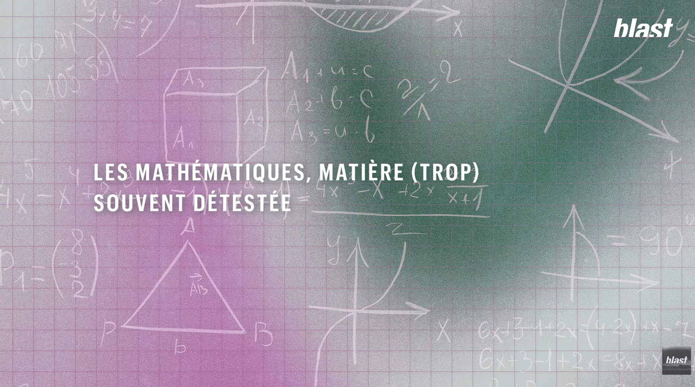
  <div style="position:absolute; top:50%; left:50%; transform:translate(-50%,-50%); font-size:50px; color:white;">▶</div>
</div>

<p style="text-align:center; font-style:italic; margin-top:8px; font-size:14px; color:#555;">
    Cliquez sur l'image pour lancer l'extrait de l'interview de Laure Saint-Raymond
  </p>

<script>
function loadVideo() {
  document.getElementById('player-container').innerHTML = 
    '<iframe width="560" height="315" src="https://www.youtube.com/embed/sAWcgVmYL3o?start=286&end=320&autoplay=1" frameborder="0" allow="autoplay; encrypted-media" allowfullscreen></iframe>';
}
</script>

***

Dans ce billet je ne traiterai pas des résultats d'enquêtes évaluant le niveau scolaire, lesquels ont déjà été abondamment commentés[^0], mais plutôt du rapport qu'entretiennent les élèves aux mathématiques au cours de leur scolarité. Cet angle d'analyse me paraît en effet digne d'intérêt et d'enseignements [@merle_rapport_2003] :

[^0]: Le lecteur trouvera matière dans les différentes études citées à travers ce billet. Pour une synthèse je renvoie à cette note d'analyse de [@cusset_niveau_2025].

> Si la connaissance de l’expérience subjective des élèves a nettement progressé, le rapport des élèves aux différentes disciplines est, à quelques exceptions près, encore peu exploré (Baudelot & Establet, 1992 ; Grisay, 1993, 1997 ; Jeantheau & Mulliez, 2001 ; Jeantheau & Murat, 1998). Or cette connaissance est nécessaire pour trois raisons. D’abord, la connaissance des perceptions collégiennes des différentes disciplines contribue à une meilleure compréhension de ce qui fonde leur choix d’orientation. Ensuite, les professeurs ne peuvent que tirer profit de la façon dont les élèves perçoivent leur discipline et les spécificités de celles-ci. Enfin, comme plusieurs auteurs l’ont montré (Dubet, 1994a, 1994b ; Felouzis, 2000), la connaissance du rapport aux études et des modalités de construction de l’expérience scolaire permet une compréhension au moins aussi éclairante de la faiblesse de la démocratisation de l’enseignement (Duru-Bellat, 2002 ; Merle, 2002a) que les analyses en termes de « déterminants sociaux » même si ces deux types d’analyse ne sont évidemment pas indépendantes l’une de l’autre.

## Les mathématiques, matière préférée des élèves ?

Durant l'interview France Inter du 9 septembre 2026 [Enquête Pisa : "Il faut qu'on change notre regard sur les mathématiques"](https://www.radiofrance.fr/franceinter/podcasts/l-invite-de-8h20-le-grand-entretien/l-invite-de-8h20-le-grand-entretien-du-mercredi-09-septembre-2026-8637454), [Hugo Duminil-Copin](https://fr.wikipedia.org/wiki/Hugo_Duminil-Copin) affirmait ceci :

> Les enfants ont une appétence naturelle pour les choses, en particulier pour les mathématiques. On croit que les mathématiques sont mal-aimées, alors qu'au collège c'est la discipline préférée.

<div style="display: flex; justify-content: center;">
<iframe width="315" height="560"
src="https://www.youtube.com/embed/woMqajh8Czs"
title="YouTube video player"
frameborder="0"
allow="accelerometer; autoplay; clipboard-write; encrypted-media; gyroscope; picture-in-picture; web-share"
allowfullscreen></iframe>
</div>

J'ai voulu vérifier cette affirmation en faisant un petit tour d'horizon des études ayant évalué l'attrait des élèves pour les mathématiques.

### Élèves d'école primaire

D'après [@mullis2020timss], **49% des élèves de CM1** français déclaraient en 2019 *"aimer beaucoup apprendre les mathématiques"* :

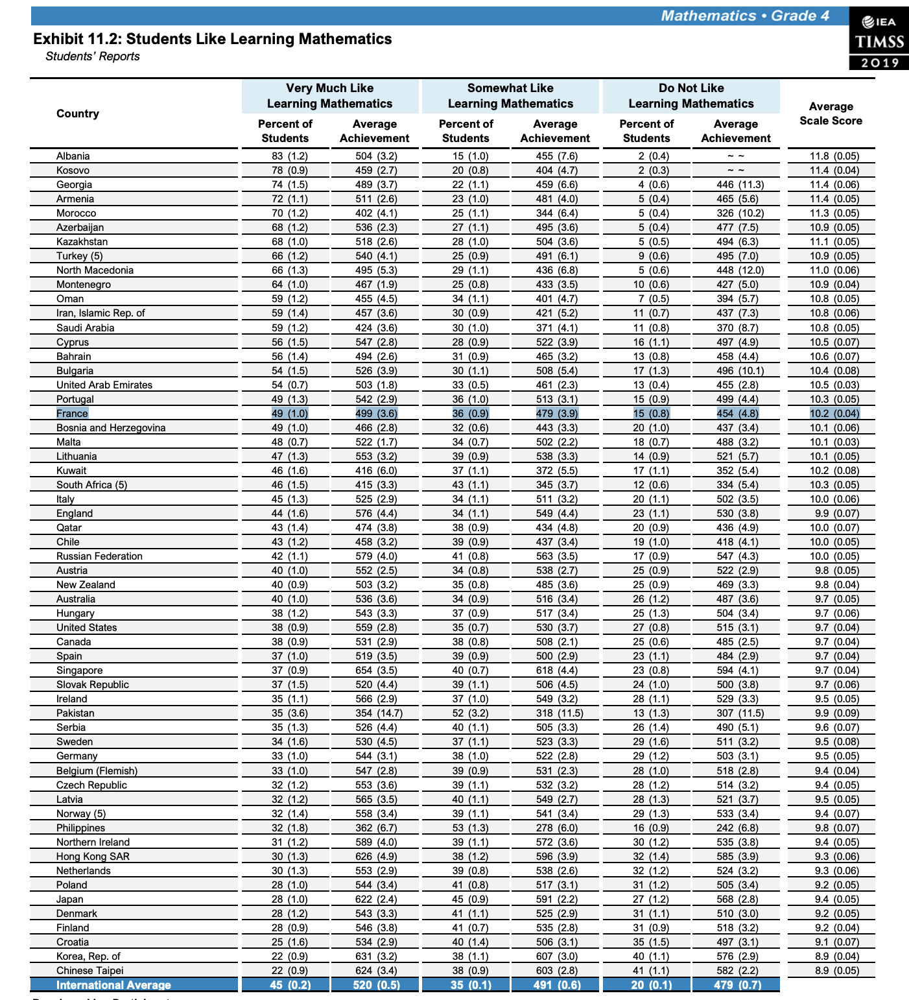

avec un léger recul de **46% en 2023** [@von2024timss] :

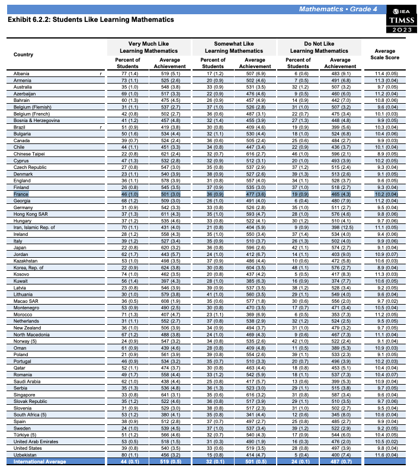

D'après un sondage Ipsos [@mercier_enquete_2016], réalisé sur 502 enfants âgés de 6 à 12 ans :

> Du côté des enfants, les mathématiques apparaissent comme étant, de loin, leur matière préférée (29 %) suivie par le sport (17 %) et le français (16 %).

Hugo Duminil-Copin a donc raison de souligner que les mathématiques sont une matière que les enfants affectionnent particulièrement en primaire. Voyons maintenant ce qu'il en est au collège.

### Collégiens

D"après [@merle_rapport_2003, §8] :

> L’intérêt déclaré à l’égard des mathématiques par les 872 élèves enquêtés est particulièrement élevé : 30 % des élèves déclarent cette discipline « très intéressante » et ils sont plus de 40 % à la trouver « intéressante ». Au total, c’est donc **une très large majorité (plus de 70 %) qui est intéressée par cette matière**. Les élèves « pas du tout » ou « peu intéressés » sont, a contrario, une petite minorité de l’ordre de 10 % des enquêtés.

Sans surprise, [@merle_rapport_2003, §9] montre également que ceux qui réussissent le mieux en maths sont les plus susceptibles de conserver un fort intérêt pour les mathématiques :

> Les déclarations de ces élèves sont dépendantes d’un certain nombre de variables. La plus influente d’entre elles est le niveau de compétence des élèves : **l’intérêt déclaré pour une discipline est d’autant plus élevé que l’élève a le sentiment d’être bon dans cette discipline** (la variable niveau de compétence est construite à partir d’une autoévaluation des élèves).

Les différentes enquêtes (PISA, TIMSS, etc) ont montré une baisse objective du niveau en mathématiques, plus marquée en France, alors même que les élèves font davantage de maths qu'ailleurs dans l'OCDE [@cusset_niveau_2026] :

> L’OCDE a par ailleurs calculé le temps dévolu aux mathématiques de façon cumulée sur l’ensemble de la scolarité entre l’âge de 6 et 14 ans : avec près de 1 450 heures, les élèves français font partie des élèves qui bénéficient du plus gros volume d’heures de mathématiques, la moyenne OCDE se situant à 1 100 heures

Et si le niveau en mathématiques est corrélé à l'intérêt pour la matière, on peut s'attendre à une diminution de celui-ci entre 2019 et 2023 comme en atteste [@lacroix2024timss] :

> Concernant le plaisir à apprendre les mathématiques, Timss demande par exemple aux élèves de quatrième s’ils aiment cette discipline. En 2023, en France, **51 % des élèves déclarent aimer les mathématiques** (59 % pour les garçons contre 42 % pour les filles) (voir figure 11 en ligne). Ce taux était **plus élevé en 2019 (60 %)**. Dans les pays de l’OCDE/UE ayant participé aux deux éditions de Timss, 50 % des élèves déclarent aimer les mathématiques en 2023 alors qu’ils étaient 57 % en 2019. Dans l’Union européenne en 2023, ce taux varie de 42 % en Finlande à 59 % en Roumanie. En outre, les élèves en France, comme ceux des pays de l’OCDE/UE, **accordent une moindre valeur aux mathématiques en 2023 qu’en 2019**, concernant leur vie quotidienne, une poursuite d’études ou une insertion professionnelle : ainsi, **82 % déclarent qu’il est important de réussir en mathématiques** (82 % également dans les pays de l’OCDE/UE ayant participé aux deux cycles) (voir figure 12 en ligne).

Les [données TIMSS 2023](https://www.education.gouv.fr/depp/timss-2023-en-quatrieme-pour-les-mathematiques-des-resultats-stables-en-france-et-un-accroissement-452619) montrent ici le positionnement par rapport aux autres pays de l'OCDE et la baisse par rapport à 2019[^12] :

[^12]: À ce stade on pourrait attribuer cette baisse aux conséquences de la pandémie de Covid 19, mais si ses effets ne sont probablement pas nuls nous verrons néanmoins qu'ils ne suffisent pas à expliquer la baisse observée en réalité bien avant la pandémie.

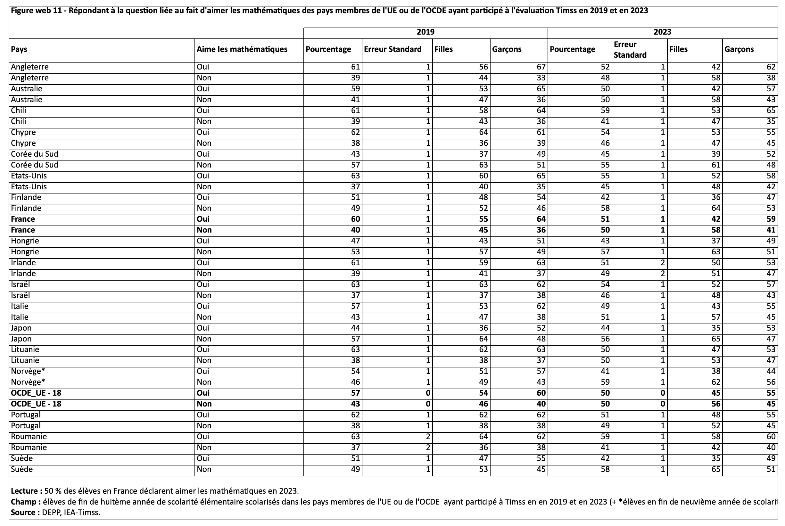


### L'appétence s'étiole de la primaire au collège

Une autre baisse notable s'effectue entre le primaire et le collège [@merle_rapport_2003, §10] :

> Cette approche globale cache une différenciation sensible de l’appréciation des élèves selon leur classe : **en sixième, en mathématiques, la proportion d’élèves « intéressés » ou « très intéressés » dépasse les 80 % ; en troisième, elle n’est plus que de 60 %**. Ce mouvement s’explique par une montée sensible du nombre des élèves se déclarant « peu intéressés » et « pas du tout intéressés » : un sur vingt se trouve dans cette situation en classe de sixième (5,4 %) alors qu’ils sont près d’un sur six (14.7 %) en classe de troisième. On en conclura qu’en fin de sixième, les élèves ont un enthousiasme indiscutable pour les mathématiques alors qu’au début de la classe de troisième, l’enthousiasme a sensiblement décru (tableau 1). L’expérience de l’enseignement des mathématiques, de l’entrée à la sortie du collège, peut notamment s’apprécier par ce « refroidissement » considérable de l’intérêt déclaré pour cette discipline. 

Bien sûr l'adolescence est parfois une période durant laquelle on assiste à une certaine apathie de façon générale[^10], mais nous verrons que c'est particulièrement marqué en ce qui concerne les mathématiques, et que cela touche assez inégalement les élèves français :

[^10]: Pierre Merle souligne que : "Ce phénomène de désenchantement n’est pas propre aux mathématiques : il est également présent pour le français. Initialement moins enthousiasmés par le français que les mathématiques en fin de sixième, les élèves n’en connaissent pas moins un effritement sensible de l’intérêt qu’ils déclarent pour cette discipline. La robustesse des réponses des élèves est confortée par leur réponse à une question sur l’évolution de leur intérêt pour les mathématiques et le français. Les élèves déclarent beaucoup plus souvent en troisième qu’en sixième une diminution de leur intérêt pour ces deux disciplines. Les élèves de 3e ont donc parfaitement conscience des effets négatifs en termes d’intérêt pour les mathématiques et le français de leurs années passées sur les bancs du collège alors que l’école primaire a peu freiné les intérêts scientifiques et littéraires des écoliers."

> Le désenchantement pour les mathématiques atteint peu les « bons » élèves et ce sont les élèves « moyens » ou « faibles » scolarisés en classe de troisième qui sont surtout touchés par une certaine désaffection à l’égard de cette discipline.

Dans le premier tableau mesurant l'appétence pour les mathématiques des élèves de CM1, il y avait en 2019 49% qui aiment beaucoup + 36% qui aiment bien, soit au total **85% des CM1 qui aiment globalement les maths, contre 60% pour les quatrièmes** la même année (2019). Il ne s'agit pas de la même cohorte mais cela donne néanmoins une idée de l'érosion entre la primaire et le collège. Ce constat est établi également dans [@timssQuatrieme2019] :

> Concernant leur plaisir à apprendre des mathématiques, **11 % des élèves de France déclarent beaucoup aimer cette discipline**. Ils sont 14 % en moyenne internationale (OCDE et UE). **Cette motivation s’est fortement érodée depuis 2015 et la scolarité en école primaire**. En France, 50 % des élèves de CM1 déclaraient beaucoup aimer apprendre les mathématiques contre 46 % en moyenne internationale. En outre,
en 2019, seulement 27 % des élèves de quatrième accordent une forte valeur aux mathématiques, concernant leur vie quotidienne, une poursuite d’études ou une insertion professionnelle, alors qu’ils sont 32 % en moyenne dans les autres pays (OCDE et UE).

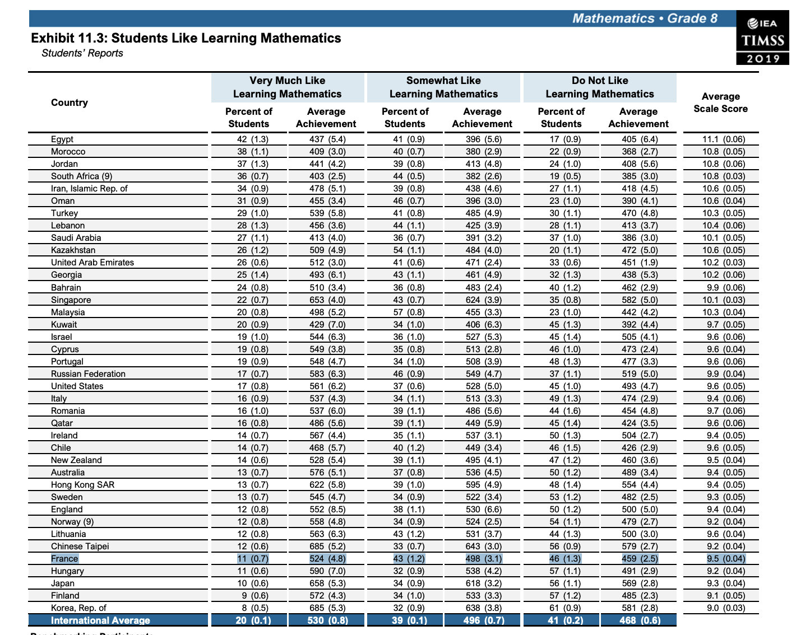

Dans [@von2024timss] **seulement 10% des quatrièmes aiment beaucoup, 34% aiment bien et 57% n'aiment pas** apprendre les mathématiques.

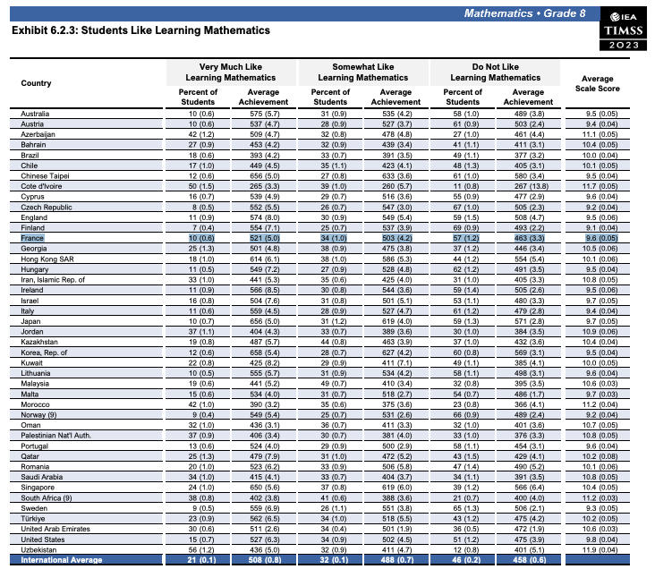

Cet étiolement semble d'ailleurs partagé par tous les pays de l'OCDE [@mullis2020timss2] :

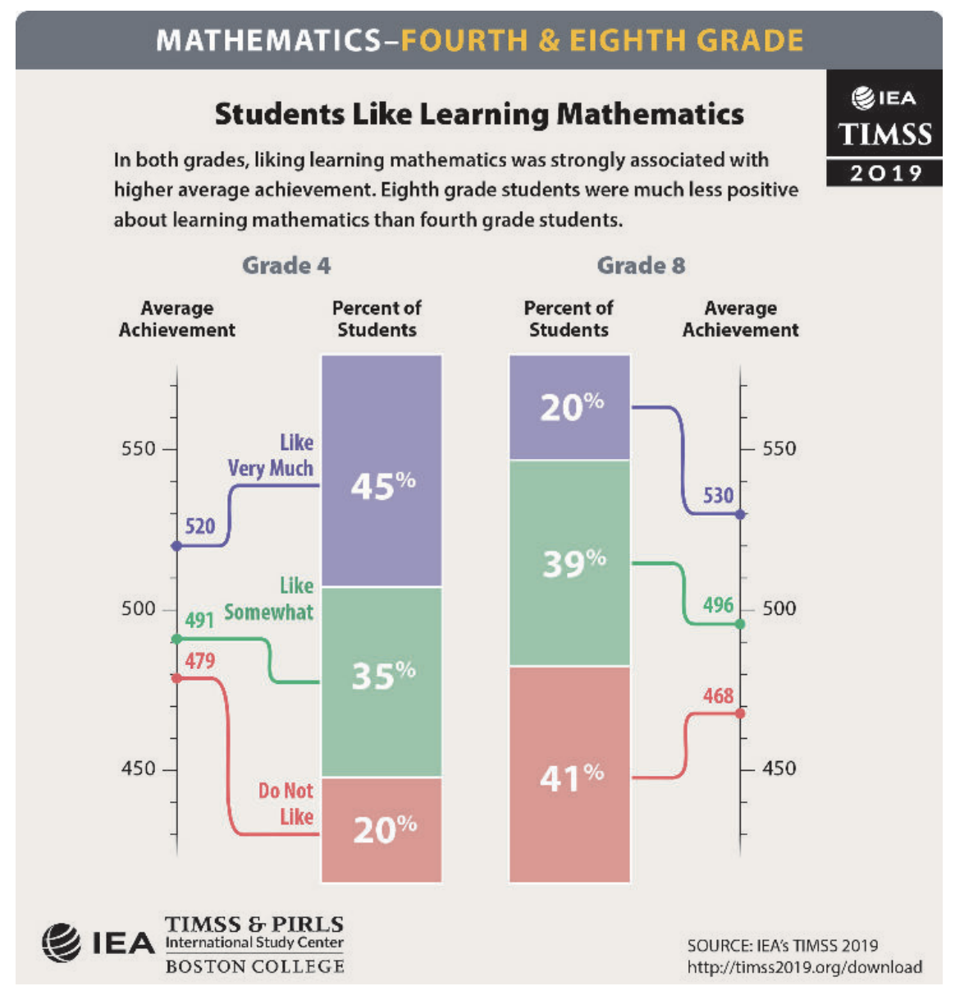
Au Maroc, malgré des scores relativement bas obtenus en mathématiques au TIMSS 2015 et 2019, j'ai été frappé par le fort intérêt que manifestent les élèves marocains pour les mathématiques au grade 4 et 8 [@timss_resultats_2015] :

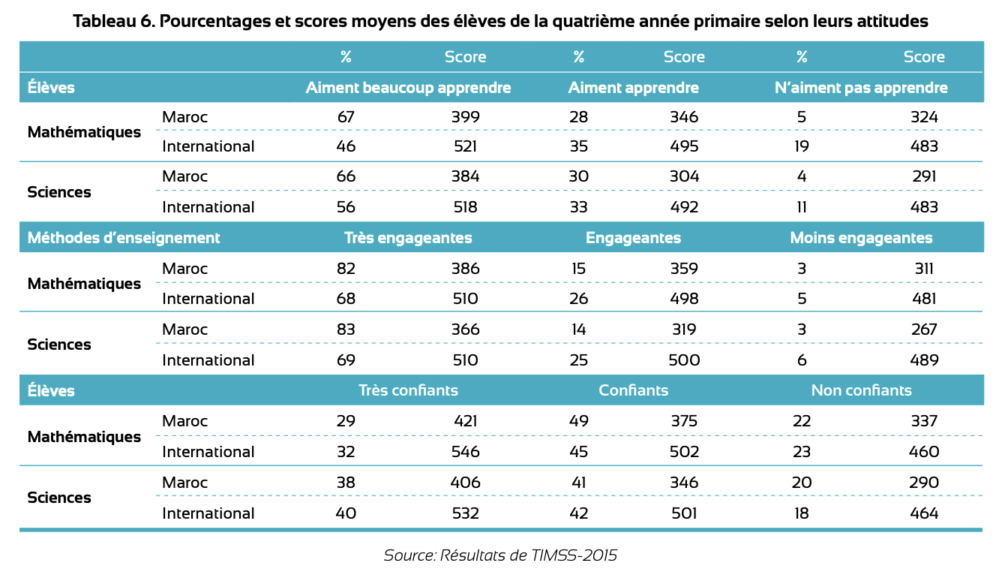
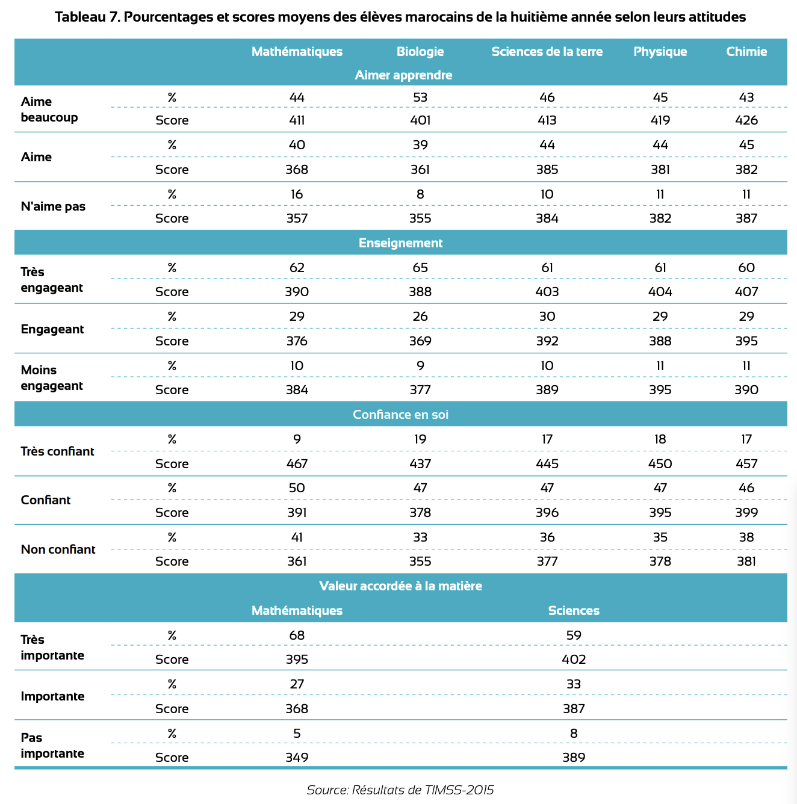


Une étude longitudinale [@von2025timss] a également été réalisée sur un sous-groupe des pays enrôlés dans l'enquête TIMSS 2023, le constat est identique avec une diminution du plaisir à apprendre les mathématiques entre le CM1 et la quatrième : 

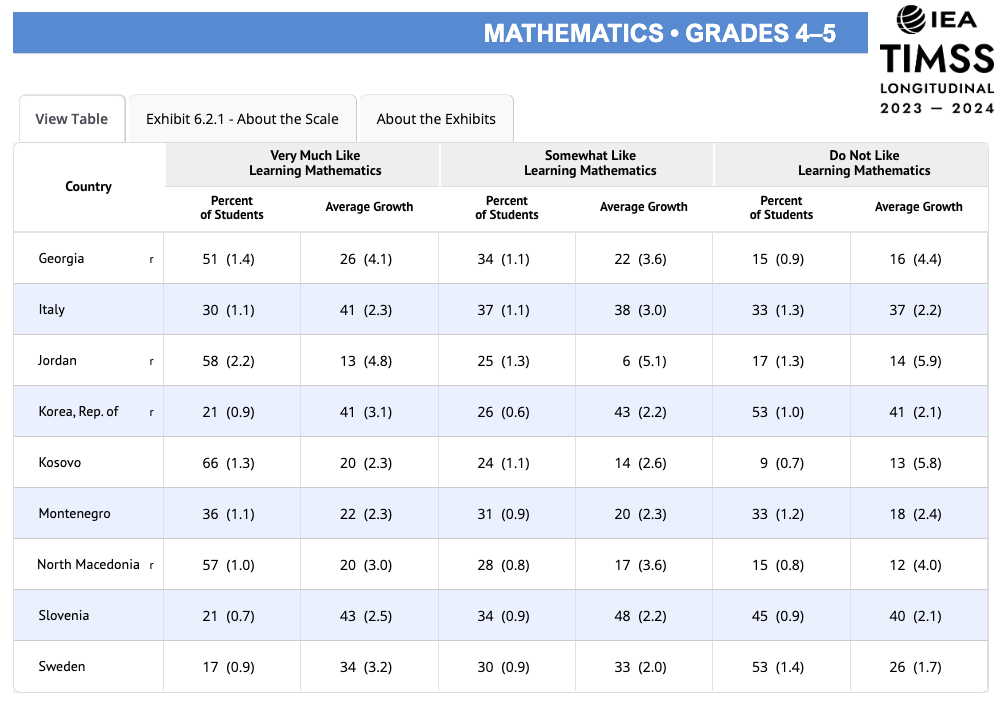

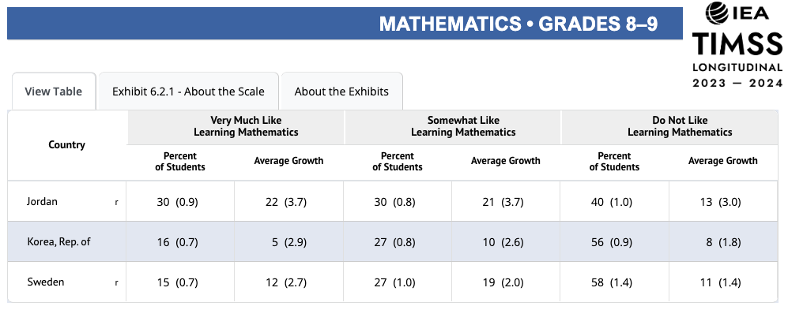
Pour conclure avec [@merle_rapport_2003] :

> **Les mathématiques occupent la seconde place dans le hit parade des disciplines les plus aimées** : elles sont choisies par 17.8 % des élèves. Un score bien moindre que l’E.P.S. mais cependant largement supérieur à celui obtenu par les autres disciplines. Comme l’E.P.S., les mathématiques bénéficient d’une forte valorisation sociale. À celle-ci s’ajoute une forte reconnaissance scolaire. L’utilité reconnue de cette discipline pour avoir un métier, et donc la valorisation qu’elle est susceptible à terme d’apporter aux élèves expliquent aussi ce jugement globalement positif. Toutefois si cette discipline a ses adeptes, elle a aussi ses détracteurs. Elle focalise le désamour de plus de 10 % des élèves, généralement les élèves les plus faibles qui déclarent par ailleurs, dans une proportion non négligeable, l’expérience de l’humiliation dans cette discipline. Plus inquiétant encore, **les mathématiques sont la discipline la moins souvent citée en 6e comme la moins aimée et en 3e, elle devient la discipline la plus souvent citée comme la moins aimée**. Autant dire que cet enseignement de la 6e à la 3e a profondément refroidi les ardeurs des collégiens.

### Lycéens

L'étude [@oecd_pisa_2024] cible exclusivement les **adolescents âgés de 15 ans**, ce qui correspond en France principalement aux élèves en fin de classe de troisième ou au début de seconde (en voie générale, technologique ou professionnelle). L'étude révèle que **plus de 40% d'entre eux déclarent que les mathématiques sont l'une de leurs matières préférées**.

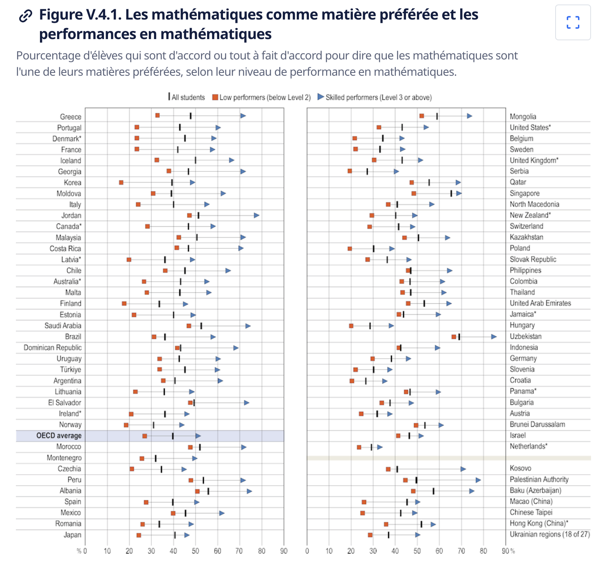

Dans la thèse de [@ji2011poursuite], on peut y lire le graphique suivant pour les lycéens français :

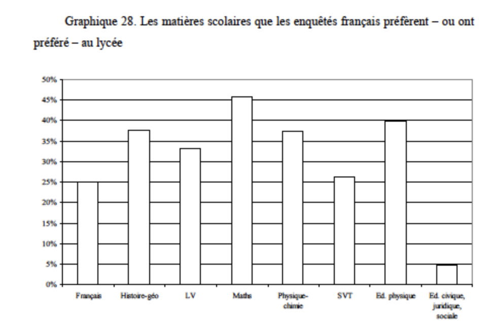
et celui-ci pour la Chine :

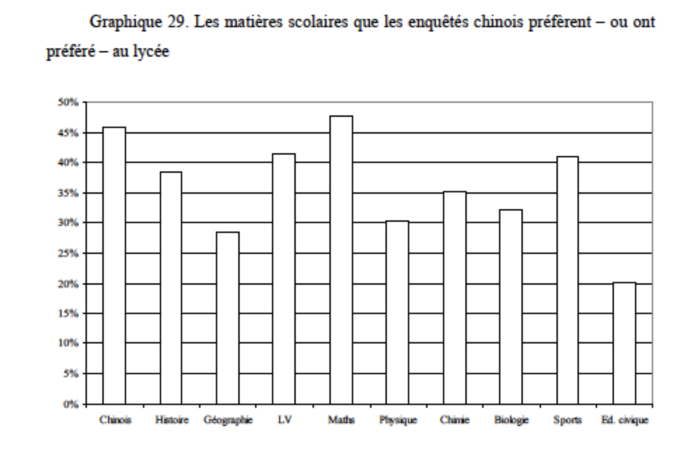
Il peut paraître curieux – j'y reviendrai – que les mathématiques se hissent en tête des matières préférées des lycéens, alors que l'appétence pour la matière s'était déjà étiolée entre le passage de la primaire au collège, et qu'elle semblait se poursuivre au lycée comme l'indique les chiffres de [@mullis_timss_2016] où seulement **11% des Terminale S disent aimer beaucoup les maths**, dans la filière où ils y sont pourtant les plus disposés, avec même **un tiers des élèves déclarant ne pas aimer** apprendre les maths.

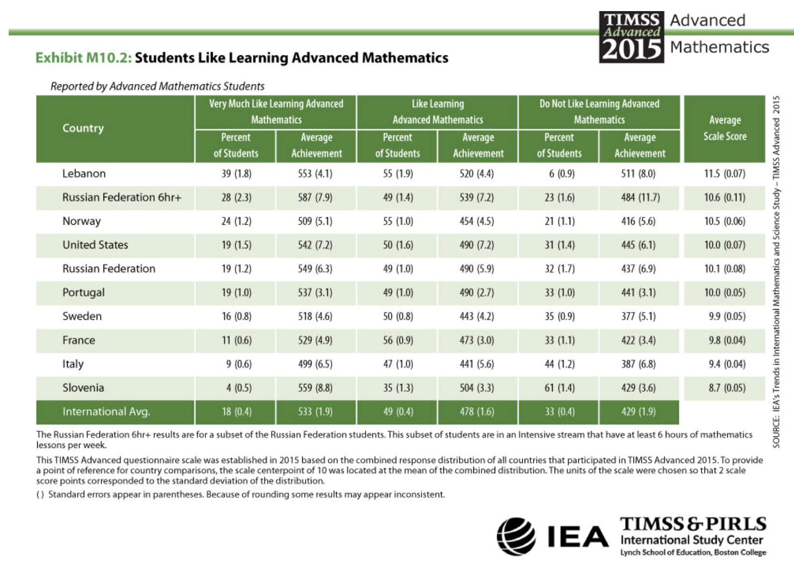

La note d'information de la [@depp_performances_2016] abonde dans ce sens :

> Le questionnaire de contexte auquel les élèves de terminale  S ont répondu en 1995 et en 2015 permet de comparer leurs niveaux de motivation. Le profil de ces élèves a changé  : **en 1995, 17,9  % déclaraient s’ennuyer en faisant des mathématiques, ce taux s’élève à 34,4 % en 2015**. Mais si les mathématiques sont moins souvent associées au plaisir intellectuel, les élèves en apprécient davantage l’intérêt pour leur orientation de carrière. En effet, 62 % des élèves (contre 56 % en 1995) déclarent qu’ils aimeraient avoir un métier utilisant les mathématiques. Ainsi le choix de s’orienter en série scientifique se ferait par défaut, **selon une pression sociale forte et un bon niveau scolaire global, plutôt que par réelle appétence pour les mathématiques**.

Les stratégies d'orientation semblent donc primer sur l'intérêt propre pour la matière[^13]. [Charles Torossian](https://fr.wikipedia.org/wiki/Charles_Torossian), co-auteur avec [Cédric Villani](https://fr.wikipedia.org/wiki/C%C3%A9dric_Villani) du rapport « 21 mesures pour l’enseignement des mathématiques », affirmait dans une [tribune](https://www.marianne.net/agora/tribunes-libres/mathematiques-au-lycee-mieux-former-mieux-orienter-mieux-accompagner) :

[^13]: Pour avoir été en Terminale S en 2006-2007 (ouch il y a 20 ans !), il y avait en effet une partie non négligeable de la classe qui subissait les maths, et n'avait d'ailleurs pas pour ambition de poursuivre nécessairement une formation scientifique après le bac, ils avaient choisi la filière S car elle était réputée être la "voie royale" pour ouvrir les portes de toutes les formations, fussent-elles Hypokagne ou Science Po. 

> La Terminale S (TS) aurait [soi-disant] été un terreau fertile pour la poursuite d’études scientifiques ! C’est oublier la réalité : en 2014, on comptait 44 % de poursuites vers des formations scientifiques, 24 % dans la santé et 32 % des formations non scientifiques. En vérité la série S était majoritairement choisie pour d’autres motifs que sa dimension scientifique. 

Si on observe une scission au sein même de la filière scientifique, il doit à plus forte raison en être de même dans les autres filières non scientifiques. C'est ce que nous allons voir maintenant.

### Étude longitudinale

L'étude de [@ingels2011high] suit une cohorte d'élèves représentative à l'échelle des États-Unis, débutant en neuvième année d'étude (autour de 14-15 ans), et suit leur parcours tout au long du lycée ainsi que leur transition vers l'enseignement supérieur et/ou le marché du travail. Un focus est mis sur les facteurs qui amènent les élèves à choisir et à poursuivre des études et des carrières dans les domaines des sciences, des technologies, de l'ingénierie et des mathématiques (STIM). L'enquête initiale de 2009 a porté sur un échantillon de 944 lycées publics et privés. **Plus de 21 000 élèves ont répondu à l'enquête** et des informations complémentaires ont également été recueillies auprès de leurs parents, des administrateurs scolaires, des conseillers d'orientation et des enseignants. La cohorte a fait l'objet de nouveaux entretiens en 2011, 2012, 2013 et 2016. L'année de référence 2009 est notée S1 9th (~ élèves de troisième), et le premier suivi en 2012 est noté S2 Teenager (~ élèves de Terminale). 

En 2009 ils déclaraient **à 14% que les mathématiques étaient leur matière préférée**[^4] juste derrière le sport (18%). 

[^4]: cf. variable `S1 E03` du [DATALAB](https://nces.ed.gov/datalab/powerstats/72-high-school-longitudinal-study-of-2009/percentage-distribution)

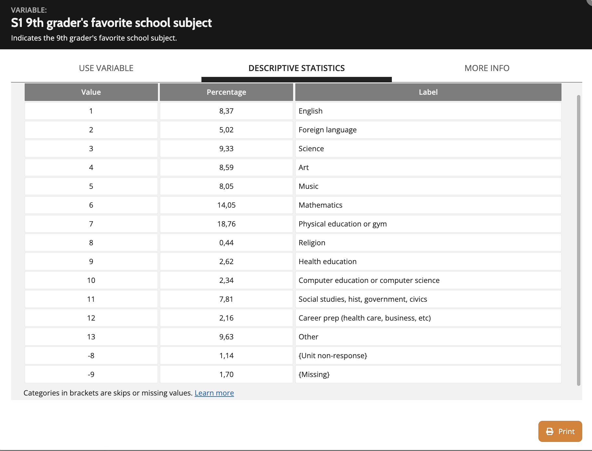

Ce que confirme par ailleurs [Hugo Duminil-Copin](https://fr.wikipedia.org/wiki/Hugo_Duminil-Copin) pour la France dans une [interview](https://dailyscience.be/10/03/2023/comment-faire-aimer-les-maths/) :

> Je ne suis pas certain que les jeunes n’aiment pas les mathématiques. Une étude récente en France montrait que les maths étaient la deuxième matière préférée des jeunes de 10 à 15 ans après le sport.

Cependant, et c'est là où ça devient intéressant, les élèves de la cohorte déclaraient aussi **à 24% que les mathématiques était la matière qu'ils aimaient le moins**[^5], suivie par l'anglais (17%).


[^5]: cf. variable `S1 E04` du [DATALAB](https://nces.ed.gov/datalab/powerstats/72-high-school-longitudinal-study-of-2009/percentage-distribution).

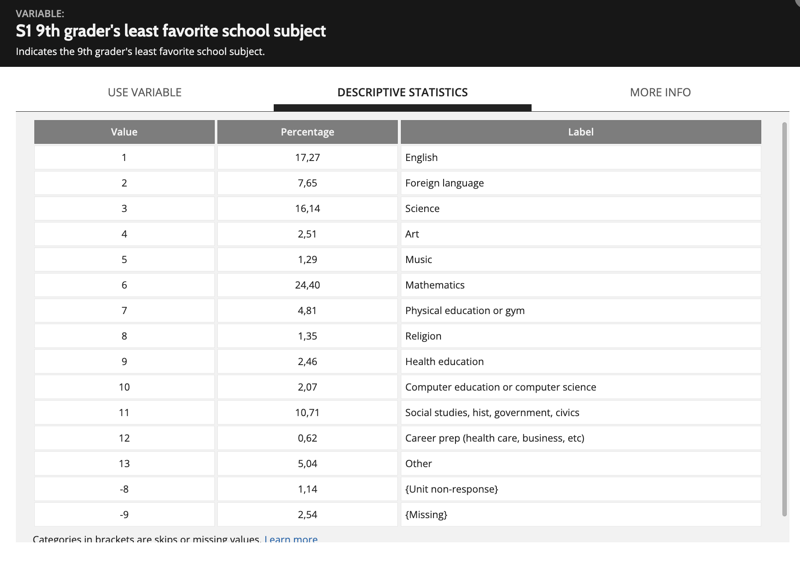

Autrement dit il faut tempérer l'enthousiasme manifeste d'[Hugo Duminil-Copin](https://fr.wikipedia.org/wiki/Hugo_Duminil-Copin) à l'antenne de France Inter[^8], et faire le constat lucide que les mathématiques sont en réalité particulièrement **clivantes**, comme il le reconnait d'ailleurs dans son dernier livre [@duminil-copin_autre_2026,p.18] :

[^8]: Je suppose que son intention était de prendre le contrepied de l'image peu reluisante des mathématiques généralement véhiculée dans les médias ou chez les leaders d'opinions qui se glorifient parfois "d'être nuls en maths" (cf. [interview](https://www.lexpress.fr/sciences-sante/sciences/alain-aspect-jentends-trop-de-leaders-dopinion-se-glorifier-detre-nuls-en-maths-DDLHQERUPRANROL7PTA5GS24ZY/) d'[Alain Aspect](https://fr.wikipedia.org/wiki/Alain_Aspect)).

> Les maths divisent. L'une des caractéristiques principales du rapport aux mathématiques est sa **forte polarisation** : on les adore ou on les déteste. Plusieurs enquêtes révèlent que les mathématiques figurent parmi les matières préférées des élèves du secondaire : près d'un quart d'entre eux les placent même en tête de leur classement. Aussi surprenant que cela puisse paraître à certains, elles sont donc loin d'être universellement redoutées. En revanche, lorsque les mathématiques provoquent effectivement du rejet, celui-ci peut être radical voire viscéral. Certaines personnes évoquent même une véritable phobie.

[David Bessis](https://davidbessis.substack.com/about) fait un constat similaire dans son [exposé](https://youtu.be/_cRu1Pl0s1E?t=468) à l'Institut Henri-Poincaré *"Les mathématiques, une science humaine ?"* :

> Le deuxième problème, il est bien connu : cet enseignement ne se passe pas bien [...] il y a des gens qui aiment vraiment et il y a des gens qui détestent vraiment [...] les maths sont **anormalement polarisantes**.  

en s'appuyant sur l'étude [@ingels2011high] et en utilisant le graphique[^1] de ce post Tumblr [Is Math the Most Hated Subject?](https://www.tumblr.com/mathhombre/177411872579/is-math-the-most-hated-subject?redirect_to=%2Fmathhombre%2F177411872579%2Fis-math-the-most-hated-subject&source=blog_view_login_wall) :

[^1]: Graphique qui représente les données des variables [S1 E03](https://www.icpsr.umich.edu/web/NADAC/studies/36423/datasets/2/variables/S1FAVSUBJ) et [S1 E04](https://www.icpsr.umich.edu/web/NADAC/studies/36423/datasets/2/variables/S1LEASTSUBJ) qui diffèrent légèrement de celles fournies par [DATALAB](https://nces.ed.gov/datalab/powerstats/72-high-school-longitudinal-study-of-2009/percentage-distribution), mais dont les ordres de grandeurs sont comparables.

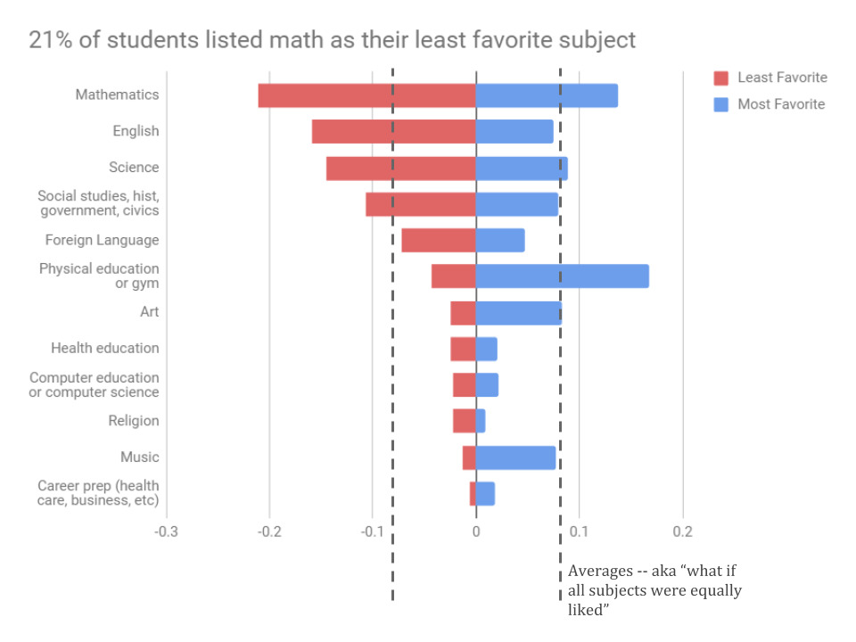
Dans son livre [@bessis2022mathematica] précise :

> Quand on demande aux adolescents américains quelle est la matière la plus difficile, les mathématiques arrivent en tête, avec 37% des réponses. C’est également, de très loin, la matière qu’ils détestent le plus. Mais quand on leur demande leur matière préférée, les mathématiques arrivent encore en tête, avec 23%. Pour certains, c’est même la matière la plus facile. Nous connaissons tous ce phénomène étrange. Il fait partie du décor et nous avons appris à le trouver normal. Nous trouvons normal qu’il y ait des gens qui aiment les maths et trouvent ça facile, et d’autres qui détestent les maths et trouvent ça incompréhensible, et nous trouvons normal qu’il n’y ait quasiment personne entre les deux.

Dans le suivi de 2012 les mathématiques sont toujours déclarées **à 16% comme étant la matière "préférée"**[^3] 

[^3]: cf. variable `S2 D01` du [DATALAB](https://nces.ed.gov/datalab/powerstats/72-high-school-longitudinal-study-of-2009/percentage-distribution).

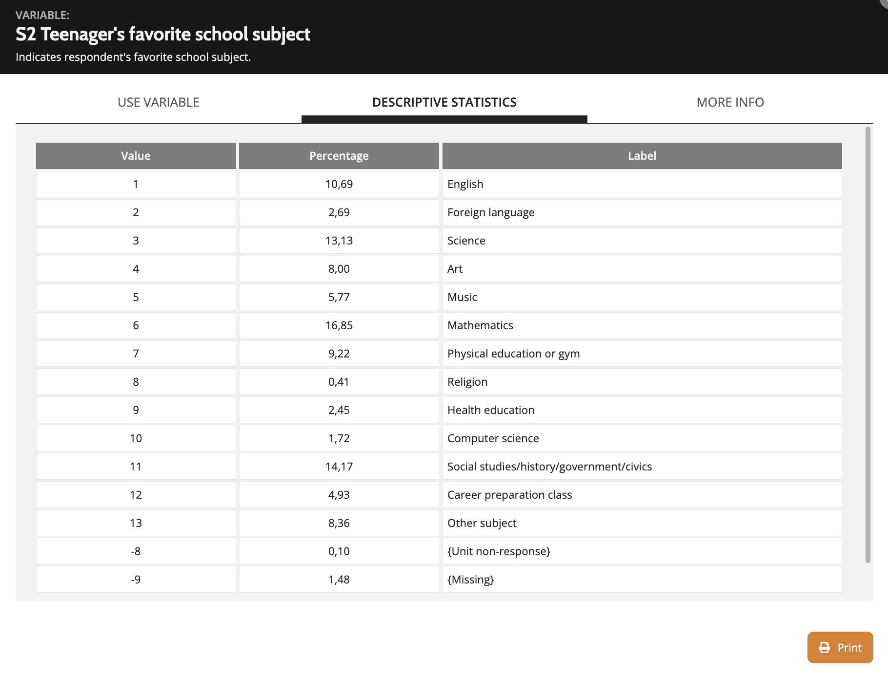
Je place maintenant des guillemets car ce que mesure cette enquête (comme celle de PISA) est un classement relatif entre matières ("quelle est ta matière préférée ?"), tandis que TIMSS mesure plutôt un niveau d'accord absolu avec des affirmations du type *"j'aime beaucoup les mathématiques"*.  

De même, une [étude](https://www.cambridgeinternational.org/Images/514611-global-education-census-survey-report.pdf) de 2018 du [Cambridge International Global Education Census](https://www.cambridgeassessment.org.uk/our-research/data-bytes/students-favourite-subjects-around-the-world/), menée sur 9 397 étudiants âgés entre 12 et 19 ans, conclut que **les mathématiques sont la matière la plus populaire** :

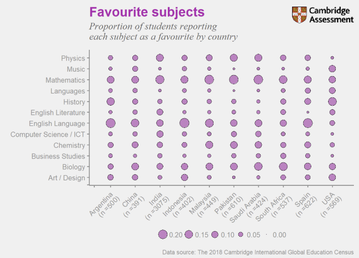

Au [Canada](https://censusatschool.ca/fr/donnees-et-resultats/2020-2021/), 6,220 élèves des niveaux primaire et secondaire ont répondu à une enquête au cours de l’année scolaire 2020-2021. La catégorie primaire comprend les élèves de la 4e à la 8e année (CM1 à la 4ème) et la catégorie secondaire inclut les élèves de la 9e à la 12e année (3ème à la Terminale). L'enquête révèle que les élèves déclarent aussi que les mathématiques sont leur [matière préférée](https://censusatschool.ca/fr/donnees-et-resultats/2020-2021/matiere-preferee/) :

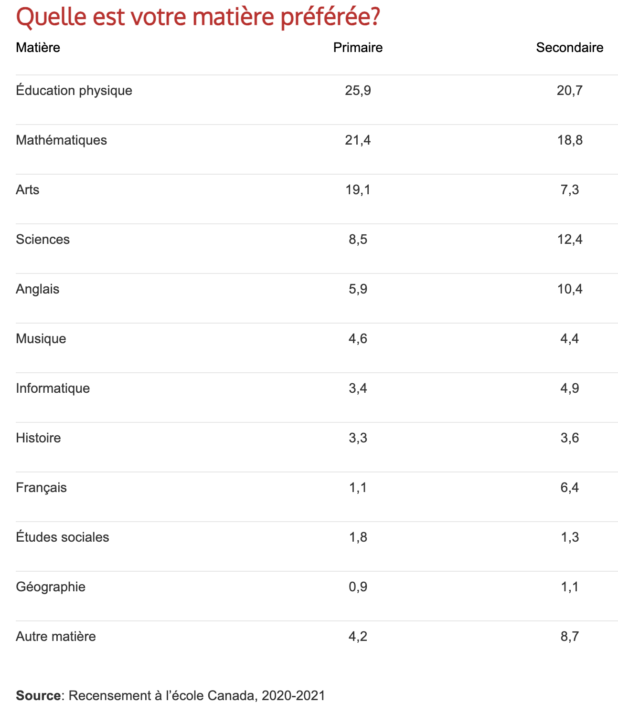

Idem pour les [élèves québéquois](https://www.lapresse.ca/actualites/200809/19/01-669204-les-maths-la-matiere-preferee-des-jeunes.php) ou les [élèves américains](https://news.gallup.com/poll/12007/Math-Teens-Favorite-School-Subject.aspx). Les mêmes schémas se répètent donc dans et hors de l'OCDE. Mais on comprend maintenant qu'un élève peut classer les maths en première position parmi ses matières préférées (parce que les autres lui plaisent peut-être encore moins)[^6] sans pour autant *"aimer beaucoup"* les maths en valeur absolue. Ces enquêtes ne mesurent donc pas rigoureusement la même chose. Par *"préférer les mathématiques"* on peut distinguer plusieurs choses, on peut par exemple aimer apprendre des mathématiques sans pour autant réussir, ou inversement avoir de bons résultats en mathématiques sans particulièrement aimer en faire, ou encore reconnaître leur utilité et les préférer comme choix d'orientation par rapport à ses projets professionnels (vote utile), sans qu'il n'y ait d'attrait pour les mathématiques en elles-mêmes. La préférence pour une matière est fonction de l'intérêt qu'on lui porte, intérêt qui revêt des significations multiples [@cosnefroy_sens_2007].

[^6]: On pourrait risquer une analogie avec la politique : un candidat peut faire seulement 18% parmi les inscrits au premier tour puis remporter l'élection présidentielle avec 58% des voix (avoir donc été "préféré" par les français), sans pour autant susciter une forte adhésion. Un autre candidat peut par ailleurs susciter une forte adhésion au sein d'une partie de l'électorat, accéder potentiellement au second tour aidé par le vote utile, et être donné largement perdant dans les sondages face à son adversaire politique du fait du rejet qu'il suscite par ailleurs. Toute ressemblance avec des personnages existants serait purement fortuite :-)

Nous avons ainsi vu avec toutes ces études que ce clivage autour des mathématiques s'installe au collège, et qu'il se poursuit au lycée – où un certain nombre d'élèves du collège en difficulté en maths n'y sont pourtant pas allés – allant même jusqu'à gagner la Terminale S. Il ne serait donc pas étonnant de retrouver ce clivage dans la population générale, ce qui est l'objet de la section suivante.

### Les adultes

Selon un [sondage CSA Research](https://www.rtl.fr/actu/debats-societe/65-des-francais-jugent-l-enseignement-des-maths-inadapte-selon-notre-sondage-7790579608) réalisé en 2017 pour Le Point et RTL :

> **61% des Français ont bien aimé les mathématiques à l'école**. Les maths étaient donc la **deuxième matière préférée des sondés à l'école (33%)**, derrière le Français (37%) et devant l'Histoire-géographie (31%). [...] Mais les mathématiques, une matière considérée par certains comme stressante, décourageante, voire ennuyeuse, ne sont pas sans détracteurs. Parmi les sondés qui crient leur **désamour pour les cours de maths (39%)**, la majorité (61%) se justifie par les difficultés rencontrée en classe. L'aspect trop théorique des cours a quant à lui dissuadé près de 40% des personnes réfractaires aux chiffres.

Selon un autre sondage en ligne [@ipsos_education_2025] portant sur 23700 adultes de moins de 75 ans à travers 30 pays, les mathématiques occupent la deuxième place des matières favorites (30%) déclarées par ces adultes lorsqu'ils étaient à l'école, juste derrière l'histoire (32%). **Pour la France, deuxième place également pour les mathématiques (29%) derrière l'histoire (37%)**.

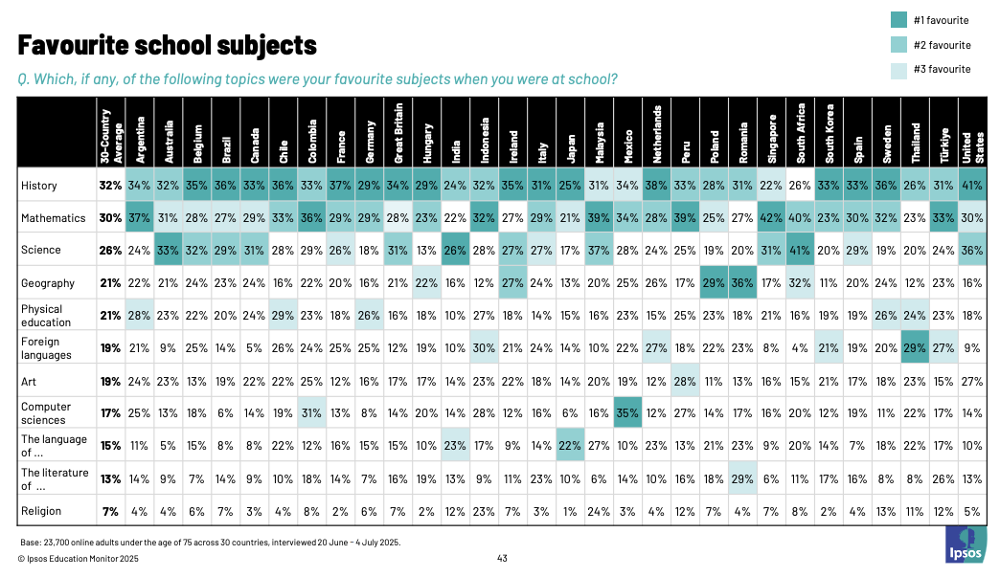
Mais lorsqu'on leur demande quelle était **la matière qu'ils aimaient le moins, les mathématiques arrivent aussi en pole position (37%), avec une quasi unanimité !** La France ne faisant pas exception avec une proportion de 38% :

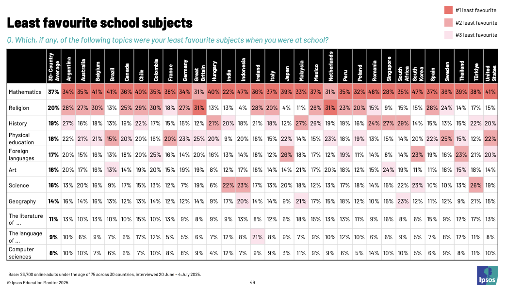

Il n'est donc pas étonnant que les réactions en bien ou en mal auxquelles j'ai l'habitude d'être confrontées soient aussi divisées et exacerbées lorsque j'évoque les mathématiques. Il me paraît ainsi souhaitable d'essayer de comprendre comment et pourquoi cette polarisation s'installe.

## Les raisons du désamour

Dans la section précédente j'ai tâché de compiler un certain nombre d'analyses illustrant le rapport aux mathématiques qu'entretiennent les jeunes et les moins jeunes. Selon qu'il s'agissait de sondages ou d'études (transversales ou longitudinales), les données et méthodologies étaient bien sûr de qualité inégales. Néanmoins ces analyses semblaient se recouper et aboutir à une forme de consensus quant au caractère particulièrement clivant des mathématiques qui se dessine dans le parcours scolaire. 

Dans cette section je passe en revue une liste d'explications non exhaustive du désamour progressif pour les mathématiques que l'on observe chez les élèves après leur entrée au collège. Chacune de ces causes mériterait de longs développements, d'être resitués dans une littérature scientifique dense, et d'en mesurer la part respective d'explicabilité. Mais alors ça ne serait plus un billet de blog mais une thèse 😉.

À COMPLÉTER

### La sélection par les mathématiques

<!-- Comme le dit [Hugo Duminil-Copin](https://fr.wikipedia.org/wiki/Hugo_Duminil-Copin) dans une [interview](https://dailyscience.be/10/03/2023/comment-faire-aimer-les-maths/) : -->

<!-- > Je ne suis pas certain que les jeunes n’aiment pas les mathématiques. Une étude récente en France montrait que les maths étaient la deuxième matière préférée des jeunes de 10 à 15 ans après le sport. Par contre, les mathématiques servent trop souvent d’étalon pour fixer l’accès à diverses formations. Y compris des formations supérieures où elles ne sont pas nécessairement centrales. Je pense à la médecine ou à des matières scientifiques qui ne seraient pas grandes consommatrices de mathématiques, comme la biologie. Les mathématiques se retrouvent donc cantonnées à un rôle d’outil de sélection. C’est une erreur. On perd ainsi le côté plaisant de faire des mathématiques. Si les enfants n’ont pas accès à ces aspects ludiques, ils se retrouvent à détester les maths. Et cela, c’est dommageable. Il faut arriver à faire sortir les mathématiques de ce rôle d’évaluation.  -->

<!-- Même son de cloche chez [Sébastien Planchenault](https://shs.cairn.info/publications-de-sebastien-planchenault--796141?lang=fr), président de l’[APMEP](https://www.apmep.fr/)[^7] : -->

<!-- [^7]: Association des Professeurs de Mathématiques de l’Enseignement Public -->

<!-- > Au lieu de faire de la filière « C » (puis « S ») la voie logique de formation des futurs scientifiques, on en a fait un outil de sélection de l’élite. La filière scientifique est devenue la voie unique d’excellence. Ce qui a été une grosse erreur. Ça a contribué à faire des maths une matière à part, avec ce poids et cet enjeu de la sélection, contre laquelle des générations d’élèves moins doués ont nourri un fort ressentiment.  -->

<!-- La raison d'une plus grande désaffection du français au collège par rapport aux mathématiques sont multiples [@merle_rapport_2003, §13]  -->

<!-- Sélection plus aisée par les maths car vrai/faux moins de sensibilité à la notation et moins sujette au capital culturel -->

### La difficulté de la matière

<!-- [@merle_rapport_2003, §15] -->

<!-- Les résultats TIMSS 2003 ont montré que 37% des élèves américains considèrent les mathématiques comme la matière la plus difficile [@inc_math_2005]. -->

### Les mathématiques modernes

### Le rapport à l'erreur

<!-- Grothendieck -->

<!-- > Craindre l’erreur et craindre la vérité est une seule et même chose. Celui qui craint de se tromper est impuissant à découvrir. C’est quand nous craignons de nous tromper que l’erreur qui est en nous se fait immuable comme un roc. -->

<!-- Bessis : -->

<!-- > En sortant de l’enfance, nous apprenons à craindre d’avoir l’air bêtes. Nous apprenons à avoir honte de nos erreurs. Nous apprenons à dissimuler, y compris à nos propres yeux, le fait que nous ne comprenons presque rien. Pour progresser en mathématiques, c’est ce réflexe de dissimulation qu’il faut apprendre à désactiver. Et c’est très difficile. À l’âge où nous étions encore libres de poser des questions stupides, y compris de poser cent fois de suite la même question stupide, il n’y avait pas de nuls en maths. Les grands mathématiciens inventent et mettent en œuvre des techniques spéciales pour retrouver cette innocence enfantine. Ils déclarent tous que c’est indispensable. -->

<!-- > Reformulées dans le contexte de la marche, les paroles de Grothendieck à propos du rôle de l’erreur deviennent lumineuses : Craindre de tomber et craindre de marcher est une seule et même chose. Celui qui craint de se casser la figure est impuissant à apprendre à marcher. C’est quand nous restons assis sur notre cul que notre maladresse initiale se transforme en un handicap psychomoteur. -->
<!-- ### L'édifice cumulatif -->

### L'anxiété mathématique

### Les rythmes asynchrones

<!-- <iframe width="560" height="315" src="https://www.youtube.com/embed/RF0-8p55q1o?si=u98wlxYQ1iHpYnrZ" title="YouTube video player" frameborder="0" allow="accelerometer; autoplay; clipboard-write; encrypted-media; gyroscope; picture-in-picture; web-share" referrerpolicy="strict-origin-when-cross-origin" allowfullscreen></iframe> -->

<!-- Vérifier la pertinence -->

### La croyance en la bosse des maths


<!-- Dans l'extrait introductif, Hugo Duminil-Copin bât en brèche le stéréotype qui consiste à : -->

<!-- > Croire qu'on est pourvu ou dépourvu en mathématiques, qu'il y a ceux qui peuvent et ceux qui ne peuvent pas. -->

<!-- Dans quelle mesure les élèves adhèrent à cette croyance ?  -->

<!-- Dans l'étude longitudinale [@ingels2011high] : -->

<!-- 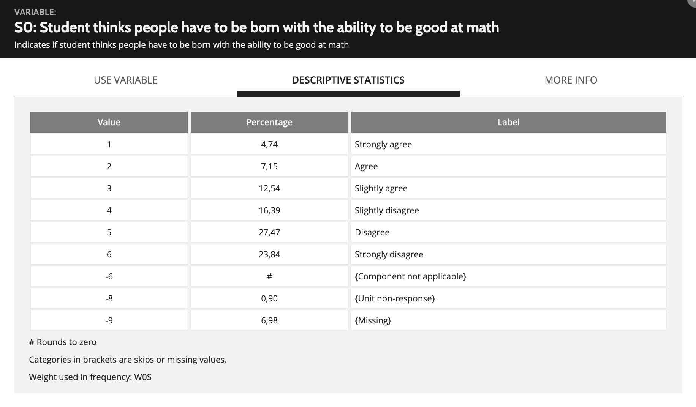 -->

<!-- 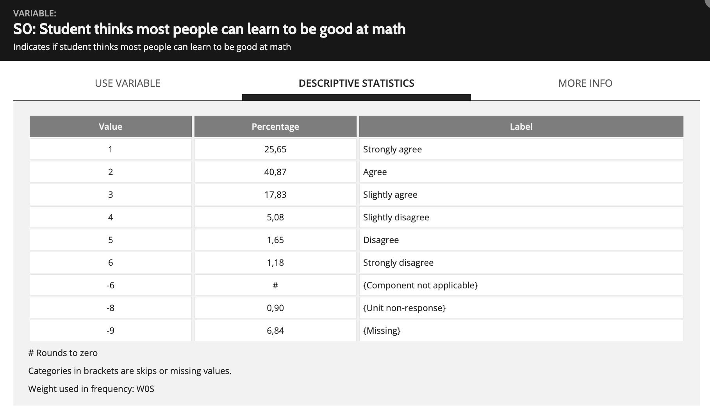 -->

<!-- Ils semblent ne pas croire à cette fable, ni au *fixed mindset*, et au contraire mettre en avant le travail -->


### Les stéréotypes

<!-- [@bessis2022mathematica] -->

<!-- > Les attitudes possibles vis-à-vis des mathématiques font partie de nos stéréotypes culturels : le geek qui adore ça (forcément boutonneux), la jeune fille cool qui s’intéresse à la mode (forcément nulle en maths), cette autre jeune fille capable de résoudre tous les problèmes sans avoir à réfléchir (forcément autiste), le cancre rebelle (forcément nul en maths). Ces stéréotypes sont absurdes et insultants. Je connais des cancres rebelles qui sont devenus de grands mathématiciens. Une lycéenne a le droit d’être jolie et d’avoir plein d’amis et de savoir résoudre tous les problèmes de maths sans avoir à réfléchir. Elle a aussi le droit de devenir une grande mathématicienne. [...] Est-ce qu’on trouverait normal que des adolescents jugent cool de ne pas savoir lire ? Qu’ils supposent que ceux qui savent lire de façon fluide, sans avoir à déchiffrer chaque lettre séparément, ont forcément des problèmes relationnels ? -->

<!-- > «Ted Kaczynski est né en 1942 à Chicago. Ses facilités exceptionnelles en mathématiques sont vite repérées par le système scolaire. Après un test où son QI est mesuré à 167, on lui fait sauter une classe. Quelques années plus tard, il saute une autre classe. Il entre à Harvard en 1958, à l’âge de seize ans.Il soutient sa thèse de mathématiques en 1967 et devient le plus jeune professeur assistant de l’université de Berkeley.À côté de ces succès, la vie de Ted est triste et solitaire. Ceux qui l’ont connu dans sa jeunesse le décrivent comme taciturne, extrêmement en retard dans son développement affectif, incapable de communiquer et de nouer de vraies relations.À Harvard, les étudiants qui logeaient dans la même résidence universitaire se souviennent de ces deux détails: son habitude de jouer du trombone au milieu de la nuit et l’odeur de nourriture en décomposition qui se dégageait de sa chambre.Quand Ted avait quinze ans, il éprouvait de telles difficultés à socialiser avec les autres adolescents qu’il préférait jouer avec les amis de son petit frère David, alors âgé de huit ans.David Kaczynski se souvient de cette époque, de son admiration pour l’intelligence de ce grand frère qu’il[…] aimait tant, mais aussi de son étonnement devant ses comportements étranges. Qu’est-ce qui empêchait Ted de se faire des amis?Un jour, quand David avait huit ou neuf ans, il est allé voir sa mère et lui a demandé:«Maman, c’est quoi le problème de Teddy?»» -->

<!-- Extrait de -->
<!-- Mathematica -->
<!-- David Bessis -->
<!-- Ce contenu est peut-être protégé par des droits d’auteur. -->

<!-- > «Depuis le début de ce livre, j’ai affirmé qu’il fallait dépasser les stéréotypes sur les mathématiques et les mathématiciens. Je n’ai pas changé d’avis. Ça n’empêche pas que ces stéréotypes existent et qu’ils ne sortent pas de nulle part.Ce n’est un secret pour personne. Quand on découvre la communauté mathématique, ce qui frappe immédiatement est l’abondance de gens «bizarres». Le mot «bizarre» est une manière polie de dire les choses. Il existe des degrés dans la bizarrerie. Certains mathématiciens sont un peu bizarres. D’autres sont franchement bizarres. D’autres sont spectaculairement bizarres. Dans certains cas, la bizarrerie n’est plus le bon concept. Un seul mot paraît alors adapté: celui de folie.C’est d’ailleurs l’un des grands sujets de conversation entre mathématiciens. Chacun a des dizaines d’anecdotes à raconter, comiques et absurdes, tellement caricaturales qu’on a parfois du mal à y croire.» -->

<!-- Extrait de -->
<!-- Mathematica -->
<!-- David Bessis -->
<!-- Ce contenu est peut-être protégé par des droits d’auteur. -->

<!-- > «Dépasser les stéréotypes, c’est garder en tête que la majorité des mathématiciens n’est pas comme ça. Il est parfaitement possible de faire des mathématiques au plus haut niveau et d’être «normal». On peut même être charismatique, socialement épanoui, chaleureux et tourné vers les autres.Plus encore que la bizarrerie, l’humour est une caractéristique généralement très développée chez les mathématiciens.Ça n’empêche que la bizarrerie extrême y est représentée de façon spectaculaire, notamment parmi les mathématiciens qui ont le plus marqué l’histoire. Au chapitre7, nous avons raconté les choix de vie d’Alexander Grothendieck, sa solitude extrême et son ascétisme.Un autre exemple frappant est celui de Grisha Perelman» -->

<!-- Extrait de -->
<!-- Mathematica -->
<!-- David Bessis -->
<!-- Ce contenu est peut-être protégé par des droits d’auteur. -->

<!-- > «Nous avons le sentiment que ce n’est pas «normal», que si Perelman refuse de se couper les ongles et continue, à cinquante ans passés, à vivre seul avec sa mère dans un petit appartement de Saint-Pétersbourg, c’est parce qu’il y a quelque chose qui ne tourne pas rond.C’est possible. Mais dans le fond, nous n’en savons rien. Perelman est l’un des plus brillants esprits sur cette Terre. Il ne fait de mal à personne et il a le droit de vivre comme il l’entend. Nous n’avons aucune légitimité pour le juger.Est-ce que ce sont les mathématiques qui rendent les gens «bizarres»? Je ne crois pas. Je dirais plutôt qu’elles savent accueillir des gens dont la bizarrerie préexistait.Elles sont l’un des rares domaines où il est possible d’accomplir de grandes choses en dépit d’immenses difficultés relationnelles. Pour des personnes initialement un peu «bizarres», «différentes», pas trop à l’aise en société, elles peuvent être un chemin de socialisation et d’épanouissement. (J’aurais tendance à me ranger dans cette catégorie.)Je ne pense donc pas que les mathématiques soient véritablement «dangereuses».Elles sont cependant contre-indiquées dans un contexte bien particulier, où elles semblent avoir le potentiel d’induire des effets secondaires[…]» -->

<!-- Un peu comme en politique mettre la focale sur les escrocs alors que le plus grand nombre est normal -->

<!-- enseignant(s) littéraires -->


<!-- ### Solfège  -->

### Le climat scolaire

<!-- Ressenti -->

<!-- Évolution entre 2019 et 2023 TIMSS : -->

<!-- 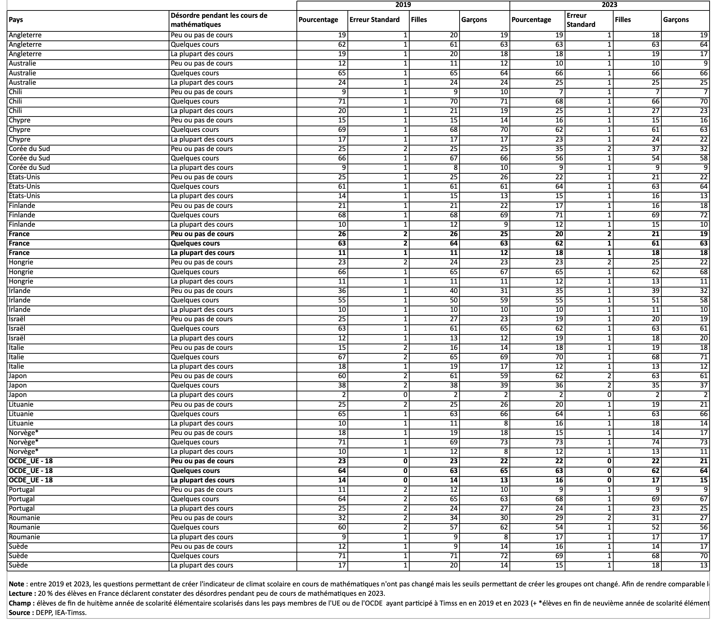 -->

<!-- Dans [@ipsos_education_2025] -->

<!-- 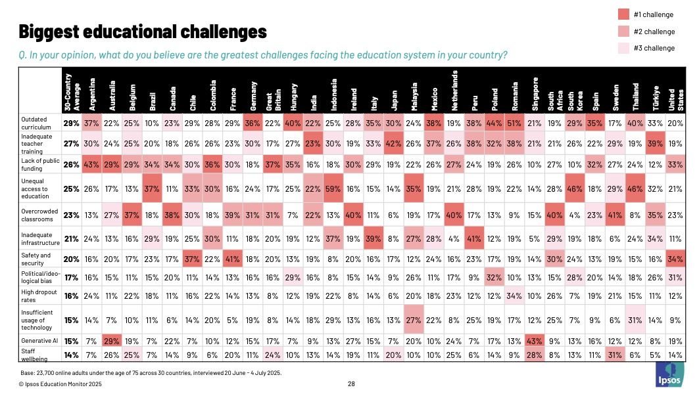 -->

<!-- 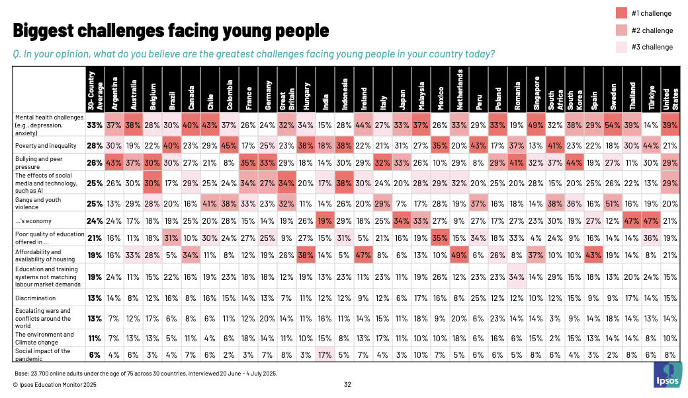 -->


<!-- [@bessis2022mathematica] -->


<!-- > Nous restons pétrifiés devant le panneau «réservé aux génies» qui nous barre l’entrée, en oubliant que nous avons nous-mêmes planté ce panneau, le jour où nous nous sommes raconté que c’était trop dur pour nous. -->


<!-- ### Peur de passer pour un con -->


## Les maths, à quoi  ça sert ?

[Christophe Besse](https://www.math.univ-toulouse.fr/~cbesse/), directeur de l’[Insmi](https://www.insmi.cnrs.fr/fr), fut invité sur France Inter dans le but de parler d'une [consultation citoyenne](#consultation-citoyenne) dont l'un des objectifs était de *"comprendre pourquoi on entend souvent 'j'ai détesté les maths'"*

<div style="display: flex; justify-content: center;">
<iframe width="560" height="315" src="https://www.youtube.com/embed/J4mzZwPE4R8?si=FREnc-h0HqxNabeY" title="YouTube video player" frameborder="0" allow="accelerometer; autoplay; clipboard-write; encrypted-media; gyroscope; picture-in-picture; web-share" referrerpolicy="strict-origin-when-cross-origin" allowfullscreen></iframe>
</div>

À la question de la journaliste *"Ça suscite des émotions les maths ?"*, Christophe Besse partage tout d'abord la même expérience que je relatais en introduction[^15] :

[^15]: voir également l'[interview](https://www.youtube.com/watch?v=sAWcgVmYL3o&t=287s) de Laure Saint-Raymond mise en exergue dans l'introduction.

> Oui quand on est comme moi chercheur en mathématiques, quand on est interrogés sur notre métier, **c'est soit de la passion, soit une espèce de réticence** ; "j'étais nul en maths", "c'est pas pour moi". En tout cas ça ne laisse pas les gens indifférents, et on essaye de comprendre pourquoi. Et aussi **pourquoi on entend si souvent "j'ai détesté les maths"**, c'est fort comme mots ! Et on ne le dit pour aucune autre matière...

puis il ajoute :

> ... alors qu'en fait les maths on les vit tous les jours dans notre quotidien, on en a **tous les jours besoin**. Par exemple pour les sondages, pour l'intelligence artificielle, pour la radio numérique, tout cela c'est des maths **sans que l'on s'en rende compte**. Quand on va payer avec sa carte bancaire c'est des maths il y a de la cryptographie **derrière**.

### Malentendu sur la notion d'utilité 

Les passages que j'ai souligné en gras me semblent révélateur de la confusion entretenue entre ces deux questions : 

- Les maths ça sert à quoi ? (pour la société)
- Les maths ça *me* sert à quoi ? (à titre individuel)

Ce dont le citoyen a *tous les jours besoin*, ce sont principalement de tous les outils techniques qui reposent *derrière* sur des mathématiques, *sans que l'on s'en rende compte*. Ces mathématiques là, comme la cryptographie, le citoyen n'en a la plupart du temps pas *directement* besoin dans son quotidien, il ne les manipule pas lui-même. Ce sont avant tout les concepteurs, les chercheurs et les ingénieurs, qui ont besoin de ce savoir-faire mathématique afin de concevoir ces outils utiles à la population. Ce sont bien souvent ces applications qui occupent la majeure partie des exemples cités pour convaincre de [la place des mathématiques dans nos vies](https://www.insmi.cnrs.fr/fr/cnrsinfo/la-place-des-mathematiques-dans-nos-vies) par leur omniprésence.

Dans la notion d'utilité il y a toujours l'adéquation entre une fin et des moyens. Autrement dit une chose est utile en fonction d’un besoin. Par exemple une bouée est utile au maître-nageur, mais ne sera d’aucune utilité pour l’alpiniste. Les mathématiques, elles, sont utiles au physicien pour modéliser les phénomènes physiques, et sont même *nécessaires*[^22] à l'élaboration des théories. Elles le sont probablement moins pour la plupart des gens au quotidien. Il y a donc divers degrés d'utilité. Les mathématiques sont parfois utiles au quotidien mais absolument nécessaires au fonctionnement de notre société moderne et des sciences. Alors certes, on peut se convaincre que les mathématiques nous sont ainsi *indirectement* utiles, mais cela tout le monde ou presque en conviendra. La voiture est utile à de nombreuses personnes pour se déplacer, mais il ne leur est pas nécessaire d'en comprendre la physique de la thermodynamique qui fait tourner leur moteur. La journaliste objectant à raison sur l'exemple de la cryptographie :

[^22]: Se souvenir que les deux notions d'utile et de nécessaire ne sont pas équivalentes, à toute fin... utile. 

> On n'a pas besoin de faire de maths ou de connaître les maths pour utiliser une carte bleue.

Ce à quoi Christophe Besse répondra que pour savoir si les soldes sont intéressantes on a besoin d'effectuer une conversion dans notre tête, preuve que nous manipulons des maths tous les jours. Certes, mais ces calculs requièrent rarement plus de connaissances mathématiques que n'en possède un élève en début de collège voire de l'école primaire. Or on l'a vu précédemment, jusqu'à ce stade les mathématiques sont appréciées par les élèves. C'est après que cela se corse. 

La question que se posent les non-scientifiques est celle de savoir à quoi leur servent *dans leur quotidien* des mathématiques plus élaborées introduites progressivement au collège, comme la démonstration géométrique ou la résolution d'équation. Force est de reconnaître que peu de personnes mettent en application ces mathématiques au quotidien. On peut fort heureusement vivre convenablement et mener une existence heureuse sans avoir à résoudre d'équations. 

### Division du travail et adaptation

L'environnement technologique dans lequel nous évoluons, développé par les scientifiques et techniciens, via la division du travail, exempte la majeure partie de la population d'avoir à maitriser les sciences qui rendent possibles ce confort. Il en va de même pour la médecine dont on délègue aux soignants la responsabilité de s'occuper de notre santé, et on fait l'impasse sur la chimie (qui ne sert probablement pas non dans la vie quotidienne) qui permet de fabriquer les médicaments dont on a besoin. Plus difficile serait de se passer d'apprendre à lire ou à compter, dans un environnement qui est saturé de mots et de nombres. Il reste plus handicapant[^18] de ne pas savoir lire dans une société où une myriade de choses et d'actions sont dépendantes des écrits et symboles qui nous entourent. L'utilité de savoir lire est ainsi liée au contexte. Dans [@bessis2022mathematica] on peut y lire :

[^18]: Piqûre de rappel quant au fait que la situation de handicap naît de l'interaction entre les caractéristiques propres d'une personne et les obstacles ou facilitateurs de son environnement. Dans une société telle que la nôtre où il n'est pas seulement utile mais nécessaire de savoir lire, l'absence de lunettes engendrerait beaucoup de handicap chez ceux qui ne peuvent lire sans. Or ce sont des mathématiques qui sous-tendent la création de lentilles façonnés par des calculs d'optiques. Pas de mathématiques, pas de lunettes; pas de lunettes, pas de lecture; pas de lecture... pas de lecture.

> Depuis cent cinquante ans environ, une nouvelle décision fondamentale a été prise : celle d’enseigner la lecture et l’écriture à tout le monde. Cette décision est tellement structurante qu’il est devenu difficile d’imaginer à quoi notre monde pourrait bien ressembler si elle n’avait pas été prise. Si, comme c’était le cas jusqu’alors, seule une petite minorité de la population avait accès à la lecture. 
 Au temps des hiéroglyphes et de l’Égypte ancienne, l’art d’écrire s’apparentait à un pouvoir magique. Les scribes formaient une caste héréditaire, et ils se transmettaient leurs secrets de génération en génération. Dans l’Europe médiévale, écrire était une vocation. Des jeunes hommes se faisaient moines, ils se retiraient du monde et consacraient leur existence à copier des manuscrits. Qu’est-ce que les paysans illettrés du Moyen Âge pensaient de tout cela ? S’imaginaient-ils qu’apprendre à lire et à écrire exigeait un don spécial, une forme particulière d’intelligence qui leur faisait défaut ? Trouvaient-ils injuste et frustrant d’en être exclus ? Ou, plus simplement, se disaient-ils qu’ils n’avaient pas le temps, pas l’argent, pas l’envie, et que de toute façon ils n’avaient rien à lire ? Aujourd’hui, plus personne ne pense que lire et écrire suppose un don spécial. **Plus personne ne pense que ça ne sert à rien**. À de rares exceptions près, tous les régimes, quelles que soient leurs croyances et leurs idéologies, font de l’enseignement primaire une priorité absolue.Le projet radical d’alphabétiser la Terre entière est un prodigieux succès. L’illettrisme n’a pas disparu, bien sûr, mais il est devenu minoritaire. En quelques générations, l’humanité a su accomplir un programme global de transformation cognitive sans équivalent dans l’histoire. Dans le même temps où était lancé ce grand chantier d’alphabétisation planétaire, une autre décision radicale était prise : on allait enseigner les bases des mathématiques à tout le monde. **Aujourd’hui, dans les écoles, collèges et lycées du monde entier, plus d’un milliard de filles et de garçons étudient les mathématiques. Et c’est un véritable désastre**. Aujourd’hui, dans les écoles, collèges et lycées du monde entier, plus de cinq cents millions de filles et de garçons souffrent en silence. Ils ont l’impression de ne rien comprendre et sont ballottés entre le désengagement (ils ne voient absolument pas l’intérêt de cette matière) et la sensation humiliante de ne pas être assez intelligents.

En plus des raisons structurelles du désamour des mathématiques déjà évoquées dans la section précédente, les élèves justifient leur désengagement par le rendement décroissant de l'utilité pratique des mathématiques au cours du collège puis au lycée [@merle_rapport_2003, §44] :

> L’utilité des mathématiques et du français pour les élèves a été saisie à partir de questions relatives à leur usage dans la vie de tous les jours et pour obtenir un métier. Mathématiques et français sont considérés comme « utiles » ou « très utiles » dans « la vie de tous les jours » par une très forte majorité d’élèves (près de huit sur dix). Ce sentiment collégien est moins présent en classe de troisième que de sixième : la proportion d’élèves à considérer que les mathématiques et le français sont « très utiles » chutent en effet de moitié. Cette évolution tient probablement au fait que **les connaissances apprises en classe de sixième semblent plus indispensables aux élèves que celles acquises en classe de troisième**. Les déclarations des élèves relatives à la moindre utilité de ces deux disciplines en fin de troisième sont en rapport aussi avec le moindre intérêt qu’elles suscitent par ailleurs sans qu’il soit possible d’établir le sens d’une éventuelle causalité entre utilité et intérêt.


Et quand ça n'est pas seulement les élèves mais aussi un ancien ministre de l'éducation qui n'y voit pas l'intérêt, cela ne facilite pas la tâche.

### La polémique de Luc Ferry

Le 15 février 2018 sur LCI, [Luc Ferry](https://fr.wikipedia.org/wiki/Luc_Ferry), ancien ministre de l'éducation déclarait :

> Comme 99 % des Français, je n'ai jamais utilisé, même pas trente secondes, ce que j'ai appris en maths tout au long de ma scolarité jusqu'en deuxième année de fac. Je n'ai jamais utilisé les identités remarquables, les cas d'égalité des triangles, ça ne m'a jamais servi à rien.

<div style="display: flex; justify-content: center;">
<iframe width="560" height="315" src="https://www.youtube.com/embed/NZEgo5qGsnY?si=Ni_7xngIE7lKS_3N" title="YouTube video player" frameborder="0" allow="accelerometer; autoplay; clipboard-write; encrypted-media; gyroscope; picture-in-picture; web-share" referrerpolicy="strict-origin-when-cross-origin" allowfullscreen></iframe>
</div>

Affirmer ne jamais utiliser les maths, en utilisant une statistique, est pour le moins savoureux, mais passons. Cela m'inspire cette petite plaisanterie auto-référentielle :

99% des énoncés de la forme (99% des $X$ sont $Y$) sont faux.

<details>
  <summary>Est-ce que cette affirmation est vraie ? (clique pour voir la réponse)</summary>

  Soit $e$ cet énoncé, et $E$ l'ensemble de tous les énoncés de la forme "99% des $X$ sont $Y$". Alors clairement $e$ appartient à $E$, puisqu'il est de cette forme avec $X=$"énoncés de la forme (99% des $X$ sont $Y$)" et $Y$="faux". L'énoncé $e$ est donc auto-référentiel, il est de la même forme que les énoncés qu'il décrit. Mais contrairement au [paradoxe du menteur](https://fr.wikipedia.org/wiki/Paradoxe_du_menteur), il n'y a aucune contradiction ici, en effet :
  
  - Si $e$ est vrai, alors 99% des éléments de l'ensemble $E$ sont faux, et donc $e$ qui est à la fois vrai et dans $E$, appartient simplement aux 1% restants. 
 
- Si $e$ est faux, alors il devient simplement faux que "99% des éléments de $E$ sont faux", ce qui n'est pas incompatible avec le fait que $e$ soit lui-même faux.
  
  Donc il n'y a pas de paradoxe logique. Toutefois cela ne nous dit toujours pas si l'affirmation est vraie ou fausse.
  
  Notons $N$ le nombre d'énoncés que contient $E$. Pour que $e$ soit vrai, il faudrait que le nombre d'énoncés faux soit exactement de $0,99N$ (donc nécessairement que $N$ soit un multiple de 100 pour que cette quantité soit entière). Sur un grand nombre $N$ d'énoncés (par exemple 1 million), la probabilité que le nombre d'énoncés faux soit **exactement** de $0,99N$ (dans notre exemple 990 000) est relativement faible ! 
  
  En revanche si on relâche l'hypothèse en prenant pour énoncé $e$ qu'au moins 99% des énoncés de $E$ sont faux, alors $e$ est probablement vrai, car l'écrasante majorité des affirmations du type "99% des $X$ sont $Y$" servent en réalité à souligner que l'écrasante majorité (bis) des $X$ sont $Y$, et non pas à quantifier exactement une proportion de 99%. 
  
En tapant "99% des ..." dans mon moteur de recherche voici les premiers résultats retournés :
  
  - "99% des manifestations se passent dans la joie" 
  
  - "99% des gens ne comprennent pas ça"
  
  - "99% des gens se trompent sur cette énigme !"
  
  - "99% des gens ne comprennent rien aux échecs"
  
  - "99% des auxiliaires de vie sont fiers de leur métier"
  
Bon les résultats sont ici corrélés à mon historique de recherche, mais au delà de ce biais d'échantillonnage, je pense que ça ne modifie pas la manière d'employer cette tournure de phrase visant à insister sur *le plus grand nombre*, sans chercher à en déterminer la véritable proportion. Je suppose ironiquement que plus de 99% des phrases de ce type ne renseignent pas une statistique correcte, sans avoir moi-même fait l'examen minitieux et exhaustifs de toutes ces phrases. L'hypothèse me semble néanmoins raisonnable du fait d'une part de l'usage courant de l'expression et d'autre part du point précédent soutenant que la probabilité de tomber pile sur une proportion de 0,99 est très faible compte tenu des incertitudes. 

Ainsi l'énoncé $e$ = "Plus de 99% des énoncés de $E$ sont faux" est certes une affirmation plus forte que de n'avoir "que" 99%, mais je disais que cela permettait de "relâcher" l'hypothèse car c'est en réalité la proportion exacte de 99% qui est la plus contraignante pour la véracité de $e$, qui est **probablement fausse** sous cette formulation (mais que je trouvais plus amusante par son caractère auto-référentiel). Tandis que sous cette hypothèse plus forte "Plus de 99%" l'énoncé $e$ est désormais **très probablement vrai**. Ce qui conclut (presque) le problème.

**Remarque** : J'ai jusqu'à maintenant considéré pour $E$ l'ensemble de tous les énoncés formulés effectivement par des humains. Cependant on pourrait considérer tous les énoncés **possibles** de la forme "99% des $X$ sont $Y$", incluant des absurdités ("99% des  mathématicien.ne.s sont des langoustes") ou des tautologies ("99% des langoustes sont des langoustes"), dont on peut en générer une *infinité*. Mais alors la notion même de proportion ne fait plus sens (99% d'une infinité d'énoncés), il faudrait plutôt parler de densité. Mais cela soulève des difficultés. Pour s'en rendre compte construisons cette famille d'énoncés : $e_k$="99% des entiers de 1 à $k$ sont inférieurs à $0,99k$". Si $k$ est un multiple de 100 alors $e_k$ est vrai, sinon $e_k$ est faux. Par conséquent, parmi les $n$ premiers énoncés $e_1,\dotsc,e_n$, le nombre d'énoncés vrais est $\lfloor \frac{n}{100} \rfloor$, et la densité de vrais est donc : $$ \lim_{n\to +\infty} \frac{\lfloor \frac{n}{100} \rfloor}{n}=\frac{1}{100}$$
Ainsi la densité de faux est de 0,99 et donc l'énoncé $e$ portant sur cette famille peut être considéré vrai au sens de cette densité naturelle. Toutefois ce résultat dépend de l'énumération, car ici nous avons ordonné les énoncés de telle sorte que nous ayons un énoncé vrai tous les 100 énoncés, la construction est périodique; mais si on rééordonnait les énoncés typiquement en plaçant tout d'abord les vrais puis en intercalant des faux, on pourrait faire tendre la densité de faux vers n'importe quelle valeur de $[0,1]$ voire même ne pas la faire converger du tout (c'est la magie des séries infinies). Donc l'énoncé $e$ sans précisions sur le choix de l'énumération est mal défini. 

</details>

Trêve de plaisanterie, faisons preuve de charité intellectuelle à l'égard de Luc Ferry, et admettons qu'il fasse une distinction (discutable nous y reviendrons dans la dernière partie) entre mathématiques pratiques dans l'usage quotidien (calculs, pourcentages) et mathématiques dites "spéculatives" [@apmep_editorial_2004]. Ce qu'il veut signifier, c'est qu'un certain nombre de notions mathématiques qu'il range dans cette seconde catégorie (les identités remarquables, les cas d'égalité des triangles, la démonstration géométrique, la résolution d'équations, etc) sont rarement mobilisées dans la vie quotidienne de la plupart des citoyens. Et sur ce point je pense qu'on peut lui donner raison. 

### Le règne de l'utile

Cependant Luc Ferry ne contente pas de faire ce constat, non, en creux il envoie un signal où il signifie que tout le contenu mathématiques du secondaire qui est rarement appliqué ne sert donc à rien si ce n'est aux "matheux", contrairement aux autres que cela ennuie [@le_huffpost_epingle_2018]. Ce qui sert *in fine* la soupe à ceux qui clâment haut et fort que *"les maths ça ne sert à rien"*[^26], pour eux, puisqu'il conclut en fin d'interview (au sujet du rapport Villani) par :

> À mon avis ça ne va pas rendre la bosse des maths à ceux qui ne l'ont pas (*rire*).

[^26]: Il faut aussi savoir lire entre les lignes, ceux qui affirment que *"les maths ça ne sert à rien"* sont bien souvent ceux qui éprouvent des difficultés avec la matière, donc qui sont dans une situation d'incompréhension désagréable. Le rejet d'une matière est dans ce cas de figure un mécanisme de défense émotionnel. Face à la frustration de l'incompréhension et au sentiment d'échec, il est plus facile et moins douloureux pour l'ego de dévaloriser l'utilité des mathématiques plutôt que d'admettre ses propres difficultés.

Ce qui, pour un ancien ministre de l'éducation, n'est pas des plus responsables qu'on se le dise. Comme le souligne cet économiste [@menia_luc_2018] en réponse à ce texte d'un collègue [@alexandre_luc_2018] :

> On ne peut pas se contenter de considérer que le quidam n’a pas une idée consistante de ce à quoi sert l’école et que les arguments des uns et des autres sont finalement assez faibles pour ou contre Ferry. On doit persister à dire ce que doit être l’école, dans une approche normative, face à quelqu’un qui le dit aussi, assez lamentablement. Le texte laisse, à mon goût, trop penser que les propos de Ferry ont une valeur réelle. N’oublions pas que quand un ancien ministre de l’Éducation nationale parle dans un grand média, il dit ce qui doit être. Se contenter de dire que, si on s’en tient à la perception du problème par les gens, il a raison – ou plutôt pas tort -, c’est déjà trop.
Il faut lui répondre que notre objectif est de faire, du mieux possible, une école du capital humain et du développement des compétences diverses, grâce notamment aux maths, pas qu’il faut renoncer aux maths parce qu’elles sont mal comprises ou mal utilisées.

[Pierre Colmez](https://fr.wikipedia.org/wiki/Pierre_Colmez) fait remarquer que ce constat sur l'utilité des maths s'applique en fin de compte à la plupart des matières [@colmez_reponse_2012], et c'est la somme de toutes ces matières qui sert à échanger dans la vie quotidienne en fournissant un ensemble de repères :

> Ce genre de discours refait surface régulièrement, et à chaque fois je me fais la réflexion qu'**en poussant le raisonnement jusqu'au bout, on aboutit à la suppression pure et simple de l'enseignement** : en ce qui me concerne, je serais bien en peine de citer beaucoup de choses apprises à l'école et dont j'ai eu à me servir en dehors (à part l'orthographe car j'écris tous les jours, et les mathématiques car je suis mathématicien). J'ai suivi de longues études de physique et la seule application que j'en ai trouvée a été la vidange du bain de ma fille à l'aide d'un tuyau (vive le principe d'Archimède !), technique que j'ai apprise en CM2 pour la vidange de l'aquarium de la classe. De même, la seule connaissance de chimie que j'utilise consciemment est le fait que le manque d'oxygène pour la combustion produit du CO, qui est un poison, au lieu du CO2, qui est un gaz parfaitement inoffensif (à dose raisonnable). Je fais donc attention à ma chaudière à gaz. Le but de l'éducation n'est certainement pas de préparer les élèves directement à leur futur métier (c'est parfaitement impossible ; il faudrait enseigner beaucoup trop de choses vue la diversité des métiers potentiels), mais de **leur donner des bases, aussi étendues que possible, pour leur permettre d'apprendre efficacement ce dont ils auront besoin une fois leur métier choisi**, et aussi pour comprendre les informations nécessaires pour prendre les décisions de la vie de tous les jours, sans oublier la constitution d'une base de repères (culturels et autres) pour les relations sociales.

L'économiste [@menia_luc_2018] rejoint le mathématicien :

> Les matières enseignées ne sont pas vraiment utiles en elles-mêmes, mais le temps passé à l’école apporte des qualités aux élèves. Ils apprennent à l’école des qualités comme le travail, la rigueur de raisonnement, etc.

Gage de son efficacité ("apprendre à apprendre"), la sélection par les mathématiques n'est cependant pas totalement étrangère à la logique du signal avancée par [@alexandre_luc_2018]. Nous en avions parlé dans la première partie, bon nombre d'élèves choisissaient de suivre une Terminale S non pas pour le contenu scientifique mais davantage pour le signal que ça renvoyait (*"J'ai obtenu un bac S donc c'est un gage de sérieux, de travail et de rigueur qui m'ouvre toutes les portes"*).

L'anecdote de [Jean Stobée](https://fr.wikipedia.org/wiki/Jean_Stob%C3%A9e) est amusante, elle rapporte l'histoire suivante [@oconnor_euclid_1999]. Un élève qui venait de commencer l'étude de la géométrie avec [Euclide](https://fr.wikipedia.org/wiki/Euclide) lui demanda : *"Mais quel profit vais-je tirer de l'apprentissage de ces choses ?"*. Euclide appela alors son esclave et lui dit :
*"Donne-lui trois pièces de monnaie, puisqu'il lui faut absolument tirer un profit de ce qu'il apprend"*. Cette histoire illustre la vision qu'avaient les mathématiciens grecs de leur discipline, où primait la recherche du savoir pur. Pour Euclide la géométrie possède une valeur intellectuelle et philosophique intrinsèque. Elle n'a pas besoin d'avoir une application ou un gain financier immédiat pour mériter d'être apprise.

### L'autonomie du sujet

Faudrait-il arrêter d'enseigner au collège la démonstration géométrique ou la résolution d'équation, ou seulement exclusivement à ceux qui se destinent à des études scientifiques, au seul motif qu'elles sont moins utiles pour le citoyen lambda dans la plupart de ses activités quotidiennes ? Non, car on peut y trouver d'autres intérêts qui ne sont pas purement *utilitaires* mais relèvent en définitive de la formation de l'esprit, de l'exercice de la rigueur de la démonstration, du développement de l'esprit critique, de la montée en abstraction ou encore de l'appropriation d'une culture scientifique. 

Exercer son intellect en faisant des mathématiques développe ces capacités logiques et intuitives, peu importe le support de réflexion (géométrie, arithmétique, probabilités, ...) cela reste du "sport cérébral" avec des modes de raisonnement propres. De même à l'école on fait du sport pour sa santé physique, de l'athlétisme par exemple qui se décline en plusieurs sous-disciplines, et personne ne se plaint de ne pas réutiliser le saut en hauteur dans sa vie quotidienne.

Être agile, aussi bien physiquement qu'intellectuellement, est libérateur. L'école n'a de mon point de vue pas vocation à s'aligner sur la seule utilité [@girard_pourquoi_2013] :

> Nicholson Baker affirme par ailleurs que la plupart des personnes n'ont besoin que d'arithmétique pour survivre dans le monde moderne. Faut-il pour autant se contenter de n'enseigner que les mathématiques de base aux profils non scientifiques ?
Jean-Rémi Girard : J'ose espérer que les finalités de l'école ne se limitent pas à la capacité à "survivre dans le monde moderne". C'est une conception de la scolarité absolument terrifiante ! **Notre école possède une visée humaniste, héritée du XVIème siècle et des Lumières, et les mathématiques participent de cette visée**. Rappelons que beaucoup de nos philosophes étaient également mathématiciens. Limiter l'enseignement des mathématiques de manière drastique, cela reviendrait à amputer la formation de l'esprit critique des générations futures. Les mathématiques participent de l'acquisition de la citoyenneté.

[@pascal_pensees_1670] résume cette visée humaniste et universelle :

> **Honnête homme**. Il faut qu’on n’en puisse dire ni il est mathématicien, ni prédicateur, ni éloquent mais il est honnête homme, cette qualité universelle me plaît seule. / Puisqu’on ne peut être universel en sachant tout ce qui se peut savoir sur tout, il faut savoir peu de tout, car il est bien plus beau de savoir quelque chose de tout que de savoir tout d’une chose. Cette universalité est la plus belle. Si on pouvait avoir les deux encore mieux, mais s’il faut choisir il faut choisir celle-là. Et le monde le sent et le fait, car le monde est un bon juge souvent.

En revanche sur le plan économique, la division du travail règne sans partage, induisant une forte spécialisation des individus et signe le déclin de l'idéal humaniste selon [@durkheim_division_1893] :

> Notre devoir est-il de chercher à devenir un être achevé et complet, un tout qui se suffit à soi-même, ou bien au contraire de n'être que la partie d'un tout, l'organe d'un organisme ? En un mot, la division du travail, en même temps qu'elle est une loi de la nature, est-elle aussi une règle morale de la conduite humaine, et si elle a ce caractère, pour quelles causes et dans quelle mesure ? [...] Nous avons passé le temps où l'homme parfait nous paraissait être celui qui, sachant s'intéresser à tout sans s'attacher exclusivement à rien, capable de tout goûter et de tout comprendre, trouvait moyen de réunir et de condenser en lui ce qu'il y avait de plus exquis dans la civilisation. 
**Aujourd'hui, cette culture générale, tant vantée jadis, ne nous fait plus l'effet que d'une discipline molle et relâchée. [...] L'honnête homme d'autrefois n'est plus pour nous qu'un dilettante**, et nous refusons au dilettantisme toute valeur morale ; nous voyons bien plutôt la perfection dans l'homme compétent qui cherche, non à être complet, mais à produire, qui a une tâche délimitée et qui s'y consacre, qui fait son service, trace son sillon.

Si la division du travail est une nécessité économique qui tend à fragmenter l'individu, la démocratie requiert quant à elle des citoyens qui cultivent l'esprit de l'honnête homme : une posture d'ouverture, d'esprit critique et d'intérêt pour le bien commun. La démocratie moderne ne demande pas à chacun d'être un expert en économie[^23], en virologie ou en géopolitique. Elle exige en revanche une forme d'honnêteté intellectuelle et de culture générale permettant de comprendre les grands enjeux et de démasquer les discours démagogiques. C'est l'idéal du citoyen éclairé auquel l'école contribue. 

[^23]: Durant ma formation scientifique au lycée, j'ai regretté et j'ai été très frustré de n'avoir pas bénéficier de cours d'économie comme mes camarades d'ES. À l'âge où l'on est sur le point de pouvoir voter, n'avoir aucune base économique est un handicap pour apprécier les programmes politiques.  

À titre personnel, être à l'aise en mathématique m'a notamment permis de comprendre un [bulletin de paie](https://www.kevinpolisano.fr/posts/2014-07-06-comprendre-son-bulletin-de-paie/), les [calculs d'imposition](https://www.kevinpolisano.fr/posts/2014-07-15-quels-impots-pour-les-personnes-handicapees/) ou encore le [fonctionnement de l'AAH](https://www.kevinpolisano.fr/posts/2014-07-21-laah-pour-les-nuls-comprendre-par-lexemple/), billet dans lequel j'écrivais ceci : *"Gardez à l’esprit que comprendre, ce n’est pas subir…"*. S'en est suivi un combat politique sur l'injustice de la conjugalisation des ressources, où la logique était un rampart à la mauvaise foi politique et une aide précieuse pour [analyser les arguments adverses](https://www.kevinpolisano.fr/posts/2021-03-07-analyse-des-arguments-de-sophie-cluzel-opposee-a-la-deconjugualisation-de-laah/).

Donc ce n'est pas parce que les activités courantes de la vie quotidienne ne requièrent que du calcul niveau CM2 comme le dit Luc Ferry, que les mathématiques ne sont pas utiles à d'autres fins (y compris citoyennes). 

Mieux encore, on peut vouloir apprendre les mathématiques pour elles-mêmes, indépendamment de toutes ces retombées positives. Après tout, on apprécie la poésie non pour son utilité mais parce qu'on la trouve belle[^25]. Personne d'ailleurs ne cherche à justifier l'utilité des vers en alexandrins dans la vie de tous les jours, nous pouvons donc aussi être honnêtes et dire qu'il y a en effet peu de situations de la vie courante où les gens seront amenés à effectuer un raisonnement par récurrence. Cela ne disqualifie pas pour autant son enseignement comme on l'a vu. Toutefois pour ce qui concerne le lycée, où les élèves préparent leur orientation professionnelle, la dose de mathématiques doit selon moi être modulée selon les appétences et projets des élèves [@girard_pourquoi_2013] :

[^25]: « Le véritable esprit de joie, d’exaltation, le sentiment d’être plus qu’un homme, qui sont la pierre de touche de l’excellence la plus haute, se trouvent dans les mathématiques comme dans la poésie » – Bertrand Russel.

> L'idée française du "tronc commun", qui veut que chaque élève sorte de ces années d'études avec un minimum de connaissances dans chaque matière, doit-elle être revisitée au profit d'une spécialisation des programmes ?  
> Jean-Rémi Girard : Chaque chose en son temps. **Il y a un temps pour poser les fondations de l'esprit, qui est l'école primaire ; un temps pour approfondir, qui est le collège ; et un temps pour se spécialiser, qui est le lycée**. Les mathématiques ont leur place au primaire, où elles sont absolument nécessaires à tous. Elles ont leur place au collège, où l'on pourrait commencer à concevoir des méthodes de différenciation. Et elles ont leur place au lycée, mais là de manière beaucoup plus différenciée. Attention néanmoins à ne pas faire n'importe quoi sous prétexte d'adaptation. Par exemple, les mathématiques que l'on peut  suivre en série littéraire relèvent de la fumisterie. On peut aimer les lettres et vouloir recevoir un enseignement en mathématiques de qualité. Pour ce qui est du corpus unique, je pense qu'il ne faut pas l'abandonner entièrement. Mais il faut se rendre compte que **tous les élèves ne progressent pas à la même vitesse, et qu'il faut le prendre en compte dans la structuration de notre système scolaire**, ce qui n'est pas le cas aujourd'hui avec notre collège uniforme. C'est pour cela que mon syndicat, le Snalc, propose une organisation modulaire du collège, qui permet que les élèves ayant des difficultés en mathématiques disposent de davantage de temps pour atteindre les objectifs fixés par les programmes, le tout dans des groupes à effectifs réduits. Ce ne sont pas les mathématiques qu'il faut changer : c'est le cadre dans lequel on les enseigne.

### L'utilité comme motivation ?

L'utilité des mathématiques a été souvent mentionnée dans les réponses à la [grande consultation nationale](#consultation-citoyenne) :

```{=html}
<div id="carouselExample" class="carousel slide">
  <div class="carousel-inner">
    <div class="carousel-item active">
      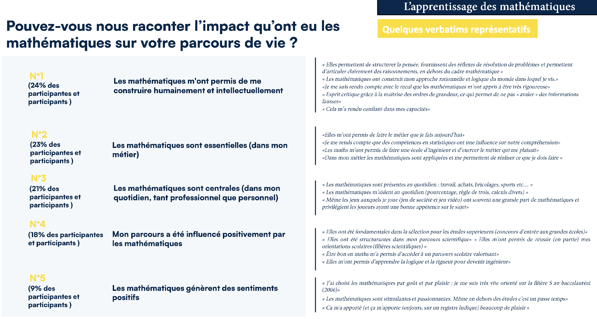
    </div>
    <div class="carousel-item">
      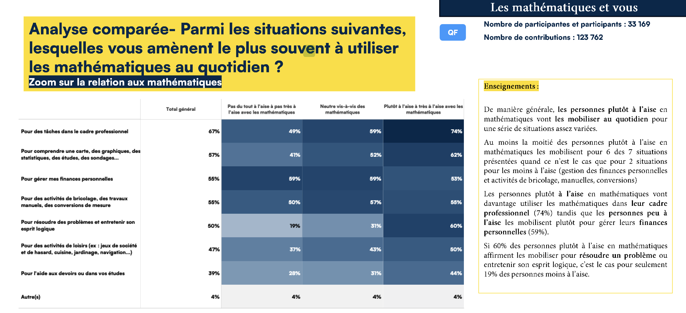
    </div>
    <div class="carousel-item">
      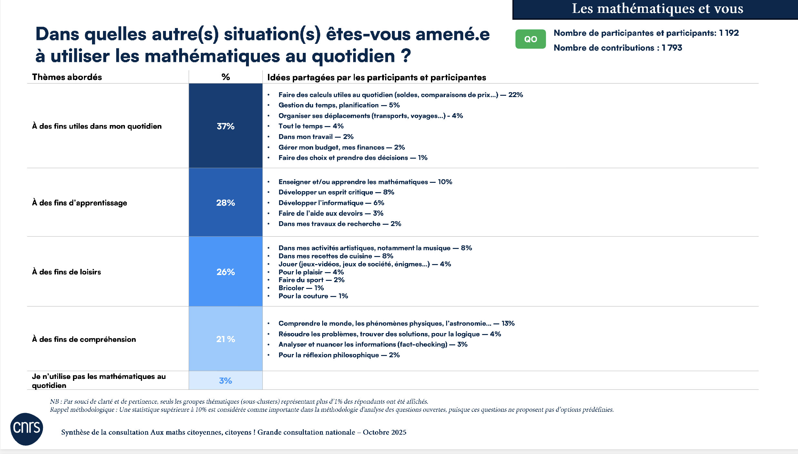
    </div>
     <div class="carousel-item">
      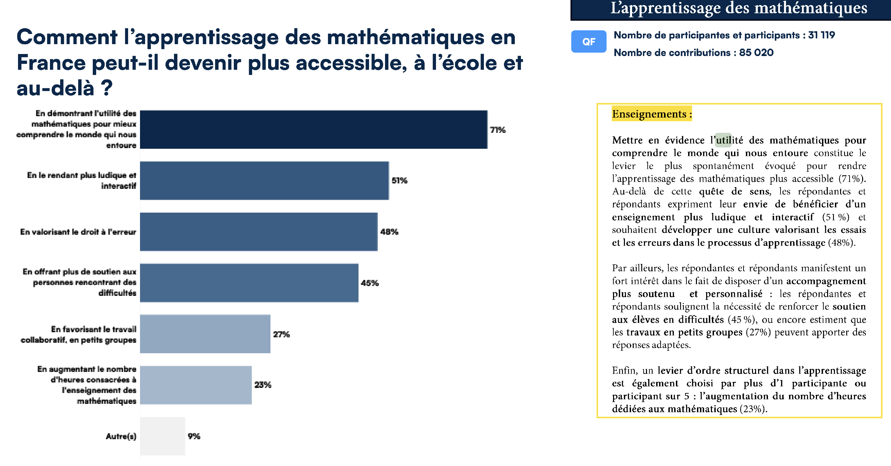
    </div>
  </div>
  <button class="carousel-control-prev" type="button" data-bs-target="#carouselExample" data-bs-slide="prev">
    <span class="carousel-control-prev-icon"></span>
  </button>
  <button class="carousel-control-next" type="button" data-bs-target="#carouselExample" data-bs-slide="next">
    <span class="carousel-control-next-icon"></span>
  </button>
</div>
```

<script>
document.addEventListener("DOMContentLoaded", function() {
  var carouselEl = document.getElementById('carouselExample');
  if (carouselEl && typeof bootstrap !== 'undefined') {
    // Détruire une instance existante si elle existe (sécurité)
    var existingInstance = bootstrap.Carousel.getInstance(carouselEl);
    if (existingInstance) {
      existingInstance.dispose();
    }
    new bootstrap.Carousel(carouselEl, {
      interval: false,
      ride: false
    });
  }
});
</script>


Elles servent bien sûr dans bien des métiers, ainsi que dans des activités comme les jeux de société[^27] ou le bricolage. Il m'est déjà arrivé de devoir expliquer à un ami de mon père comment appliqué le théorème de Pythagore, en réponse à sa question de savoir si l'armoire qu'il construisait pouvait ensuite être redressée sans toucher le plafond :

[^27]: C'est toujours satisfaisant d'être en mesure d'échafauder des stratégies gagnantes grâce aux mathématiques, ou de pouvoir par exemple expliquer à mon fils comment marche ce tour de cartes.

<div style="display: flex; justify-content: center;">
<iframe width="560" height="315" src="https://www.youtube.com/embed/Z-5KRaRqE5w?si=j-gJYEOI0JBjd7K1&amp;start=601" title="YouTube video player" frameborder="0" allow="accelerometer; autoplay; clipboard-write; encrypted-media; gyroscope; picture-in-picture; web-share" referrerpolicy="strict-origin-when-cross-origin" allowfullscreen></iframe>
</div>

Néanmoins cela n'arrive pas tous les quatre matins. Je ne suis pas certain que ces exemples d'applications utiles suffisent à motiver les troupes. [@cosnefroy_sens_2007] bat cette idée en brèche :

> **L’éveil de la curiosité disciplinaire ne passe quasiment jamais par l’utilité, pourtant fréquemment citée comme un ingrédient de l’intérêt**. Ce décalage laisse penser que l’argument se développe après-coup, comme le suggèrent les propos de cet élève (12, G, 3, N3) : « l’anglais c’est une langue indispensable de nos jours. Pour travailler, dans n’importe quel pays on parle anglais, on comprend ». À la question de l’origine de son intérêt, il répond : « Depuis tout petit. Quand j’étais petit j’écoutais des chansons et des trucs comme ça, et je comprenais pas [...] Avec l’âge j’ai pensé au travail, mais quand j’étais petit c’était surtout les chansons et mes idoles. » La valorisation de l’utilité de la discipline se construit dans un second temps, une fois l’intérêt déjà établi. De même, si les mathématiques sont à plusieurs reprises associées à l’utilité dans la vie quotidienne, on ne peut que s’étonner du décalage entre les arguments invoqués et la nature des apprentissages effectués en cours. En effet, **l’utilité des mathématiques consiste pour l’essentiel à fournir les savoir-faire nécessaires pour gérer l’économie domestique (impôts, comptes). Il est difficile d’imaginer qu’une telle conception de l’utilité, qui renvoie à des apprentissages de base, puisse soutenir durablement l’investissement dans des apprentissages autrement plus complexes à ce niveau de la scolarité.**  Symétriquement, on s’interrogera sur la façon dont l’absence d’utilité est convoquée pour expliquer le désintérêt à l’égard d’une discipline. Plusieurs exemples concernent la physique : « la physique non plus on l’utilise pas dans la vie de tous les jours » (7, G, 3, N2). Il est surprenant de voir associé désintérêt et manque d’utilité dans une discipline pourtant porteuse d’applications diverses dans la vie quotidienne. Tout ceci pousse à renverser la causalité entre utilité et intérêt. L’utilité n’est probablement pas une raison déterminante de s’intéresser à la discipline. C’est plutôt en fonction de l’intérêt qu’on lui accorde qu’on définit l’utilité associée à la discipline. **Le recours à l’utilité fonctionne alors comme une justification a posteriori**, d’autant plus facile à mobiliser que la discipline en question se prête effectivement à des applications diversifiées. C’est la raison pour laquelle elle est si souvent évoquée pour l’anglais.

Nous avons donc souvent tendance, nous autres  mathématicien.ne.s, à vouloir convaincre les néophytes de l'intérêt des mathématiques en insistant sur leur utilité, tournée vers l'extérieur donc, car on présuppose que c'est ce qui est susceptible de pouvoir les intéresser et de les motiver; alors même que **notre propre intérêt et motivation sont en premier lieu intrinsèques à la discipline**, les applications constituant autant de cerises sur le gâteau. 

### La motivation intrinsèque des maths

Entendons nous bien, je suis moi-même le premier à motiver mes cours de maths par des exemples d'applications, avec ce souci de montrer que les maths ne sont pas déconnectées du réel et faire part de leur déraisonnable efficacité [@wigner1990unreasonable]. Mais est-ce suffisant de désigner des buts applicatifs pour donner le goût de *faire des mathématiques* et de maintenir une motivation durable ? Je ne le pense pas. Il faut bien qu'à un moment la motivation devienne intrinsèque à la discipline et non pas seulement extrinsèque. C'est comme vouloir apprendre la guitare pour draguer, ça peut motiver un temps pour apprendre à gratter quelques accords, mais ça n'amènera jamais personne au niveau d'un musicien confirmé -- prêt à consentir à faire des gammes et à répéter pendant des heures pour s'améliorer -- si le plaisir pour la musique elle-même n'est pas le maître-mot. 

Voyons ce qu'en dit [@broue_jean-pierre_2006] à propos de [Jean-Pierre Serre](https://fr.wikipedia.org/wiki/Jean-Pierre_Serre), monument des mathématiques françaises qui a soufflé cette année ses 100 bougies :

> L’utilité des mathématiques ? Certes plus personne ne songe à la remettre en cause aujourd’hui, puisqu’on sait bien qu’elles sont partout, de la gestion du trafic aérien à la forme des verres de lunettes en passant par l’imagerie médicale, internet et les télécommunications, de la description des particules élémentaires à la maîtrise de l’information génomique. Cependant, **l’utilité de ses mathématiques n’a jamais été, pour Serre, un critère de ses choix de travail**. Il se plaît à dire que les mathématiciens se contentent de mettre leur production à la disposition de tous, comme sur des étagères où l’on peut venir se servir. Noter, cependant, que ce service-là est gratuit. Et que le mathématicien ne fabrique et ne dépose sur l’étagère que ce qui lui plaît. **Ce qui le motive, c’est le plaisir, pas l’appât du gain**. Serre dit souvent qu’il s’est étonné toute sa vie qu’on l’ait payé, si longtemps, pour une activité qu’il aimait tant. C’est bien la jouissance et la curiosité qui ont été, sans aucun doute, les moteurs du travail de Serre.

[Jacobi](https://fr.wikipedia.org/wiki/Charles_Gustave_Jacob_Jacobi) était de cet avis, et a inspiré le titre du livre de [@dieudonne1987pour] :

> M. Fourier avait l'opinion que le but principal des mathématiques était l'utilité publique et l'explication des phénomènes naturels ; mais un philosophe comme lui aurait dû savoir que le but unique de la science, c'est **l'honneur de l'esprit humain**, et que sous ce titre, une question de nombres vaut autant qu'une question du système du monde. 


### Les maths servent à tout et rien

D'un côté donc des  mathématicien.ne.s qui s'évertuent à vouloir montrer que les maths *servent dans tout et partout* (puisque s'immisçant jusque dans nos téléphones, cartes bancaires, etc); de l'autre des  mathématicien.ne.s qui à la question *"les maths à quoi ça sert ?"* répondent simplement *"à rien"*, assumant d'ignorer cette injonction appelant à justifier du caractère utile des maths au sens pratique du terme. En guise de réponse, [Laurent Schwartz](https://fr.wikipedia.org/wiki/Laurent_Schwartz_(math%C3%A9maticien)) répondait quant à lui à cette question par cette cocasse plaisanterie :

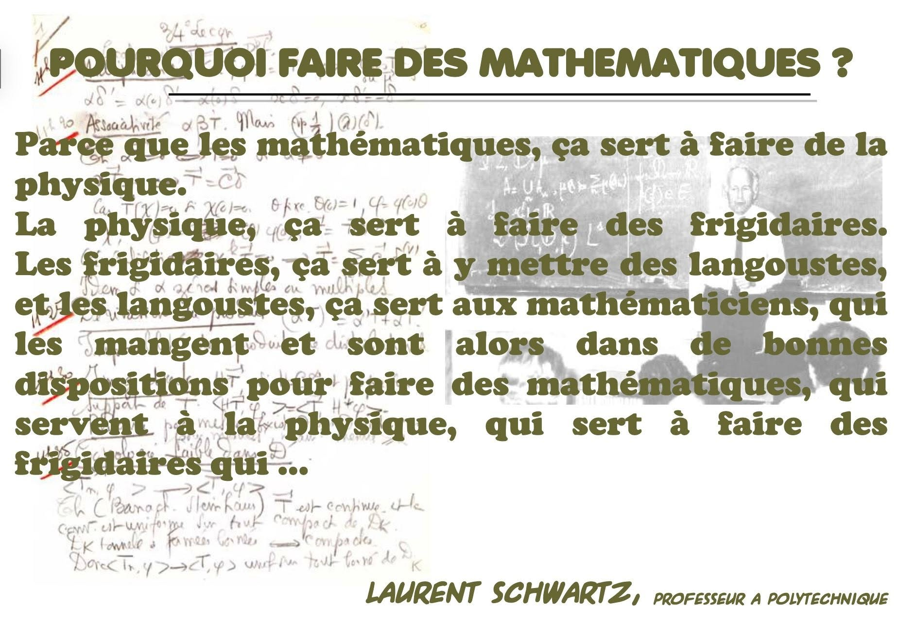

Au delà du comique de la circularité[^17], sa réponse concilie à la fois le caractère utilitaire et utilitariste[^20] des mathématiques, puisqu'elle maximise à la fois le bonheur désintéressé des  mathématicien.ne.s comme celui des consommateurs [@galderisi_langoustes_2016] : 

[^17]: qui rappelle cette [parabole](https://loptimisme.com/pecheur-mexicain/) du pêcheur mexicain et du business man.

[^20]: Doctrine philosophique de l'utilitarisme de John Stuart Mill.

> Les points de suspension et le nombre croissant de mathématiciens à travers le monde pourraient faire craindre l’extinction du délicieux crustacé. Ces points miment en réalité le cercle herméneutique que la réponse esquisse malicieusement. Les sciences mathématiques n’ont pour objet et seule justification qu’elles-mêmes. La fin ultime de la science est la science, aussi gratuite et non profitable puisse-t-elle paraître aux non-savants dans l’immédiat ou même dans l’absolu. **L’intérêt collectif de la recherche semble ici réduit au bon plaisir d’une catégorie de chercheurs qui trouvent dans les retombées de leurs recherches leur bonheur gastronomique et leur alibi (dé)ontologique**. Mais la revendication de l’absolu de la recherche scientifique et le rejet ironique de toute forme d’application utilitaire s’appuient en réalité dans l’exemple cité sur une invention, le frigidaire, dont chacun peut comprendre qu’il ne sert pas seulement à garder au frais les décapodes que les sectateurs d’Uranie, nos collègues mathématiciens, aiment tant. **Le non-chercheur, exclu ostensiblement du cercle herméneutique, y est en réalité réadmis par le biais d’une application scientifique, d’un produit technologique qui fait aussi son confort depuis un siècle**. Le non-spécialiste est ainsi incité à comprendre les exigences de ces mathématiciens qui en cherchant à satisfaire leur plaisir font en réalité l’intérêt de tout le monde.
Mais, dira-t-on, celui de Laurent Schwartz est moins une pratique mathématique qu’un discours second sur sa science, un aphorisme qui ne remet pas en cause les présupposés téléologiques et les exigences de la recherche, la nécessité d’une gratuité absolue. C’est une évidence. Et cependant, comment ne pas remarquer que le mathématicien reconnaît la légitimité de la question, qu’il se sent contraint de donner une réponse qui n’a d’humoristique que le ton, et qu’il concède que le trait d’union avec le monde, qu’opèrent ici les physiciens (c’est-à-dire d’autres chercheurs) à travers la création du réfrigérateur, est une condition et une conséquence des mathématiques. En somme, que les mathématiciens ont aussi besoin de pouvoir profiter de leurs recherches, que la gratuité épistémique n’est pas nécessairement improductive.

Ce qui anime le scientifique, nous dit [@poincare_valeur_2005]  :

> La recherche de la vérité doit être le but de notre activité ; c’est la seule fin qui soit digne d’elle. Sans doute nous devons d’abord nous efforcer de soulager les souffrances humaines, mais pourquoi ? Ne pas souffrir, c’est un idéal négatif et qui serait plus sûrement atteint par l’anéantissement du monde. Si nous voulons de plus en plus affranchir l’homme des soucis matériels, c’est pour qu’il puisse employer sa liberté reconquise à l’étude et à la contemplation de la vérité.

faisant écho aux langoustes de Schwartz qui créént de *bonnes disposition pour faire des mathématiques*.

[@poincare_science_1908] poursuit :

> Tolstoï explique quelque part pourquoi « la Science pour la Science » est à ses yeux une conception absurde. Nous ne pouvons connaître tous les faits, puisque leur nombre est pratiquement infini. Il faut choisir ; dès lors, pouvons-nous régler ce choix sur le simple caprice de notre curiosité ; ne vaut-il pas mieux nous laisser guider par l’utilité, par nos besoins pratiques et surtout moraux ? [...] Pour moi, ai-je besoin de le dire, je ne saurais me contenter ni de l’un, ni de l’autre idéal ; je ne voudrais ni de cette ploutocratie avide et bornée, ni de cette démocratie vertueuse et médiocre, uniquement occupée à tendre la joue gauche, et où vivraient des sages sans curiosité qui, évitant les excès, ne mourraient pas de maladie, mais à coup sûr mourraient d’ennui. [...] **Le savant n’étudie pas la nature parce que cela est utile ; il l’étudie parce qu’il y prend plaisir et il y prend plaisir parce qu’elle est belle. Si la nature n’était pas belle, elle ne vaudrait pas la peine d’être connue, la vie ne vaudrait pas la peine d’être vécue.** Je ne parle pas ici, bien entendu, de cette beauté qui frappe les sens, de la beauté des qualités et des apparences ; non que j’en fasse fi, loin de là, mais elle n’a rien à faire avec la science ; je veux parler de cette beauté plus intime qui vient de l’ordre harmonieux des parties, et qu’une intelligence pure peut saisir. C’est elle qui donne un corps, un squelette pour ainsi dire aux chatoyantes apparences qui flattent nos sens, et sans ce support, la beauté de ces rêves fugitifs ne serait qu’imparfaite parce qu’elle serait indécise et toujours fuyante. Au contraire, la beauté intellectuelle se suffit à elle-même et c’est pour elle, plus peut-être que pour le bien futur de l’humanité, que le savant se condamne à de longs et pénibles travaux.

Il y a une [Libido sciendi](https://books.openedition.org/enseditions/24353?lang=fr), à laquelle Cédric Villani – en réponse à Luc Ferry [@noauthor_cedric_2018] – souscrit en paraphrasant [André Weil](https://fr.wikipedia.org/wiki/Andr%C3%A9_Weil) :

> Le plaisir de la découverte des maths dure plus longtemps que le plaisir sexuel. C'est quelque chose qu'on peut expérimenter très tôt, le fait que comprendre vient avec un éblouissement et le plaisir de voir tous les arguments qui s'enchaînent.

Laurent Schwartz décrit une expérience similaire [@bouleau_dialogues_1994] :

> J'ai plaisir à sécher parce que l'organisme se tend d'une manière telle qu'**on en ressent presqu'une jouissance physique**. On sent qu'on avance. On sent qu'on ne trouve pas ce qu'on veut mais qu'on avance. Je me dis ce soir j'en saurai plus que ce matin. Cette question d'avance c'est un peu comme quelqu'un qui monte une montagne si tu veux. Je n'éprouve pas le désir de faire l'aiguille verte par une face plutôt que par une autre, je ne cherche pas spécialement la tension. Mais si je veux quelque chose, alors j'y mets de la tension, ce moment là est une jouissance.

Enfin pour rester dans le thème et terminer sur l'utilité je citerais [Richard Feynman](https://fr.wikipedia.org/wiki/Richard_Feynman) :

> Science is like sex: sometimes something useful comes out, but that is not the reason we are doing it. 

[@nordon_bloc-notes_2007] nous fournira quant à lui une conclusion à la [Wittgenstein](https://fr.wikipedia.org/wiki/Ludwig_Wittgenstein) (*"Ce dont on ne peut parler, il faut le taire"*) :

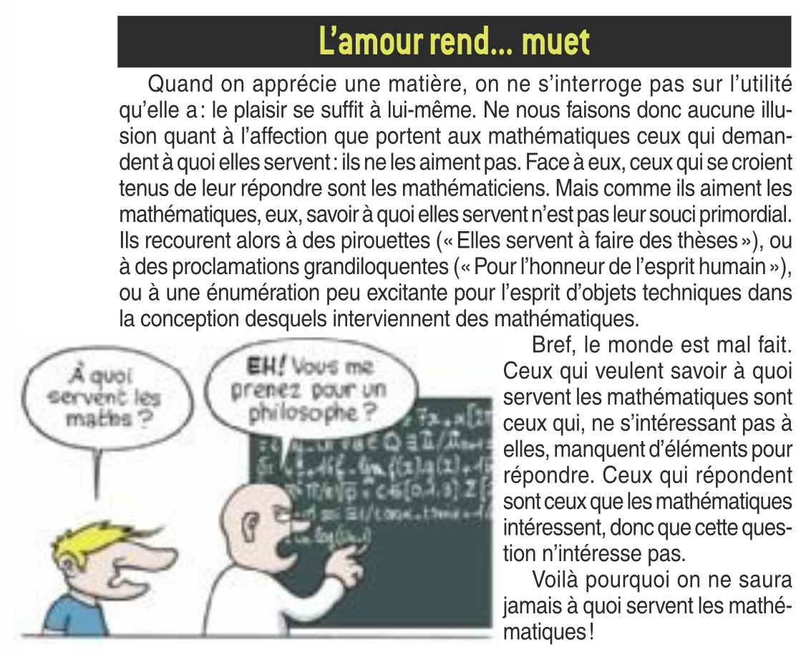

## Perception des mathématiques

Pour jauger l'intérêt des mathématiques nous avions dans un premier temps suivi le fil chronologique du cursus scolaire (de l'école primaire aux études supérieures en passant par le secondaire), enregistrant une baisse d'appétence progressive pour la matière. Nous avons ensuite énuméré différentes raisons de ce désamour qui détournent les élèves des mathématiques, créant ainsi deux groupes : ceux qui aiment les maths et y trouvent *de* l'intérêt, et ceux qui n'aiment pas/plus et y cherchent *un* intérêt. Pour rendre compte de la différence de perception des mathématiques et de son évolution, nous allons maintenant adopter la démarche opposée en partant des représentations des adultes une fois constituées, puis remonter le fil jusqu'à la petite école. Examiner les préjugés permettra de diagnostiquer ce qui dans les conditions actuelles les (re)produit. Nous tâcherons de montrer que les mathématiques sont une science vivante et profondément humaine, emplies d'émotions, que l'on peut faire des mathématiques *avec les tripes*. Il s'agit donc de prendre ces tripes comme point de départ. Commençons par osculter la population, ses souvenirs et ses émotions.

### Consultation nationale : "Aux maths citoyennes, citoyens !" {#consultation-citoyenne}

Organisé par l’[Insmi](https://www.insmi.cnrs.fr/fr)[^14] du 10 mars au 30 avril 2025, le [questionnaire en ligne](https://www.insmi.cnrs.fr/fr/cnrsinfo/le-questionnaire-en-ligne) *« Aux maths citoyennes, citoyens ! Grande consultation nationale »* a recueilli plus d’1,1 million de contributions par plus de **33 000 participantes et participants !** L’objectif était de récolter les perceptions, les représentations, les émotions et envies des citoyennes et citoyens au sujet des mathématiques. 

[^14]: Institut national des sciences mathématiques et de leurs interactions.

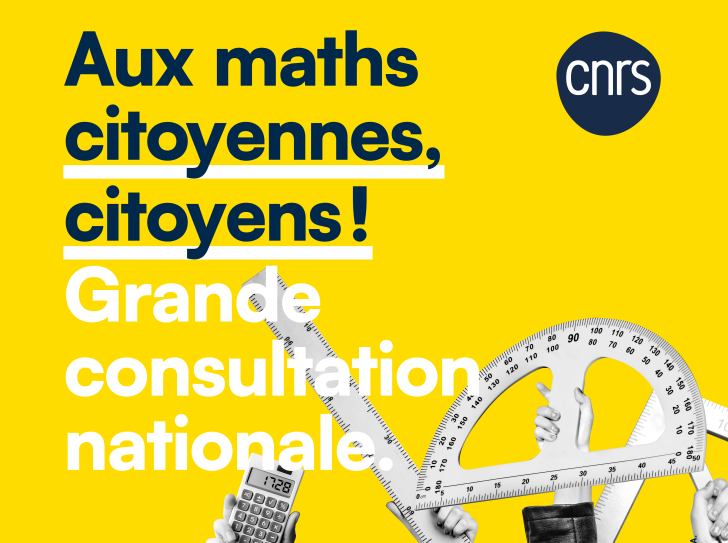

> À noter : les personnes ayant répondu à cette consultation en ligne ne sont pas strictement représentatives de l’ensemble de la population française [...] forte participation des cadres et des professions intellectuelles supérieures (57% des répondantes et répondants à la consultation vs 22% de la population en emploi en France). Par ailleurs, 71% des répondantes et répondants déclarent se sentir soit très à l’aise soit plutôt à l’aise avec les mathématiques.


### Les mots pour le dire

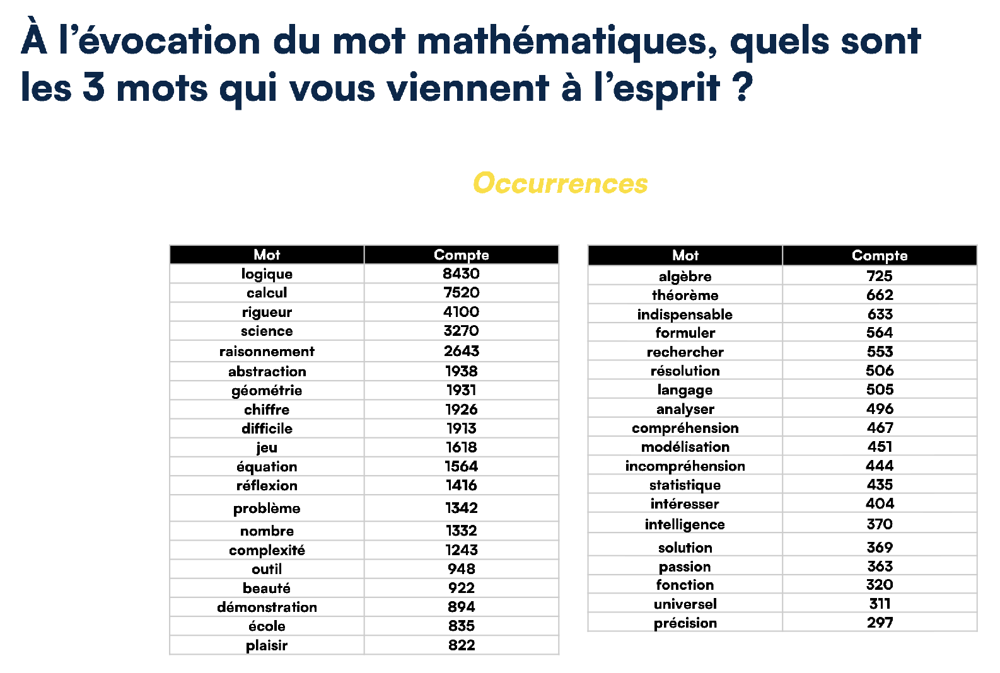

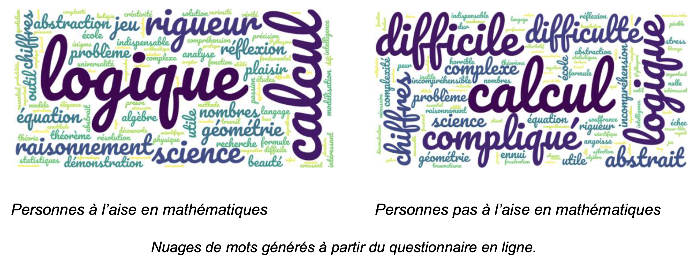

> Les cooccurrences montrent que les mathématiques sont avant tout associées à **un univers de la raison et de la rigueur, dominé par le triptyque calcul – logique – raisonnement, davantage qu’une pratique vivante ou créative**. En arrière-plan, quelques associations plus rares avec la beauté, le jeu ou l’utilité suggèrent l’existence d’un imaginaire alternatif — plus sensible, plus ouvert— mais encore marginal face à la puissance du modèle rationnel et scolaire.


> Lorsqu’on évoque le mot « mathématiques », les mots qui viennent spontanément à l’esprit sont majoritairement d’ordre technique. Ainsi, dans la consultation en ligne, les cinq mots les plus fréquents — logique, calcul, rigueur, réflexion, raisonnement — totalisent à eux seuls près de 30 % du corpus. Une part minoritaire exprime un ressenti affectif ou une évaluation. Les personnes peu à l’aise en mathématiques choisissent des **mots négatifs (difficulté, complexité, peur, angoisse)** et les personnes à l’aise des **mots plutôt positifs (plaisir, jeu, beauté, curiosité)**. Par ailleurs, plus on avance en âge, plus le mot plaisir est récurrent. Enfin, on remarque très peu de termes qui font écho à l’ancrage concret des mathématiques dans la vie quotidienne et le terme « abstraction » revient en 6ème position des occurrences. Cette dimension pragmatique reste ainsi peu présente dans les représentations spontanées. 

Qui plus est ces représentations portent sur un échantillon de participants non représentatif de la population (surreprésentation des personnes diplômées), la synthèse précisant que : "71% des répondantes et répondants déclarent se sentir soit très à l’aise - soit plutôt à l’aise avec les mathématique". On imagine donc sans mal que l'association des maths à une activité sensible et créative soit encore moins répandue dans la population générale. 

```{=html}
<div id="carouselExample2" class="carousel slide">
  <div class="carousel-inner">
    <div class="carousel-item active">
      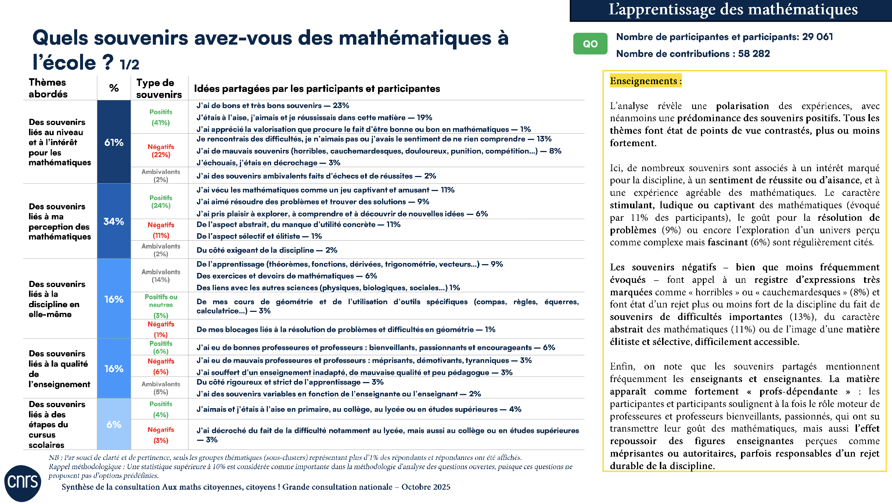
    </div>
    <div class="carousel-item">
      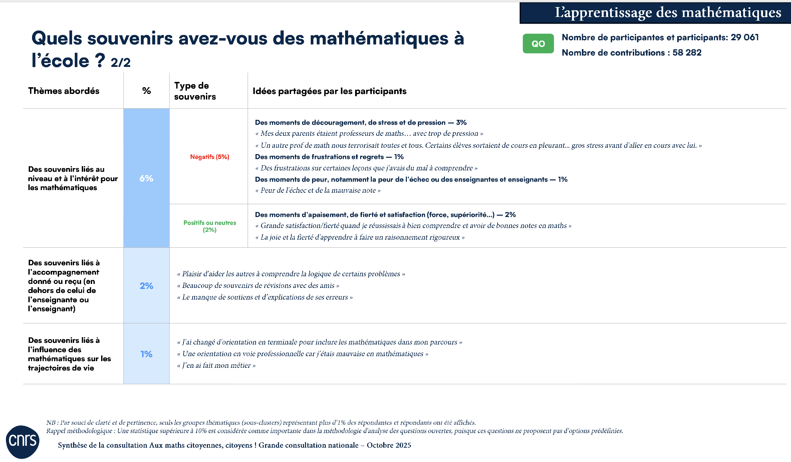
    </div>
  </div>
  <button class="carousel-control-prev" type="button" data-bs-target="#carouselExample2" data-bs-slide="prev">
    <span class="carousel-control-prev-icon"></span>
  </button>
  <button class="carousel-control-next" type="button" data-bs-target="#carouselExample2" data-bs-slide="next">
    <span class="carousel-control-next-icon"></span>
  </button>
</div>
```

<script>
document.addEventListener("DOMContentLoaded", function() {
  var carouselEl = document.getElementById('carouselExample2');
  if (carouselEl && typeof bootstrap !== 'undefined') {
    // Détruire une instance existante si elle existe (sécurité)
    var existingInstance = bootstrap.Carousel.getInstance(carouselEl);
    if (existingInstance) {
      existingInstance.dispose();
    }
    new bootstrap.Carousel(carouselEl, {
      interval: false,
      ride: false
    });
  }
});
</script>

> Plus les personnes sont à l’aise avec les mathématiques, plus elles évoquent des souvenirs positifs à l’école – des souvenirs liés au jeu, à la découverte, à la résolution de problèmes (38% vs. 22% pour les moins à l’aise). Parmi les mots utilisés par les personnes répondantes à l’aise, reviennent : **« passionnant », « valorisation », « bons souvenirs », « explorer »**. 21% des personnes à l’aise en mathématiques indiquent que celles-ci ont eu un impact positif sur leur parcours (contre 9% des personnes pas à l’aise). À l’inverse, les personnes peu à l’aise associent beaucoup plus leurs souvenirs à des émotions négatives : **« stress », « frustration », « peur », « souvenirs » qualifiés de « cauchemardesques », « horribles », « douloureux »**, une thématique évoquée par 14% d’entre elles contre seulement 4% des personnes à l’aise. 20% des personnes pas à l’aise en mathématiques répondent que celles-ci ont généré des sentiments négatifs (contre 3% des personnes à l’aise)

Dans le livre de [@duminil-copin_autre_2026], le personnage (de prénom volontairement non genré)

>  Camille finit par se dire que le souci vient des mathématiques, elles-mêmes : **froides, arides, sans émotion ni créativité, trop abstraites**. L'adulte en gardera un souvenir douloureux et un profond ressentiment. Dans son esprit, les mathématiques se réduiront à un critère de tri scolaire et social. En guise de protection contre sa frustration, Camille développera une étrange forme de fierté : celle d'appartenir au club des "nuls en maths". 

```{=html}
<div id="carouselExample4" class="carousel slide">
  <div class="carousel-inner">
    <div class="carousel-item active">
      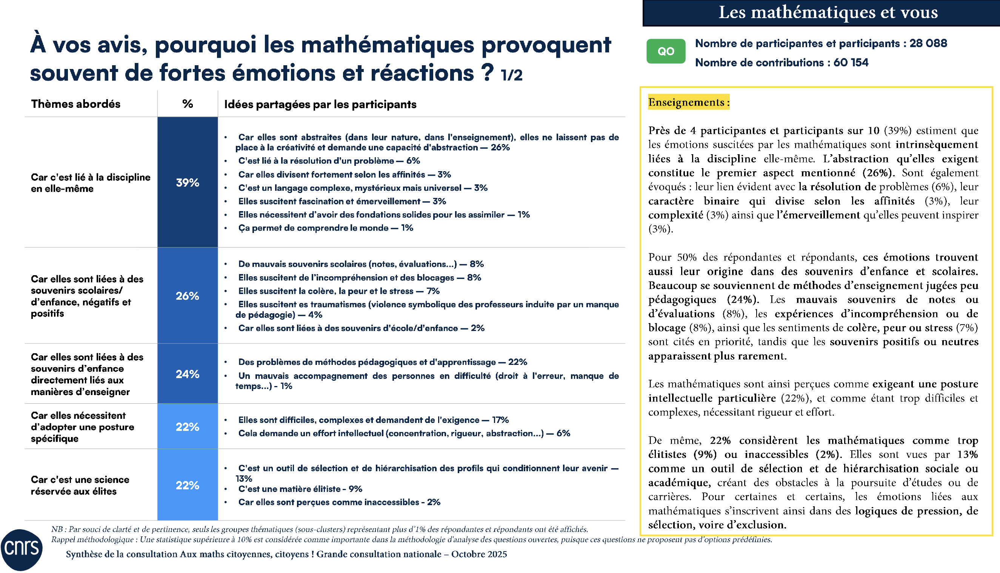
    </div>
    <div class="carousel-item">
      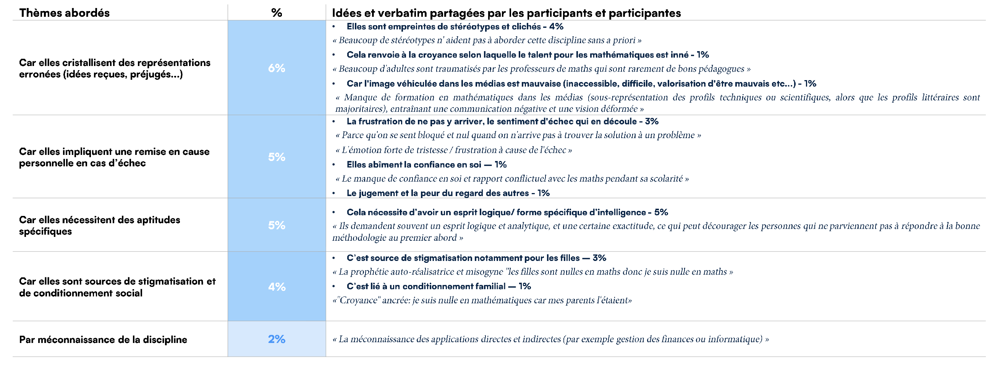
    </div>
  </div>
  <button class="carousel-control-prev" type="button" data-bs-target="#carouselExample4" data-bs-slide="prev">
    <span class="carousel-control-prev-icon"></span>
  </button>
  <button class="carousel-control-next" type="button" data-bs-target="#carouselExample4" data-bs-slide="next">
    <span class="carousel-control-next-icon"></span>
  </button>
</div>
```

<script>
document.addEventListener("DOMContentLoaded", function() {
  var carouselEl = document.getElementById('carouselExample4');
  if (carouselEl && typeof bootstrap !== 'undefined') {
    // Détruire une instance existante si elle existe (sécurité)
    var existingInstance = bootstrap.Carousel.getInstance(carouselEl);
    if (existingInstance) {
      existingInstance.dispose();
    }
    new bootstrap.Carousel(carouselEl, {
      interval: false,
      ride: false
    });
  }
});
</script>

Ce rapport émotionnel aux mathématiques permet de reboucler sur l'interview de Christophe Besse, lorsque la journaliste se souvient :

> j'avais des gens dans ma classe quand j'étais petite qui, quand ils arrivaient en cours de maths, avaient même peur quoi. C'était vraiment de l'ordre de l'émotion pour en revenir à ce que l'on disait tout à l'heure. 

Puis elle clôt l'interview par cette question :

> Comment vous expliquez ce paradoxe qui est très français : il y a plein de gens qui détestent les maths [...] Et dans le même temps, la France reste une référence en matière de recherche très pointue en mathématiques, comment ça se fait ? 

Ce à quoi Christophe Besse répondit :

> Alors ça, c'est la colle. **C'est très difficile de comprendre pourquoi on a cette difficulté**. C'est vrai que la recherche mathématique française est une des toutes meilleures au monde. [...] Pourquoi on a ce paradoxe c'est difficile à comprendre. Peut-être que l'on insiste trop sur le fait qu'on y arrive pas, c'est un constat d'échec. J'aime bien prendre l'analogie quand on est petit on apprend à marcher, si on tombe et que nos parents nous disent mais jamais tu arriveras à marcher et bien on avancera jamais, et bien pour les mathématiques c'est pareil c'est pas grave de se tromper. Dans la vie d'une chercheuse ou d'un chercheur c'est notre quotidien, si on ne se trompe pas on avance pas. C'est pas grave, c'est de l'entrainement, il faut encourager les gens.

Si je le rejoins sur notre rapport particulier à l'échec en France expliquant une part de l'anxiété mathématique, en revanche il ne m'apparait pas si difficile de comprendre cet apparent "paradoxe" d'une population fâchée avec la discipline combinée à une élite mathématique. Nous n'avons aucune difficulté à comprendre que l'on peut simultanément avoir une société composée de populations pauvres et de personnes très riches. Il en va de même ici, il n'y a aucun paradoxe, seulement **un système à deux vitesses** qui d'un côté est très performant pour repérer, sélectionner et propulser au plus haut niveau une minorité d'élèves très bons en mathématiques dans des filières d'excellence (classes préparatoires, grandes écoles, ENS, CNRS); et de l'autre qui n'assure pas des bases solides et un niveau moyen satisfaisant à l'ensemble de la population, en laissant beaucoup d'élèves sur le bord du chemin, comme en témoignent les enquêtes TIMSS et PISA où la France s'illustre par de fortes inégalités éducatives.

Pour ma part, ce qui m'interroge davantage, c'est la différence de perception des mathématiques entre d'un côté les  mathématicien.ne.s tels qu'ils les pratiquent au quotidien, et de l'autre le reste de la population pour qui elles leur évoquent tout autre chose.

### Un décalage de perception

Le documentaire français [*Comment j'ai détesté les maths*](https://fr.wikipedia.org/wiki/Comment_j%27ai_d%C3%A9test%C3%A9_les_maths) [@olivier_peyon_comment_2013] sorti en novembre 2013, *"donne la parole à ceux qui ont subi l'enseignement des mathématiques, et l'ont en général détesté, parfois adoré"*. Dès les dix premières minutes, se fait directement ressentir le décalage de perception des mathématiques entre les élèves et les  mathématicien.ne.s de profession. Voici quelques extraits du point de vue des lycéens :

> Il n'existe pas de société où la majorité des gens aiment les maths. [...] Même moi qui suis bon je n'aime pas les maths.

> Je peux concevoir que les maths soient fascinantes et créatives pour certains, **mais à notre niveau il n'y a rien de vraiment créatif**. Pour atteindre ce stade, il faut être un mathématicien de haut vol, alors qu'en littérature vous pouvez être créatif dès le début, raconter votre journée sans intérêt et vous amuser.

Donnons maintenant la parole à un mathématicien de haut vol, Cédric Villani, qui décrivait juste après l'intervention des élèves la dualité des mathématiques :

> Les mathématiques sont rigoureuses ouais mais imaginatives aussi, les mathématiques sont abstraites mais universelles, les mathématiques sont inégalitaires et démocratiques, sont anciennes et en mutation permanente, sont solitaires et sociales à la fois, sont difficiles et simplissimes.

| Froides  | Chaudes  |
|--------|--------|
| rigoureuses  | imaginatives   |
| abstraites   | universelles  |
| inégalitaires | démocratiques  |
| anciennes  | en mutation   |
| solitaires   | sociales  |
| difficiles | simplissimes  |

: Caractérisation des mathématiques {.striped .hover}

<div style="display: flex; justify-content: center;">
<iframe width="560" height="315" src="https://www.youtube.com/embed/YBZHoxpPBuA?si=v21waUzlMsH11AMo&amp;start=389" title="YouTube video player" frameborder="0" allow="accelerometer; autoplay; clipboard-write; encrypted-media; gyroscope; picture-in-picture; web-share" referrerpolicy="strict-origin-when-cross-origin" allowfullscreen></iframe>
</div>

De la bouche même de Cédric Villani, la colonne de droite est plus *sexy*. Alors pourquoi les élèves ne perçoivent principalement que la colonne de gauche évoquant des affects "froids" ? Pourquoi l'école ne parvient pas à véhiculer ces autres affects plus "chaleureux" ? C'est de ces "saveurs savantes"[^28], qui ne sont pas perçues comme telles, que j'aimerais discuter.

[^28]: Thème de la fête de la science 2026.

Rembobinons un peu le fil de ces représentations.

### Perception des collégiens et des élèves d'école primaire

[@coppe_perception_2024] ont conçu un questionnaire visant à documenter la perception des mathématiques et de la résolution de problèmes par les élèves de la fin du primaire à la fin du collège à Genève.

```{=html}
<div id="carouselExample3" class="carousel slide">
  <div class="carousel-inner">
    <div class="carousel-item active">
      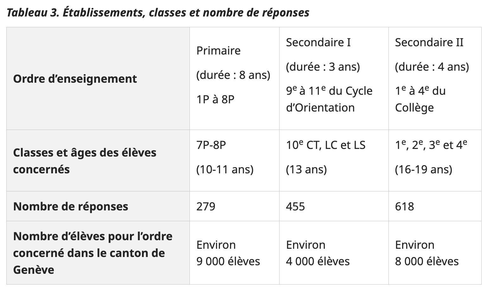
    </div>
    <div class="carousel-item">
      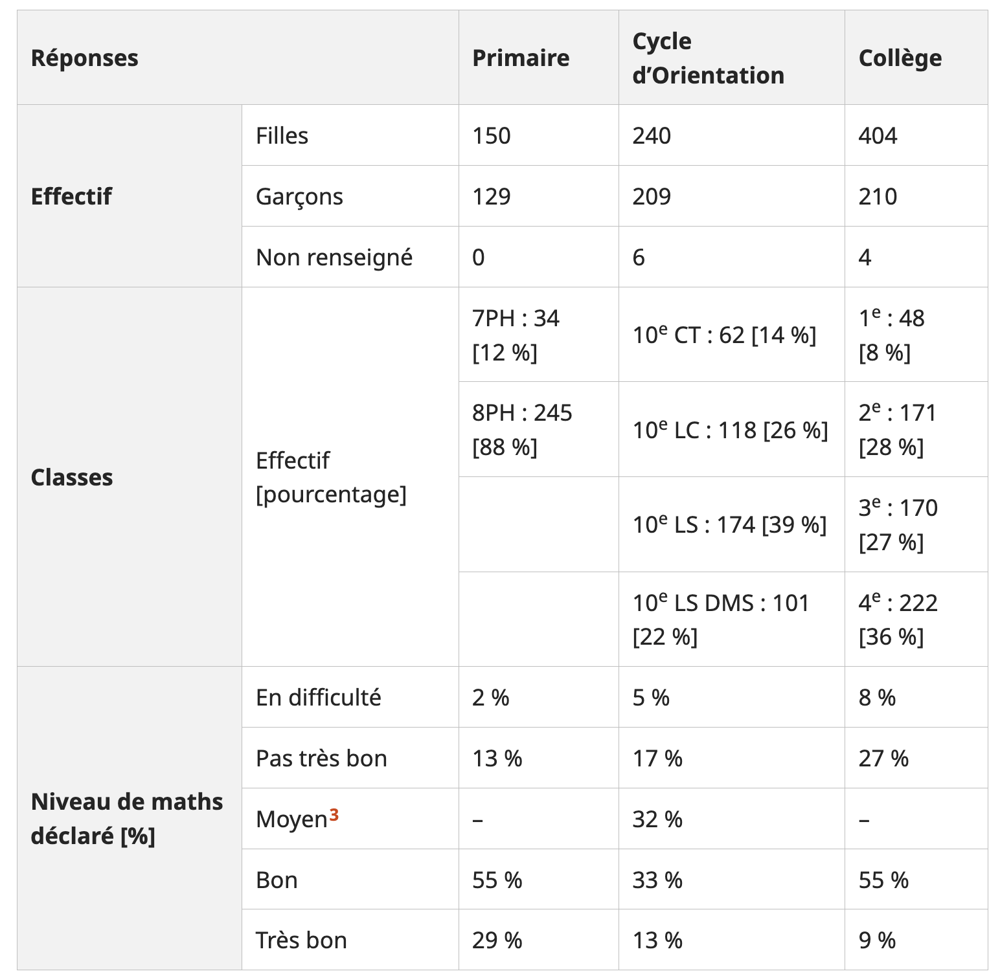
    </div>
    <div class="carousel-item">
      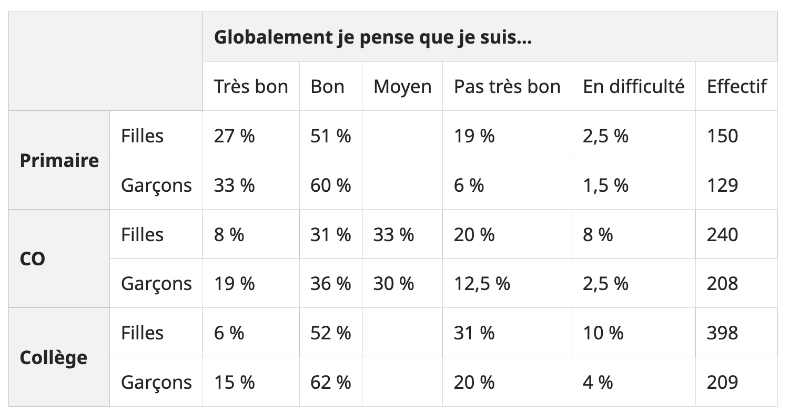
    </div>
  </div>
  <button class="carousel-control-prev" type="button" data-bs-target="#carouselExample3" data-bs-slide="prev">
    <span class="carousel-control-prev-icon"></span>
  </button>
  <button class="carousel-control-next" type="button" data-bs-target="#carouselExample3" data-bs-slide="next">
    <span class="carousel-control-next-icon"></span>
  </button>
</div>
```

<script>
document.addEventListener("DOMContentLoaded", function() {
  var carouselEl = document.getElementById('carouselExample3');
  if (carouselEl && typeof bootstrap !== 'undefined') {
    // Détruire une instance existante si elle existe (sécurité)
    var existingInstance = bootstrap.Carousel.getInstance(carouselEl);
    if (existingInstance) {
      existingInstance.dispose();
    }
    new bootstrap.Carousel(carouselEl, {
      interval: false,
      ride: false
    });
  }
});
</script>

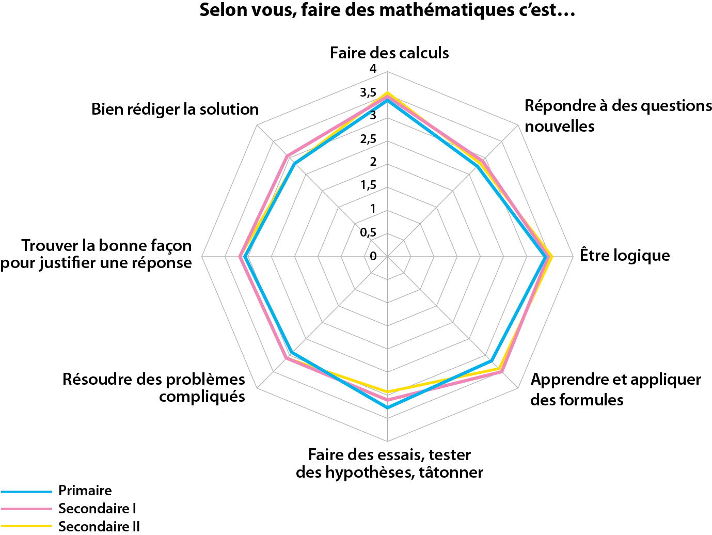

> Nous constatons que l’ordre des réponses évolue peu en fonction de l’ordre d’enseignement; **la conception «logique» est prépondérante partout, tout comme l’aspect calculatoire**, alors que les conceptions «rédaction» («Bien rédiger une réponse») et«nouveauté» («Répondre à des questions nouvelles») sont classées aux deux dernières places pour tous les ordres d’enseignement. Néanmoins, il existe quelques différences subtiles entre les ordres d’enseignement. Ainsi la conception «procédurale» («Apprendre et appliquer des formules») arrive en première position au secondaireI, alors qu’elle n’est que 3e au secondaire II et 4e au primaire. **A contrario, la conception «expérimentale» («Faire des essais, tester des hypothèses et tâtonner») arrive en 3e position au primaire alors qu’elle n’est que 5e au secondaire I et 6e au secondaire II (Collège)**.

La dimension créative est donc davantage présente en primaire qu'au collège, alors même qu'ils ont plus de connaissances mobilisables. 

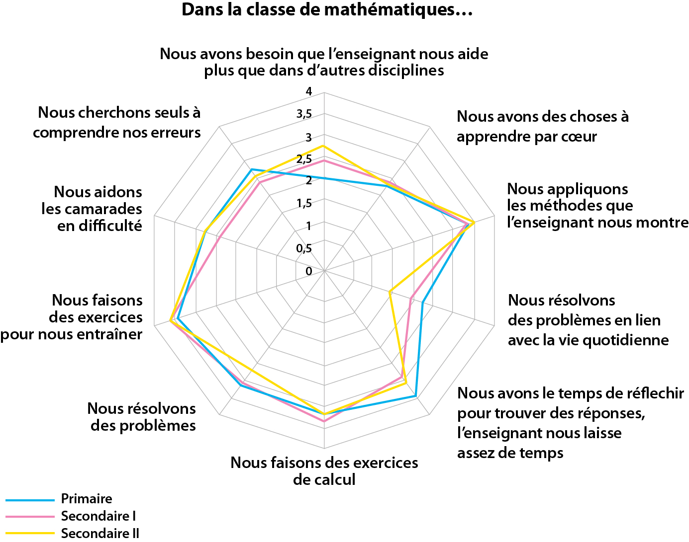

> Les activités les plus fréquentes dans la classe de mathématiques, quel que soit l’ordre d’enseignement, sont dans l’ordre décroissant: «Faire des exercices d’entraînement» et «Appliquer les méthodes que l’enseignant [nous] montre». Il apparaît donc que c’est une perception de travail procédural et d’entraînement qui domine chez les élèves à tous les ordres d’enseignement. Toutefois, c’est toujours l’apprentissage par cœur qui est le moins plébiscité, ce qui peut surprendre, mais nous rassure aussi. De plus, si résoudre des problèmes est souvent cité (un peu moins au secondaire II), ce ne sont par contre pas des problèmes en lien avec la vie quotidienne, qui, eux, arrivent en queue de peloton de façon décroissante avec l’ordre d’enseignement. Parallèlement, nous pouvons aussi mettre en avant quelques différences. Ainsi, **au primaire, les élèves pensent, davantage que les élèves du secondaire, qu’on leur laisse «assez de temps de réfléchir pour trouver les réponses»**.

Au collège, une vision plus *mécaniste* des mathématiques (appliquer les bonnes règles) semble prévaloir, là où les  mathématicien.ne.s en ont une vision plus *vivante* et *sensible*.


| **Dimension**          | **Mathématiques scolaires**               | **Mathématiques de recherche**            |
| ---------------------- | -------------------------------------------------- | ----------------------------------------- |
| **Moteur**             | Appliquer les "bonnes règles", éviter la sanction | Explorer, conjecturer, accepter l'impasse |
| **Statut de la règle** | Contrainte rigide non négociable                   | Syntaxe souple au service d'une intuition |
| **Affect dominant**    | Stress, aridité, intimidation                      | Émerveillement, élégance, liberté         |


Dans la consultation nationale du CNRS, nous avions vu qu'à la question de savoir comment rendre les mathématiques plus accessibles, les personnes interrogées répondaient en premier lieu *"démontrer l'utilité des mathématiques"* (71%), et beaucoup moins souvent *"changer la place et la perception des mathématiques"* (11%) : 

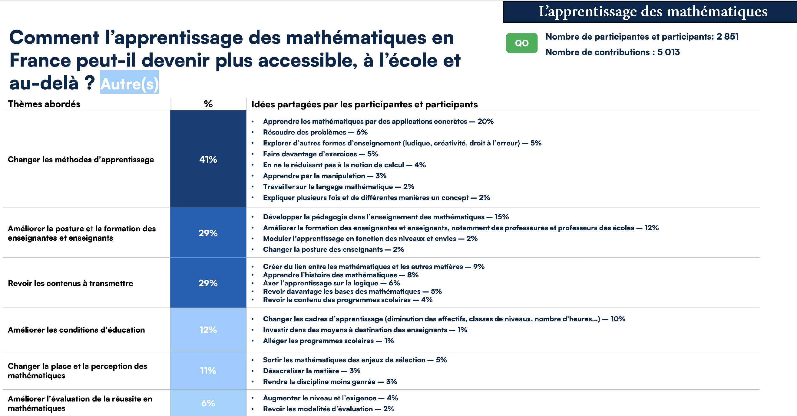

Comment se fait-il que les  mathématicien.ne.s aient une perception diamétralement opposée à celle qui préside dans le contexte scolaire ? Nous avons passé en revue les raisons du désamour des élèves, il est temps de montrer a contrario ce qui anime les  mathématicien.ne.s dans leurs recherches et ce qui est passé sous silence à l'école.

## Changer le regard sur les mathématiques

### Avant-propos

Je dois dire avant toute chose que je ne suis pas très fan de ce type de formules creuses, telles que : *"Changer le regard sur le handicap"*. Elles me font l'effet d'une sorte d'incantation, de vœu pieux qui donne bonne conscience mais fait l'économie de penser les conditions de possibilités d'un tel changement et sa mise en œuvre par des actions politiques. Il ne suffit pas de décréter le changement de regard, encore faut-il se donner les moyens pour créer les conditions à partir desquelles les préjugés reculeront subséquemment [@rojas__2019] :

> Il m’apparait que cette expression **confond de surcroît les causes et les conséquences** de l’exclusion et des discriminations que subissent les personnes handicapées. Les préjugés s’ils existent (et ils existent) ne sont pas la cause mais plutôt la conséquence, et souvent même la justification après-coup, d’une organisation excluante. **Ce n’est donc pas le regard qu’il faut changer mais préalablement l’organisation sociale**, qui pour le moment est pensée par des personnes valides pour des personnes valides sans tenir compte de notre existence. Si ce changement d’organisation nous permettait de devenir vos voisins de pallier ou de bus, vos camarades de classes, vos collègues, vos potes, vos partenaires de karaoké ou de yoga, vos partenaires tout court, vos conjoints etc. il y a des chances que vous finissiez par nous « regarder » ou nous appréhender différemment. Il y a des chances que vous vous aperceviez que nous vous ressemblons plus que vous ne l’imaginiez, que vous compreniez un peu mieux nos difficultés, que vous réalisiez que ce vous pensiez savoir sur le handicap n’est pas vrai et que vous changiez certains de vos réflexes ou de vos habitudes à notre égard. Du moins, c’est l’espoir délirant que certains d’entre nous nourrissent, tout en ayant conscience que ce sera long, ni magique, ni automatique. Enfin, « changer le regard » sur le handicap ne veut strictement rien dire politiquement. **Cette expression ne correspond à aucune action ou mesure sérieuse**. Elle n’est pas et ne peut pas être **un objectif politique**.

*"Changer le regard sur les mathématiques"* sera donc une conséquence souhaitée, mais ce n'est qu'en levant les obstacles (cf. les raisons du désamour) et au travers une certaine *praxis* renouvelée que pourra s'opérer ce changement.

>  Les mathématiques ne sont pas condamner à diviser la population entre initiés et exclus. Dépasser le clivage entre "vaincus" et "convaincus" demande de repenser en profondeur la perception de ce que signifie "faire des mathématiques", et de plonger au coeur même des mécanismes de la pensée. [@duminil-copin_autre_2026] 

Considérons trois examples pour illustrer ces mécanismes et entrevoir les mathématiques comme *"science de l'imagination"*.

### Des exemples convoquant l'imagination

#### Vous ne manquez pas d'aire !

Les passages qui suivent sont extraits de [@lockhart2009mathematician].

> S’il existe un principe esthétique unificateur en mathématiques, c’est bien celui-ci : **ce qui est simple est beau**. Les mathématiciens aiment réfléchir aux choses les plus simples possibles, et ces choses sont, par nature, imaginaires. Par exemple, si j’ai envie de réfléchir à des formes — ce qui m’arrive souvent —, je peux imaginer un triangle à l’intérieur d’un rectangle : 

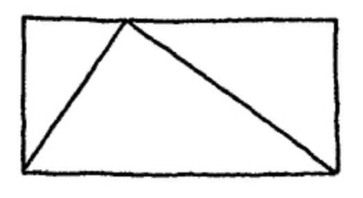{width=50% fig-align="center"}

> Je me demande **quelle proportion du rectangle est occupée par le triangle** — les deux tiers, peut-être ? Il est important de comprendre que je ne parle pas ici de ce dessin représentant un triangle dans un rectangle. Je ne parle pas non plus d’un triangle métallique qui ferait partie de la structure d’un pont. Il n’y a aucun objectif pratique caché. Je ne fais que jouer. **C’est cela, les mathématiques : s’interroger, jouer, se divertir en faisant appel à son imagination.** [...] Nous pouvons donc jouer, imaginer tout ce qui nous plaît, créer des structures et nous poser des questions à leur sujet. Mais comment répondre à ces questions ? Cela n’a rien à voir avec les sciences. Il n’existe aucune expérience — avec des éprouvettes, du matériel ou autre — qui puisse me révéler la vérité sur un pur produit de mon imagination. La seule façon d’accéder à la vérité au sein de notre imaginaire est de faire appel à cet imaginaire lui-même, ce qui demande un travail ardu. Dans le cas du triangle inscrit dans son rectangle, j’aperçois quelque chose de simple et d’élégant : 

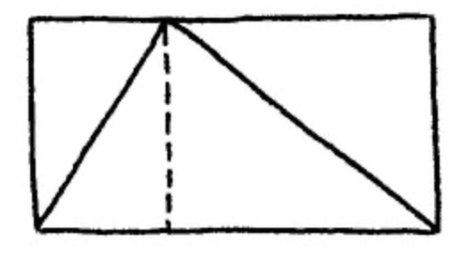{width=50% fig-align="center"}

> Si je divise le rectangle en deux parties, comme ceci, je constate que chaque partie est coupée en deux, en diagonale, par les côtés du triangle. Il y a donc autant d’espace à l’intérieur du triangle qu’à l’extérieur. Cela signifie que **le triangle occupe exactement la moitié du rectangle** ! Voilà à quoi ressemblent les mathématiques, voilà ce qu’elles font ressentir. Ce petit raisonnement illustre l’art du mathématicien : poser des questions simples et élégantes sur nos créations imaginaires, puis élaborer des explications aussi satisfaisantes que belles. Il n’existe rien de comparable à ce domaine des idées pures ; C’est fascinant, c’est amusant, et c’est gratuit !
D’où m’est venue cette idée, au juste ? Comment ai-je su qu’il fallait tracer ce trait ? Comment un peintre sait-il où poser son pinceau ? L’inspiration, l’expérience, les tâtonnements, un heureux hasard… C’est là que réside tout l’art : créer ces magnifiques petits poèmes de la pensée, ces sonnets de pure raison. Il y a, dans cette forme d’art, quelque chose qui possède un pouvoir de transformation merveilleux. **La relation entre le triangle et le rectangle était un mystère, et voilà qu’un simple trait a tout rendu évident**. Je ne voyais rien, et soudain, tout est devenu clair. D’une certaine manière, j’ai réussi à faire naître une beauté profonde et simple à partir de rien, et, ce faisant, à me transformer moi-même. N’est-ce pas là l’essence même de l’art ?

<div style="display: flex; justify-content: center;">
<iframe width="315" height="560"
src="https://www.youtube.com/embed/d8ZZJTBayvU"
title="YouTube video player"
frameborder="0"
allow="accelerometer; autoplay; clipboard-write; encrypted-media; gyroscope; picture-in-picture; web-share"
allowfullscreen></iframe>
</div>

<details>
  <summary>Un exemple d'application</summary>
  
Lyna possède un terrain rectangulaire de 12 m de long et 8 m de large, entouré d'un grillage. Elle qui aime jardiner, elle décide d'installer un potager en fixant une corde sur toute la longueur du terrain côté route (c'est la base du triangle de 12 m), puis elle plante un piquet quelque part sur le côté opposé du terrain, qui sera le sommet du potager d'où elle tend deux cordes entre le sommet et les extrémités de la base. Le potager est donc de forme triangulaire et le reste du terrain est de la pelouse. 

Elle a besoin de la surface exacte du potager pour savoir combien de sacs de terreau commander. Mais comment mesurer l'aire d'un triangle ? Lyna sait calculer l'aire d'un rectangle, mais pas celle d'un triangle penché. Elle tend alors une quatrième corde du piquet jusqu'à la base, perpendiculairement à celle-ci. Cette corde coupe le terrain en deux rectangles et chacun est lui-même coupé en deux par une des cordes du potager. Le potager occupe ainsi la moitié du terrain entier, soit 48 m².

Où Lyna doit-elle planter son piquet pour que le potager ait la plus grande surface possible ? 

Réponse : n'importe où sur le côté opposé ! L'aire ne change pas, car la hauteur reste la même. Et cela surprend souvent les élèves !
  
</details>

> C’est pourquoi il est si déchirant de voir ce que l’on fait subir aux mathématiques à l’école. **Cette aventure riche et fascinante de l’imagination a été réduite à un ensemble stérile de faits à mémoriser et de procédures à appliquer**. Au lieu d’une interrogation simple et naturelle sur les formes — un processus créatif et gratifiant d’invention et de découverte —, on propose aux élèves ceci : $A=\frac{1}{2}b h$ « L’aire d’un triangle est égale à la moitié de sa base multipliée par sa hauteur. » On demande aux élèves de mémoriser cette formule, puis de l’« appliquer » encore et encore dans des « exercices ». L’enthousiasme, la joie, et même la souffrance ou la frustration propres à l’acte créatif ont disparu. Il n’y a même plus de problème. La question est posée et résolue simultanément : il ne reste plus rien à faire pour l’élève. Soyons clairs sur ce que je conteste. Il ne s’agit pas de rejeter les formules ou la mémorisation de faits intéressants. Cela a sa place, tout comme l’apprentissage du vocabulaire : cela permet de créer des œuvres plus riches et plus nuancées. Mais ce qui importe, ce n’est pas le fait qu’un triangle occupe la moitié de son rectangle. Ce qui compte, c’est la belle idée de le diviser par une ligne, et la façon dont cette idée peut en susciter d’autres, ouvrant la voie à des avancées créatives face à d’autres problèmes — ce qu’un simple énoncé de fait ne pourra jamais offrir.
**En supprimant le processus créatif pour ne conserver que ses résultats, on garantit pratiquement qu’aucun véritable engagement envers le sujet ne pourra naître**. C’est comme si l’on me disait que Michel-Ange a réalisé une magnifique sculpture, sans pour autant me laisser la voir. Comment pourrais-je en tirer la moindre inspiration ? (Et, bien sûr, la situation est en réalité bien pire : ici, on occulte l’existence même de l’art de la sculpture, m’empêchant ainsi de l’apprécier).
En se concentrant uniquement sur le « quoi » et en délaissant le « pourquoi », les mathématiques sont réduites à une coquille vide. L’art ne réside pas dans la « vérité » en soi, mais dans l’explication, dans le raisonnement. C’est le raisonnement qui donne à la vérité son contexte et qui définit ce qui est réellement exprimé et signifié. **Les mathématiques sont l’art de l’explication**. Si l’on prive les élèves de la possibilité de s’investir dans cette démarche — poser leurs propres problèmes, formuler leurs propres conjectures et découvertes, se tromper, éprouver cette frustration créatrice, connaître un éclair d’inspiration, et élaborer leurs propres conjectures et découvertes, se tromper, éprouver cette frustration créatrice, connaître un éclair d’inspiration, et enfin assembler leurs propres explications et démonstrations —, alors on les prive des mathématiques elles-mêmes. Non, je ne conteste pas la présence de faits et de formules dans nos cours de mathématiques ; **je dénonce l’absence de mathématiques dans nos cours de mathématiques**.

#### Vous êtes sommé de ne pas vous gausser

> En sortant de l’enfance, nous apprenons à craindre d’avoir l’air bêtes. Nous apprenons à avoir honte de nos erreurs. Nous apprenons à dissimuler, y compris à nos propres yeux, le fait que nous ne comprenons presque rien. Pour progresser en mathématiques, c’est ce réflexe de dissimulation qu’il faut apprendre à désactiver. Et c’est très difficile. À l’âge où nous étions encore libres de poser des questions stupides, y compris de poser cent fois de suite la même question stupide, il n’y avait pas de nuls en maths. Les grands mathématiciens inventent et mettent en œuvre des techniques spéciales pour retrouver cette innocence enfantine. Ils déclarent tous que c’est indispensable. [@bessis2022mathematica]

Nous n'allons pas poser cent fois de suite la même question stupide mais une question impliquant 100 fois l'addition stupide d'entiers consécutifs. Et voir ce qui, de cette application bête et méchante, ressort d'intéressant et de beau. Vous avez très certainement déjà entendu cette célèbre anecdote au sujet du *"prince des mathématiques"*. Voici comment est généralement présentée cette histoire. 

Dans les années 1780, un instituteur donna à ses élèves la tâche fastidieuse de calculer la somme des 100 premiers entiers. Celui-ci pensait ainsi avoir la paix pendant un moment, mais un jeune élève donna presque aussitôt la réponse : $$1 + 2 + 3 + ... + 98 + 99 + 100 = {\color{red}5 050}.$$ Ce petit malin n'était autre que [Carl Friedrich Gauss](https://fr.wikipedia.org/wiki/Carl_Friedrich_Gauss), qui allait devenir l'un des plus grands mathématiciens de tous les temps. Gauss n'était pas un génie du calcul mental. Il avait une intuition plus profonde. L'idée est d'écrire la suite deux fois, une fois dans l'ordre et une fois à l'envers : $$S=1 + 2 + 3 + ... + 98 + 99 + 100$$ $$S = 100 + 99 + 98 + ... + 3 + 2 + 1$$  puis d'additionner les éléments correspondants. Par ce groupement, on obtient 100 paquets de 101, soit un total de $100\times 101=10 100$. Et puisque la suite originale a été dupliquée, il faut diviser le total par 2, ce qui donne le résultat de 5050. 

La formule pour la somme des nombres de 1 à $n$ est $\color{red}\frac{n (n + 1)}{2}$.

<div style="display: flex; justify-content: center;">
<iframe width="315" height="560"
src="https://www.youtube.com/embed/NhCv8SCvHNI"
title="YouTube video player"
frameborder="0"
allow="accelerometer; autoplay; clipboard-write; encrypted-media; gyroscope; picture-in-picture; web-share"
allowfullscreen></iframe>
</div>

La première fois que j'ai pris connaissance de cette anecdote, au cours de mon année de seconde, j'ai été subjugué par l'ingéniosité du petit Gauss, car ayant plus de deux fois son âge à cette époque j'aurais été incapable de trouver une pareille astuce. Cela me paraissait hors de portée à deviner à 15 ans, donc a fortiori à 7 ans ! C'était bien le signe avant-coureur de son génie mathématique. 

> Mais je crains que la répétition constante de ce genre d'histoires ne donne l'impression que les mathématiques sont un jeu réservé à ceux qui, tout au long de leur vie, font preuve d'une intelligence fulgurante. [@hayes_gausss_2006]

Et pourtant nous allons voir que l'inspiration du petit Gauss n'est peut-être en réalité pas moins accessible que ne l'était celle qui découpait mentalement par une ligne le rectangle en deux parties dans l'exemple précédent. L'anecdote est au contraire racontée de manière à nous impressionner. Cette histoire trouve sa source dans un essai commémoratif publié en 1856 par [@sartotrius_von_waltershausen_gauss_1856], collègue et ami de Gauss, un an après sa mort :

<details>
  <summary>Extrait original en allemand</summary>
Gauss besuchte zuerst 1784, nachdem er sein siebentes Lebensjahr zurückgelegt, die Catharinen-Volksschule, in welcher der erste Elementar-Unterricht ertheilt wurde und die damals unter der Leitung eines gewissen Büttner gestanden hat. Es war eine dumpfe, niedrige Schulstube mit einem unebenen ausgelaufenen Fussboden, von der man nach der einen Seite gegen die beiden schlanken gothi-schen Thürme der Catharinen-Kirche, nach der andern gegen Ställe und armselige Hintergebäude hinaus blickte. Hier ging Büttner zwischen etwa hundert Schülern auf und ab, mit der Karwatsche in der Hand, welche damals als ultima ratio seiner Erziehungs-methode von Gross und von Klein anerkannt wurde und von der er nach Laune und Bedürfniss einen schonungslosen Gebrauch zu machen sich berechtigt fühlte. In dieser Schule, die noch sehr den Zuschnitt des Mittelalters gehabt zu haben scheint, blieb der junge Gauss zwei Jahre lang ohne durch etwas Ausserordentliches aufzu-fallen. Erst nach jener Zeit brachte es der Gang des Unterrichts mit sich, dass auch er in die Rechenklasse eintrat, in welcher die Meisten bis zu ihrer Confirmation, bis etwa zu ihrem 15t Jahre blieben. Es ereignete sich hier ein Umstand, den wir nicht ganz unbeachtet lassen dürfen, da er auf Gauss' späteres Leben von einigem Einfluss gewesen ist und den er uns in seinem hohen Alter mit grosser Freude und Lebhaftigkeit öfter erzählt hat. Das Herkommen brachte es nämlich mit sich, dass der Schüler, welcher zuerst sein Rechenexempel beendigt hatte, die Tafel in die Mitte eines grossen Tisches legte; über diese legte der zweite seine Tafel u. s. w. Der junge Gauss war kaum in die Rechenclasse eingetreten, als Büttner die Summation einer arithmetischen Reihe aufgab. Die Aufgabe war indess kaum ausgesprochen als Gauss die Tafel mit den im niedern Braunschweiger Dialekt gesprochenen Worten auf den Tisch wirft :
»Ligget se'« (Da liegt sie.) Während die andern Schüler emsig weiter rechnen, multipliciren und addiren, geht Büttner sich seiner Würde bewusst auf und ab, indem er nur von Zeit zu Zeit einen mitleidigen und sarcastischen Blick auf den kleinsten der Schüler wirft, der längst seine Aufgabe beendigt hatte. Dieser sass dagegen ruhig. schon eben so sehr von dem festen unerschütterlichen Bewusstsein durchdrungen, welches ihn bis zum Ende seiner Tage bei jeder vollendeten Arbeit erfüllte, dass seine Aufgabe richtig gelöst sei, und dass das Resultat kein anderes sein könne. Am Ende der Stunde wurden darauf die Rechentafeln umgekehrt; die von Gauss mit einer einzigen Zahl lag oben und als Büttner das Exempel prüfte, wurde das seinige zum Staunen aller Anwesenden als richtig befunden, während viele der übrigen falsch waren und alsbald mit der Karwatsche rectificirt wurden. Büttner glaubte nun ein gutes Werk zu thun eigens aus Hamburg ein neues Rechenbuch zu verschreiben, um damit den jungen bahnbrechenden Geist nach Kräften zu unter-stützen, er soll aber einsichtsvoll genug gewesen sein bald zu erklä-ren, dass Gauss in seiner Schule nichts mehr lernen könne.

</details>

<details>
  <summary>Traduction en français</summary>
  En 1784, après avoir franchi le cap de sa septième année, Gauss fréquenta pour la première fois l'école primaire Sainte-Catherine, où était dispensé l'enseignement élémentaire de base et qui était alors dirigée par un certain Büttner. Il s'agissait d'une salle de classe sombre et basse, au sol inégal et usé ; d'un côté, la vue donnait sur les deux fines tours gothiques de l'église Sainte-Catherine, tandis que de l'autre, elle s'ouvrait sur des écuries et des bâtiments annexes misérables. C'est là que Büttner arpentait la salle, au milieu d'une centaine d'élèves, un fouet à la main — instrument reconnu, à l'époque, par tous, petits et grands, comme l'ultime recours de sa méthode éducative, et dont il s'estimait en droit de faire un usage impitoyable, au gré de ses humeurs et de ses besoins. Dans cette école, qui semble avoir conservé une structure très médiévale, le jeune Gauss passa deux années sans se distinguer par quoi que ce soit d'extraordinaire. Ce n'est qu'au terme de cette période que, suivant le cours normal de la scolarité, il intégra la classe de calcul, où la plupart des élèves restaient jusqu'à leur confirmation, soit vers l'âge de quinze ans. Il s'y produisit un événement que nous ne saurions passer sous silence, car il eut une certaine influence sur la vie ultérieure de Gauss ; un épisode qu'il a d'ailleurs souvent raconté, dans un âge très avancé, avec une grande joie et beaucoup de vivacité. La coutume voulait en effet que l'élève qui terminait son exercice de calcul en premier déposât son ardoise au centre d'une grande table ; ...sur lesquelles le second posa sa ardoise, et ainsi de suite. Le jeune Gauss venait à peine d'entrer dans la classe de calcul que Büttner donna à faire la somme d'une progression arithmétique. L'énoncé était à peine terminé que Gauss jeta son ardoise sur la table en prononçant, dans le dialecte populaire de Brunswick, ces mots :
« La voilà. » Tandis que les autres élèves continuaient avec zèle à calculer, multipliant et additionnant, Büttner, conscient de sa dignité, faisait les cent pas, ne jetant que de temps à autre un regard empreint de compassion et sarcastique sur le plus petit des élèves, qui avait terminé son exercice depuis longtemps. Celui-ci, en revanche, restait assis, calme ; il était déjà profondément imprégné de cette conviction inébranlable — qui l'accompagnera jusqu'à la fin de ses jours, à chaque fois qu'il achèvera un travail — que son exercice était correctement résolu et que le résultat ne pouvait être autre. À la fin de la leçon, on retourna les ardoises ; celle de Gauss, qui ne portait qu'un seul nombre, se retrouva sur le dessus. Lorsque Büttner vérifia le calcul, il s'avéra — à la stupéfaction de tous les présents — qu'il était exact, alors que beaucoup d'autres étaient faux et furent aussitôt « rectifiés » à coups de fouet. Croyant bien faire, Büttner fit venir tout exprès de Hambourg un nouveau manuel d'arithmétique afin de soutenir, autant qu'il le pouvait, ce jeune esprit pionnier ; toutefois, faisant preuve de discernement, il déclara bientôt que Gauss n'avait plus rien à apprendre dans son école.

</details>

On remarque que plusieurs éléments du récit usuel sont absents de cette source d'origine. En effet il n'est fait mention ni des nombres de 1 à 100, ni d'aucune autre suite arithmétique particulière. De même, il ne donne aucune indication sur l'astuce ou la technique inventée par Gauss pour résoudre le problème, ainsi l'idée de combiner les nombres deux à deux n'est pas abordée, pas plus que la formule permettant de calculer la somme d'une série. Ces détails (et bien d’autres) ont été complétés par des auteurs ultérieurs. Pour paraphraser Luc Ferry, on peut affirmer que 99% des versions de cette anecdote qu'on trouve sur internet ne sont pas conformes à la version originale. Pour une analyse historique des différentes versions de cette histoire voir [@hayes_mathematical_2007].

Est-ce que Gauss s'y est réellement pris comme cela pour calculer cette somme ? On est maintenant en droit d'en douter. N'y a-t-il pas une manière plus naturelle d'aborder le problème et de mieux comprendre par quel bout l'esprit du petit Gauss aurait attrapé le problème ?

> La découverte est le privilège de l’enfant. C’est du petit enfant que je veux parler, l’enfant qui n’a pas peur encore de se tromper, d’avoir l’air idiot, de ne pas faire sérieux, de ne pas faire comme tout le monde. Il n’a pas peur non plus que les choses qu’il regarde aient le mauvais goût d’être différentes de ce qu’il attend d’elles, de ce qu’elles devraient être. [...]  Quand je suis curieux d’une chose, mathématique ou autre, je l’interroge. Je l’interroge, sans me soucier si ma question est peut-être stupide ou si elle va paraître telle, sans qu’elle soit à tout prix mûrement pesée. [@grothendieck2021recoltes]

[@bessis2022mathematica] questionne :

> Mais interroger les choses, en quoi ça consiste exactement ? Si je veux interroger les choses, comment dois-je m’y prendre ? À y regarder de près, l’expression est mystérieuse, presque autant que l’expression miroir utilisée également par Grothendieck : être à l’écoute de la voix des choses. Et tant qu’on y est : qu’est-ce qu’une « chose mathématique » ? À quel endroit peut-on rencontrer ces choses, et comment faire pour entrer en communication avec elles ? [...] Les mathématiciens, eux, aiment appeler cela des objets mathématiques, parce que imaginer ces choses comme des objets concrets que l’on pourrait toucher facilite la compréhension. « Interroger les choses », « écouter la voix des choses », ça veut dire essayer de les imaginer, examiner l’image mentale qu’on s’en fait, essayer de la solidifier, de la préciser, d’en dévoiler davantage de détails, comme quand on essaie de se souvenir d’un rêve.

Quelle *image mentale* a bien pu se forger le petit Gauss pour résoudre instantanément ce problème ? 
Pour y répondre nous allons nous intéresser à une histoire similaire d'un autre petit prodige, [William Thurston](https://fr.wikipedia.org/wiki/William_Thurston), surnommé Bill, plus jeune encore que Gauss quand il trouva la solution [@gabai_william_2015] :

> Pour faire cesser les chamailleries entre ses enfants, Paul leur posait des questions de mathématiques. Alors qu’ils étaient en voiture, Paul demanda à Bill (qui avait alors cinq ans) : « Combien font 1 + 2 + · · · + 100 ? » Bill répondit : « 5 000. » Paul dit : « Presque. » Bill ajouta : « Oh, j’ai rempli une case pour le 1, deux cases pour le 2, et ainsi de suite jusqu’à 100 ; cela représente donc la moitié de 100 × 100, soit 10 000. Mais j’avais oublié que les cases du milieu sont coupées en deux… ça fait donc 5 050 ! »

Son erreur est informative. Contrairement à Gauss pour lequel nous ne disposions d'aucun indice sur ce qui avait traversé son esprit pour fournir la bonne réponse, ici Bill nous livre des clefs de compréhension quant à sa manière d'*imaginer concrètement* le problème dans sa tête. De quelles cases parle-t-il au juste ? Lorsque l'on lit la consigne on n'y voit seulement des nombres ! Oui mais ça nous dit Grothendieck, c'est parce que nous n'avons pas suffisamment *"interrogé les choses"*, et en l'occurrence nous abordons les choses sous un rapoort exclusivement symbolique. [@bessis2022mathematica] nous invite à oser regarder les choses sous un autre angle, plus sensible :

> Ce rapport intime avec les nombres, vous l’avez perdu. En sortant de la petite enfance, vous êtes tombé dans ce que j’appelle le piège du langage, et c’est ce qui vous empêche aujourd’hui de «voir» la somme des entiers de 1 à 100 de la même manière que Gauss et Thurston. **Le piège du langage, c’est la croyance que nommer les choses suffit à les faire exister et nous dispense de l’effort de véritablement les imaginer.** [...] On nous raconte que c’est avec les mots que nous pensons et que ça ne sert à rien de vouloir dépasser les mots. Ce raccourci est très problématique, à la limite du mensonge. Nommer les choses permet certes de les évoquer mais pas de les rendre présentes à l’esprit avec l’intensité et la clarté qui permettent de penser et de créer. [...] Au lieu de vous laisser bercer par les mots, forcez-vous à penser que la somme est physiquement présente devant vous. **Forcez-vous à imaginer les entiers de 1 à 100 en chair et en os**, incarnés dans le monde réel, sagement alignés devant vous. Si vous arrivez à les voir et si vous prenez le temps de bien observer la scène, vous trouverez un moyen de calculer leur somme.

À 22'28 David Bessis en fait faire l'expérience à Adèle Van Reeth dans son émission radio[^34] "les Chemins de la Philosophie" :

[^34]: "Et la première chose qui m’a frappé, c’est que finalement, la radio, comme moyen de communication, est un moyen qui est beaucoup plus intéressant, au niveau de la concentration de l’auditeur, au niveau de l’écoute justement, qu’un autre moyen de communication comme la télévision. Pourquoi ? Parce que l’imagination, dans le terme imagination, il y a les images, et il est extrêmement important que l’auditeur n’ait pas un rôle purement passif, ne reçoive pas l’image telle qu’on veut la lui imposer, mais soit capable lui-même de la créer, et de la créer à partir du discours, à partir du langage." [@connesLimagination]

<iframe src="https://embed.radiofrance.fr/franceculture/diffusion/7facdcb3-83b8-43a8-a381-03d9b9584945" width="100%" height="144" frameborder="0" allowfullscreen></iframe>

Simplifions déjà le problème en considérant la somme des 10 premiers entiers consécutifs (dont on peut rapidement se convaincre de tête qu'elle vaut 55). Mais tâchons comme il nous y invite d'essayer de "voir" cette somme, où l'unité est matérialisée par un cube. Alignons comme le ferait un enfant des piles de cubes de hauteurs respectives 1, 2, 3, etc jusqu'à 10. L'image mentale qui vient à l'esprit ressemble maintenant à ceci :

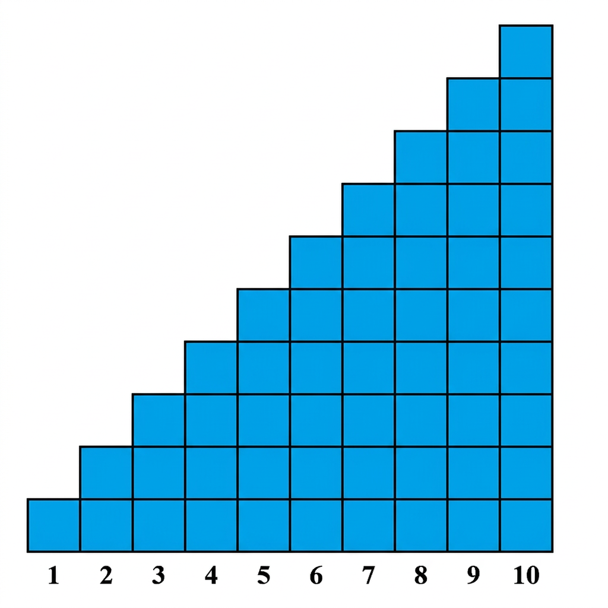{width=70% fig-align="center"}

Ce n'est plus seulement une égalité : $$ 1+2+3+4+5+6+7+8+9+10={\color{red}55}$$

Elle prend corps dans mon esprit de manière structurée à travers cette construction légos en escalier, et la question revient à compter le nombre de cubes qui la compose. 

**Première stratégie**. Si vous demandez à un enfant quelle forme géométrique ça lui évoque, il y a de fortes chances qu'il vous réponde *"un triangle"*, un peu dentelé certes mais un triangle tout de même, dont la base fait 10 de longueur et la hauteur 10 également. Comme chaque cube vaut une unité, la quantité de cubes à l'intérieur de ce triangle correspond à son aire, qui se calcule en multipliant la base par la hauteur, divisé par 2[^33], soit $\frac{10\times 10}{2}=50$. Le compte n'est pas bon, il en manque 5 ! Nous avons commis la même erreur que Bill (*"Mais j’avais oublié que les cases du milieu sont coupées en deux"*) en nous cassant les dents (en rouge saignant) :

[^33]: Et oui on réutilise le résultat de l'exemple précédent, c'est aussi cela qui est chouette en maths, on élabore de nouveaux résultats à partir d'autres déjà démontrés. Les mathématiques elles-mêmes sont un grand jeu de légos.

{width=70% fig-align="center"}

En ajoutant 10 fois un demi-cube on obtient les 5 cubes restants. Le raisonnement est identique pour 100 cubes, et valable quelque soit le nombre $n$ de cubes. L'escalier est plus grand mais est toujours composé d'un triangle de base $n$ et de hauteur $n$, donc d'aire $\frac{n^2}{2}$ à laquelle il faut ajouter $n$ demi-cubes, d'où un total de $\frac{n^2}{2}+\frac{n}{2}=\frac{n(n+1)}{2}$.

> « Les mathématiciens ont tendance à considérer qu’une démonstration est terminée dès lors qu’ils sentent que la bonne image s’est formée dans leur tête, comme les joueurs d’échecs arrêtent les parties sans aller jusqu’au mat, parce qu’ils reconnaissent qu’une position est gagnante. [@bessis2022mathematica]

<details>
  <summary>Démonstration par récurrence</summary>

Soit $\mathcal{P}(n)$ la propriété : 
\og $\displaystyle \sum_{k=1}^{n} k = \frac{n(n+1)}{2}$ \fg.

**Initialisation**. Pour $n = 1$ :
$$
  \sum_{k=1}^{1} k = 1
  \qquad\text{et}\qquad
  \frac{1 \times (1+1)}{2} = \frac{2}{2} = 1.
$$
Donc $\mathcal{P}(1)$ est vraie.

**Hérédité**. Soit $n \in \mathbb{N}^*$ fixé. 
Supposons que $\mathcal{P}(n)$ soit vraie (hypothèse de récurrence), 
c'est-à-dire $\displaystyle \sum_{k=1}^{n} k = \frac{n(n+1)}{2}$. 
Montrons que $\mathcal{P}(n+1)$ est vraie. 

On a :
\begin{align*}
  \sum_{k=1}^{n+1} k 
  &= \sum_{k=1}^{n} k + (n+1) \\
  &= \frac{n(n+1)}{2} + (n+1) 
     && \text{(hypothèse de récurrence)} \\
  &= \frac{n(n+1) + 2(n+1)}{2} \\
  &= \frac{(n+1)(n+2)}{2} \\
  &= \frac{(n+1)\bigl((n+1)+1\bigr)}{2}.
\end{align*}
Ainsi $\mathcal{P}(n+1)$ est vraie. 
On en conclut que $\mathcal{P}(n)$ est vraie pour tout $n \in \mathbb{N}^*$.

Le raisonnement par récurrence lui-même peut donner lieu à une image mentale, via l'analogie d'une suite de dominos. Si la propriété est vraie au rang $n_0$ (le premier domino de numéro 0 tombe) et si sa véracité au rang $n$ implique celle au rang $n + 1$ (la chute du domino numéro $n$ fait tomber le domino numéro $n + 1$) alors la propriété est vraie pour tout entier (tous les dominos tombent en cascade).


</details>

<details>
  <summary>Un exemple d'application</summary>
  
  Le club de tennis de table de la MJC organise un tournoi de fin d'année impliquant 11 joueurs. Le format est un [tournoi toutes rondes](https://fr.wikipedia.org/wiki/Tournoi_toutes_rondes) où chaque joueur affronte chacun des autres une seule fois. Léo, le responsable de la MJC, ne dispose que de 2 tables et chaque match dure environ 20 minutes. Il se demande combien de matchs auront lieu et combien de temps faut-il prévoir ?
  
  Léo compte les matchs :
  
  - le joueur 1 affronte les 10 autres : 10 matchs 
- le joueur 2 a déjà joué contre le joueur 1, il lui reste 9 adversaires : 9 matchs
- le joueur 3 : 8 matchs
- ...
- le joueur 9 : 2 match
- le joueur 10 : 1 match (contre le joueur 11).
  
Le nombre de match au total est donc de  $$ 1+2+3+4+5+6+7+8+9+10={\color{red}55}$$
  
  (C'est aussi le nombre de poignées de main dans l'ordre où elles se font en faisant arriver les joueurs un par un dans la salle)
  
  À raison de 20 minutes par match cela fait $55\times 20=1100$ minutes de jeu, soit plus de 18 heures. Réparties sur 2 tables cela fait entre 9 et 10 heures d'intervalle. Léo réserve donc la salle de 8h à 18h, puis dessine un tableau 11 × 11 avec les joueurs en lignes et en colonnes. Chaque case représente un match possible : 
  
- la diagonale (un joueur contre lui-même) est à exclure : 11 cases ;
- chaque match apparaît deux fois (A contre B et B contre A) ;

Il reste donc (121 − 11)/2 = 55 matchs comme calculé. En ne gardant que les cases au-dessus de la diagonale, on retrouve l'escalier de 1, 2, 3, ... , 10 cases correspondant au triangle de la somme, avec l'idée du rectangle coupé en deux par sa diagonale.

Léo est appelé par son $n+1$ qui l'informe qu'il ne dispose que 4 heures de salle. Combien de joueurs au maximum peuvent jouer sur 2 tables avec des matchs de 20 minutes ? Au maximum peuvent avoir lieu 24 matchs possibles en 4 heures. Si $n$ est le nombre de joueurs, on a vu que le nombre total de match est de $\frac{n(n-1)}{2}$, ce qui impose donc : $$\frac{n(n-1)}{2} \leq 24 \Rightarrow n\leq 7$$ Pas plus de 7 joueurs peuvent s'affronter, et donc 21 matchs auront lieu.
</details>

**Seconde stratégie**. Une autre manière très intuitive de résoudre le problème consiste à dupliquer le triangle bleu en un triangle orange et à les emboiter comme des légos pour former un rectangle de largeur $n$ et de hauteur $n+1$, contenant donc $n(n+1)$ cubes (qui est un nombre toujours pair). On en déduit que le triangle bleu contient $\color{red}\frac{n (n + 1)}{2}$ cubes.

{width=70% fig-align="center"}

Cette image mentale est en réalité celle associée à "l'astuce" des sommes écrites dans un sens et dans l'autre puis additionnées :

$$\color{blue} S=1 + 2 + 3 + ... + 98 + 99 + 100$$ 
$$\color{orange} S = 100 + 99 + 98 + ... + 3 + 2 + 1$$

<div style="display: flex; justify-content: center;">
<iframe width="315" height="560"
src="https://www.youtube.com/embed/-aJDFdUJLR8"
title="YouTube video player"
frameborder="0"
allow="accelerometer; autoplay; clipboard-write; encrypted-media; gyroscope; picture-in-picture; web-share"
allowfullscreen></iframe>
</div>

On comprend mieux ce qui a pu se passer dans la tête de Gauss ou de Thurston. On peut malgré tout continuer à trouver remarquable qu'un enfant de 5 ou 7 ans trouve de lui-même comment aborder ce problème géométriquement, mais on conviendra qu'avec la bonne représentation mentale la résolution devient intuitive voire évidente, et cela démystifie l'origine de "l'astuce" sortie du chapeau d'un génie.

> Mon professeur de terminale était un excellent enseignant, que j’appréciais et qui m’a énormément appris. Mais en nous parlant d’« astuce », il nous a ce jour-là transmis le mauvais message.Il n’y a jamais d’astuce. Il n’y en a jamais eu et il n’y en aura jamais. Croire en l’existence d’astuces est aussi toxique que de croire en l’existence de vérités par nature contre-intuitives. [@bessis2022mathematica]

En d'autres termes, même sous les formules les plus absconces que vous pourriez rencontrer, il y a des idées intuitives qui ont guidé les  mathématicien.ne.s. Ces images mentales, formées dans leur tête, ne nous sont pas accessibles directement. Toute la difficulté est, à partir des formules que nous lisons, de nous forger nos propres représentations, jusqu'à ce que cela nous paraisse être une "évidence".

> Pour s’en rendre compte [...] Combien de temps mettez-vous à visualiser ce que vous faites quand vous faites vos lacets ? Deux secondes ? Trois ? Maintenant prenez un papier et un crayon et essayez de décrire exactement en quoi consiste le mouvement, d’une façon telle qu’un débutant complet pourra suivre vos instructions et arriver au même résultat. La version la plus difficile de l’exercice consiste à n’utiliser que des mots. Mais la version facile, en s’autorisant les dessins, est déjà très difficile. Prendre la mesure de cette difficulté, c’est comprendre quelque chose de fondamental et de profondément réconfortant : un texte mathématique peut avoir l’air horriblement compliqué et pourtant n’exprimer que des idées très simples. [@bessis2022mathematica]

#### L'énigme du moine bouddhiste 

> Un moine bouddhiste entreprend de gravir une haute montagne sacrée. Pour cela il part tôt le matin à 6h, en pleine forme, et arrive au sommet à 12h. Il médite une nuit dans le refuge de la cime et repart le lendemain à 6h. Empruntant le même chemin, mais fatigué de son périple, il arrive en bas à 12h également. Sans faire aucune hypothèse sur les arrêts qu’il a pu faire, ou sur la vitesse à laquelle il a pu marcher, montrez qu’il y a un endroit du chemin où le moine s’est trouvé à la même heure le jour où il monte et le jour où il descend.

Essayez de réfléchir à ce problème sans vous précipitez vers la solution ci-dessous, car l'idée derrière est à la portée de tout le monde (si, si !).

<details>
  <summary>Solution formelle dans le langage de la rigueur mathématique</summary>

Soit l'intervalle de temps commun de la journée entre le départ et l'arrivée la plus tardive. Soit le temps $t$ sur un intervalle allant de 0 (l'heure du départ, ici 6h) à $T$ (l'heure maximale, ici 12h). Soit l'altitude du bas de la montagne fixée sans perte de généralité à zéro, et l'altitude du sommet notée $H$. Définissons deux fonctions au cours du temps : $t\mapsto f(t)$ enregistrant l'altitude du moine le jour 1 (ascension) à l'instant $t$. Par hypothèse on a que $f(0) = 0$ et $f(T) = H$. Et $t\mapsto g(t)$ enregistrant l'altitude du moine le jour 2 (descente) à l'instant $t$, avec $g(0) = H$ et $g(T) = 0$. Ces deux fonctions $f$ et $g$ sont continues (le moine ne se téléporte pas).
On définit la fonction d'écart $h$ par : $h(t)=f(t)-g(t)$. 

- À $t = 0$ on a $h(0) = f(0) - g(0) = 0 - H = -H<0$
- À $t = T$ on a $h(T) = f(T) - g(T) = H - 0 = H>0$. 

La fonction $h$ est elle-même continue et change de signe sur l'intervalle $[0,T]$. D'après le [Théorème des Valeurs Intermédiaires](https://fr.wikipedia.org/wiki/Th%C3%A9or%C3%A8me_des_valeurs_interm%C3%A9diaires), il existe au moins un instant $c$ dans cet intervalle tel que $h(c) = 0$. Ce qui implique que $f(c) = g(c)$. CQFD.

</details>

<details>
  <summary>Solution intuitive "avec les mains"</summary>
  
  Imaginez les deux journées en même temps. Visualisez deux moines jumeaux qui partent à 6h du matin : l'un du bas, l'un du haut. Ils marchent l'un vers l'autre sur le même sentier. Peu importent leurs vitesses, ils vont obligatoirement se croiser à un moment donné. Ce point de croisement est la réponse.
  
</details>

La solution mathématique ne fait que traduire rigoureusement cette intuition première, montrant une fois de plus qu'*un texte mathématique peut avoir l’air horriblement compliqué et pourtant n’exprimer que des idées très simples*. Le [Théorème des Valeurs Intermédiaires](https://fr.wikipedia.org/wiki/Th%C3%A9or%C3%A8me_des_valeurs_interm%C3%A9diaires) lui-même exprime une idée très simple, une fonction continue sur un intervalle se traduit graphiquement par une courbe que l'on peut tracer sans lever le crayon de la feuille. Si on doit relier le point de départ en bas à gauche au point d'arrivée en haut à droite sans lever votre crayon, on est donc obligé de couper n'importe quelle ligne horizontale tracée entre les deux. C'est très visuel. On est donc assuré que toutes les valeurs intermédiaires seront atteintes au moins une fois. Par exemple si un enfant mesure 1m40 à 10 ans puis 1m70 à 15 ans, on sait qu'entre 10 et 15 ans il sera passé par toutes les tailles entre 1m40 et 1m70 (la ligne horizontale étant la réglette mesurant la hauteur).


### Du rôle de l'imagination en mathématiques

Vous venez de résoudre ces problèmes "avec les mains", soit en manipulant visuellement des triangles ou des cubes; soit en déplaçant mentalement des personnages fictifs le long d'un chemin imaginaire, mobilisant la mémoire kinesthésique (sensations de mouvement). C'est par exemple de cette manière que, pour concevoir la relativité restreinte, [Albert Einstein](https://fr.wikipedia.org/wiki/Albert_Einstein) s'est imaginé chevaucher un [rayon de lumière](https://fr.wikipedia.org/wiki/Vitesse_limite#Paradoxe), ou pour concevoir la relativité générale a s'imaginer en "chute libre" dans un [ascenseur](https://fr.wikipedia.org/wiki/Ascenseur_d'Einstein). Ces [expériences de pensée](https://fr.wikipedia.org/wiki/Exp%C3%A9rience_de_pens%C3%A9e) dans lesquelles les scientifiques mettent en scène leur propre corps permettent d'imaginer une situation théorique et en explorer les conséquences logiques. Les entités manipulées ne sont pas toujours des "personnages fictifs" mais le plus souvent des *objets mathématiques*, dont l'imagination de saisit comme d'un jouet pour mieux les cerner.

> « Voir » un raisonnement, est-ce le comprendre ?  
> Les mathématiciens se méfient des raisonnements. Ce qui les intéresse, ce sont les « objets » mathématiques et les « situations » qui les mettent en scène. Ils s’exercent à « voir » ces objets et à « comprendre » ces situations. **Tant qu’ils ne voient pas, ils ont l’impression de ne pas comprendre**. Et le raisonnement sert à produire des énoncés valides à propos des choses qu’on n’arrive pas encore à voir. Les mathématiciens s’en servent comme d’un fil d’Ariane, une canne d’aveugle. Mais ce n’est qu’une étape dans le processus de compréhension.  
> Quel rôle la démonstration joue-t-elle alors ? Ne sert-elle qu’à vérifier ou à valider après coup ce qui a été compris grâce à l’imagination ?  
> Le travail mathématique est **un constant va-et-vient entre imagination et formalisation**. Les démonstrations servent à vérifier ce qu’on a déjà compris, mais pas seulement : c’est en essayant d’écrire des démonstrations rigoureuses que les mathématiciens identifient les zones d’ombre de leur intuition et font progresser leur clarté mentale. [@bessis_en_2022]

Ici "Voir" est employé à dessein avec des guillemets car, on l'a vu avec nos exemples, l'imagination convoque différents canaux sensoriels (visuel, temporel, algébrique ou kinesthésique). Le point commun à toutes ces situations, c'est que pour parvenir à se forger des images mentales (et les consolider durablement dans sa mémoire), il faut s'exercer à résoudre par soi-même ces problèmes, comme le dit [@connesLimagination] :

> On ne peut y arriver véritablement que lorsqu’on sèche sur un problème. Donc il y a une vertu essentielle pour un mathématicien – par exemple s’il est en train de lire un bouquin – de prendre un théorème qui est dans ce livre et surtout, de ne pas regarder la démonstration, mais d’essayer de le démontrer lui-même. Pourquoi ? Parce que lorsqu’il fait cela, en fait, il va créer dans son cerveau, je dis une image mentale mais en fait, c’est pas toujours quelque chose de géométrique, c’est pas toujours quelque chose qui peut se décrire comme une image, mais, c’est un certain assemblage dans son cerveau qui ensuite va faire que, **lorsqu’il sera confronté à une page de formules, eh bien cette page de formules va lui parler. Et dans cette page de formules, il va voir des acteurs**. Il va voir des choses qui vont “résonner” entre elles, etc. 

Ces acteurs (les objets mathématiques), se coordonnent pour former des [théorèmes](https://fr.wiktionary.org/wiki/th%C3%A9or%C3%A8me), dont l'étymologie se rapporte au registre de la "vision" et du "spectacle", de même racine que le mot "théâtre"[^40]. Il y a donc comme en musique une créativité, un art vivant dans le fait de composer des théorèmes comme d'autres composent de la musique ou de la poésie. Faire résonner les choses entre elles, c'est éprouver le sens de l'harmonie, et cela se travaille par la pratique et la familiarisation avec un langage symbolique dédié, analogue en mathématiques et en [@france_musique_et_2023].

[^40]: "Nous sommes des comédiens, on aime séduire. Le principe de la pédagogie que j'ai toujours appliquée, c'est de répéter plusieurs fois les choses de manière différente de façon à trouver tous les moyens de séduire les gens qui sont en face de moi et de sentir qu'ils ont compris. Je n'ai jamais dénaturé au point que je les trompe. Je cherche à les intéresser exactement comme le comédien devant son public qui le soutient. Un comédien ou un tragédien qui ne joue devant personne ce n'est pas commode." – Laurent Schwartz [@bouleau_dialogues_1994].

> La comparaison que j’ai toujours envie de prendre, c’est que supposez par exemple que vous soyez dans le métro, et que vous voyiez un passager du métro ou une passagère du métro qui est en train de lire une partition de musique. Quand on n’est pas musicien, cette partition de musique ne nous dit rien, rien du tout. Quand on n’est pas mathématicien et qu’on voit un passager en train de lire des formules de maths, on a l’impression qu’on est complètement exclu et qu’on n’a aucune chance de comprendre. Et en fait, la raison, c’est justement cette fabrication d’images mentales et cette fabrication d’images mentales, elle implique de manière absolument essentielle cette capacité d’imaginer. [@connesLimagination]


Lorsqu'un musicien lit une partition, il est en mesure (si je puis dire) de ressentir le rythme, de fredonner (même intérieurement) la mélodie, d'estimer la difficulté technique, etc. De même lorsqu'un.e  mathématicien.ne. lit des équations qui lui sont familières, il en saisit le sens à travers des images mentales qu'il combine et qui lui parlent[^35]. Ce parallèle fait écho à ce que Luc Ferry déclarait :

[^35]: "Sauf que les musiciens disposent d’un énorme avantage pratique : il leur suffit de jouer leur musique pour que tout le monde comprenne immédiatement de quoi il s’agit, sans avoir besoin de déchiffrer la partition. Le gros problème des  mathématicien.ne.s, c’est qu’ils n’ont pas cette option. Dans leur tête, les idées sont lumineuses, simples et puissantes. Sur le papier, elles deviennent tristes et rabougries. Leur malédiction, c’est de ne pouvoir jouer les mathématiques que dans leur tête." [@bessis2022mathematica] Selon le mot d'Édouard Herriot : "La musique est une mathématique sonore, la mathématique une musique silencieuse".

> Les vrais matheux sont des gens qui ne comprennent pas qu'on ne comprenne pas. Ça les énerve (...) Quand ils voient une équation, c'est comme un musicien qui lit une partition, ça lui chante dans la tête. [@FerryLepoint]

Mais là où il a tort, c'est que d'une part il n'y a pas d'un côté les "vrais matheux" qui ont "la bosse des maths" et comprennent; et les autres qui définitivement ne comprennent pas (cela se travaille, comme l'oreille musicale et la pratique d'un instrument). Et d'autre part les "vrais matheux" comprennent mieux que personne ces situations désagréables d'incompréhension [@bessis2022mathematica] :

> Vous êtes supposé être un jeune chercheur brillant. Vous venez d’obtenir un poste prestigieux et vous êtes orateur invité à une conférence internationale. Au dîner, vous vous retrouvez assis à côté d’une jeune doctorante qui vous explique son sujet de thèse. Vous ne comprenez pas ce qu’elle vous raconte. Vous lui posez une question. Vous ne comprenez pas sa réponse. Comme vous êtes tenace, vous osez lui dire franchement que vous n’avez pas compris. Elle vous répond que ce n’est pas grave, qu’elle va vous réexpliquer de manière plus simple et que vous allez tout de suite comprendre. Mais vous ne comprenez toujours rien à ce qu’elle vous raconte. Vous savez qu’il faudrait tout reprendre depuis le début, depuis ces bases que vous êtes censé connaître depuis des années et qui vous échappent. Vous arrivez aux limites de ce qui est socialement acceptable. Votre crédibilité est en jeu. Si vous avouez à quel point vous êtes largué, vous passerez pour un idiot. La norme sociale, c’est de ne pas insister. Cette situation est l’archétype de toutes les conversations mathématiques ratées, celles qui ne nous apprennent rien et renforcent notre certitude d’être le pire des nuls. **Quel que soit votre niveau en maths, vous savez forcément de quoi je parle**. L’immense majorité des conversations mathématiques se terminent sur cette impression de malaise. Elles sont ratées pour cette raison simple : vous n’osez pas dire à quel point vous êtes largué, vous en avez honte, vous vous trouvez ridicule. Cette idée vous parasite l’esprit et vous n’écoutez même plus. **Vous ne pensez plus qu’à votre propre nullité. C’est ce qui vous empêche d’imaginer et c’est ce qui vous empêche d’apprendre**. Vous ressortez de ces conversations avec un sentiment d’humiliation.

Même à [@grothendieck2021recoltes] ça lui arrivait :

> Cette incapacité me distingue d’ailleurs de la plupart de mes collègues mathématiciens, et (comme j’ai eu l’occasion de l’évoquer) c’est elle qui m’a souvent rendu difficile de m’insérer dans le travail collectif au sein du groupe Bourbaki, pendant les lectures en commun notamment, où il m’arrivait souvent d’être largué à longueur d’heures alors que tous les autres suivaient à l’aise.

Lire cela sous la plûme d'un des plus brillants mathématiciens du XXe siècle est décomplexant ! Donc je peux vous faire un aveu. Dans mon laboratoire, je suis l'un des responsables de l'animation du séminaire de mon département. J'y invite des chercheurs à exposer leurs travaux dans des domaines des mathématiques aussi variés que la théorie des probabilité, le calcul stochastique et processus aléatoires, les statistiques des extrêmes, l'inférence causale, la biostatistique, le *machine learning*, etc. Chacun de ces sous-domaines se ramifiant encore lorsque l'on zoome sur les thématiques développées. Autant vous dire qu'il m'arrive fréquemment d'être largué durant certains exposés, du fait d'une thématique de recherche trop éloignée des miennes.

> Ce malentendu peut déclencher un violent sentiment d’imposture. Je connais des gens que ça a définitivement bloqués. Les mathématiques ne sont pas un savoir mais une pratique. **Un mathématicien comprend mieux que personne les objets sur lesquels il travaille, parce qu’ils lui sont familiers, mais son intuition mathématique ne devient jamais omnipotente**. Les objets dont il n’est pas familier lui posent toujours des difficultés. Vous pouvez être une athlète d’exception, championne olympique du lancer du javelot, au sommet de votre condition physique, ça ne vous empêchera pas de vous faire rétamer au tennis par une bonne joueuse junior. [@bessis2022mathematica]

Pour filer la métaphore, j'ai beau connaître les notes de musique et savoir jouer d'un instrument (de la guitare), je serais bien en peine de jouer de l'alto et de lire une partition en clé d'Ut ! C'est pareil en mathématiques. Il y a bien des multi-instrumentistes, et des  mathématicien.ne.s qui s'illustrent dans de nombreuses branches des mathématiques, comme [Terrence Tao](https://fr.wikipedia.org/wiki/Terence_Tao), ou avant lui un Poincaré considéré comme un des derniers grands savants universels du fait de ses recherches dans des domaines transversaux. Toutefois en mathématiques auss la division du travail s'opère et donne lieu à la spécialisation des chercheurs organisés sous forme de communautés. Maîtriser l'ensemble des mathématiques est devenu impossible, et donc nous sommes tous ignorants de pans entiers du paysage mathématique. Ce qui nous rassemble, c'est l'expérience partagée qui consiste à arpenter ces vallées ou ces montagnes de la réflexion par l'imagination.

> Je donne toujours le conseil suivant à un jeune mathématicien : si on est confronté par exemple à un calcul même très difficile, bien sûr, ce sont des calculs abstraits etc., la bonne méthode, ça n’est pas de se ruer sur l’ordinateur pour essayer de faire le calcul, ou de prendre une feuille et de calculer, non ! La bonne méthode, c’est de partir faire un tour à pied et d’essayer de se débrouiller avec ce qu’on a, pour justement, en y réfléchissant, créer dans le cerveau ces images mentales. [@connesLimagination] 

Et puis, une fois l'aventure d'explorateur terminée, lorsque l'on a frayé un chemin et cartographié le territoire, il reste à faire le récit de ce voyage à nos condisciples :

> Je me souviens très bien de mon premier exposé de recherche : c’était en 1997, à Cambridge, au Newton Institute. J’étais étudiant en thèse et absolument terrifié. Pour lutter contre ma propre insécurité, j’ai choisi de positionner cet exposé au niveau le plus élémentaire possible, ce qui m’a demandé un énorme travail de préparation. J’ai cherché le moyen de raconter l’histoire avec les images mentales les plus simples et les enchaînements les plus naturels. J’essayais en quelque sorte de faire un exposé qui minimisait l’énergie mentale – ma propre énergie comme celle du public. **La bonne métaphore est celle de l’escalade : pour grimper une falaise, il faut trouver un chemin et une séquence de gestes qui ne nécessitent quasiment aucun effort**. [@bessis2022mathematica] 
 
C'est de ces gestes que nous allons maintenant parler.

### Les représentations mentales des  mathématicien.ne.s

#### Les gestes invisibles de l'esprit

David Bessis est selon moi celui qui a le mieux décrit au grand public l'expérience vécue des  mathématicien.ne.s en acte. Il nous livre un récit introspectif sur la manière dont il a découvert *comment* faire des maths efficacement en s'appuyant sur des images mentales et en faisant la part belle au corps et à l'intuition. 

{width=60% fig-align="center"}

> La pratique des mathématiques est une activité physique. Pour comprendre ce qu’on ne comprend pas, il faut **effectuer dans sa tête les gestes silencieux, invisibles mais indispensables**, qui permettront d’enrichir son intuition et de développer de nouvelles représentations mentales, plus profondes et plus puissantes. C’est une activité qui nous renforce et nous épanouit. Apprendre à faire des mathématiques, c’est apprendre à se servir de son corps. C’est comme apprendre à marcher, nager, danser ou faire du vélo.  [@bessis2022mathematica] 

C'est aussi quelque chose que l'on retrouve sous la plûme d'Hugo Duminil-Copin, qui était passionné de sport (d'une mère danseuse et d'un père professeur d'EPS) jouant un rôle dans sa vision incarnée des mathématiques [@duminil-copin_autre_2026]. 
À ces élèves dont l'appétence pour cette discipline s'amenuise ou chute au cours de la scolarité, n'apercevant pas sa dimension créative, David Bessis fait ce constat amer :

> **Personne ne leur a dit que les mathématiques étaient une activité physique**. Personne ne leur a dit que, en mathématiques, il n’y avait pas des choses à apprendre mais des choses à faire.Ils ne prennent pas la cuillère du bon côté, parce que personne ne leur a expliqué comment faire, et parce qu’ils n’ont jamais vu personne la prendre du bon côté. Les phrases qui sont prononcées pendant un cours de maths ne sont pas des informations qu’il faut retenir. Ce sont des consignes et des indications pour **des gestes invisibles que chacun doit accomplir secrètement dans sa tête**. Suivre un cours de maths comme on suit un cours d’histoire ou de biologie, c’est aussi absurde que de prendre des notes pendant un cours de yoga, soigneusement, pour être sûr de ne rien oublier. Si vous ne faites jamais le moindre exercice de respiration, ça ne sert strictement à rien.  [@bessis2022mathematica] 

Il faut donc se mettre en mouvement, tenter des choses, les interroger pour reprendre Grothendieck, ne pas attendre de savoir pour tâcher de comprendre, comme à vélo il faut s'élancer, pédaler et trouver progressivement de l'équilibre. Chuter, se remettre en selle, jusqu'à acquérir le bon geste qui permet d'aller plus loin, plus vite, et confiant. Jusqu'au prochain obstacle : un trottoir à passer, une pente à gravir ou une crevasse à sauter, qui demandent de reconfigurer le geste appris, savoir changer son centre de gravité pour se mettre en [*wheeling*](https://fr.wikipedia.org/wiki/Wheeling_(stunt)) et franchir le trottoir, savoir se mettre en *danseuse* sur les pédales pour gagner en force et gravir la montée, savoir sauter un obstacle par la technique du [*Bunny Hop*](https://fr.wikipedia.org/wiki/Bunny_hop_(v%C3%A9lo)) en levant séparément la roue avant puis arrière. Est-ce utile dans la vie quotidienne ? Pourquoi apprendre à se mettre en danseuse pour gravir une pente raide si on dispose d'un vélo électrique, ou d'une voiture[^36] ? C'est encore plus frappant avec le *wheeling* ou le *Bunny Hop*, il y a peu de situations de la vie courante où nous avons *besoin* de ce type de techniques ! Les enfants n'apprennent pas à faire du vélo parce que c'est *utile* pour aller d'un point A à un point B ou pour préserver sa santé, non ils aiment faire du vélo avant tout parce que c'est amusant, ça développe l'équilibre, la coordination et donc leur donne une plus grande liberté de mouvement, une plus grande confiance en eux, etc. Maîtriser ce geste procure de la joie tout simplement. Tout comme la danse ou la musique, qu'on ne pratique pas pour leur utilité.

[^36]: Pourquoi apprendre le calcul si on dispose d'une calculatrice ? À résoudre une équation si l'IA peut le faire à notre place ?

Je disais précédemment qu'aucun élève ne se plaignait de faire du saut en hauteur en EPS sous prétexte que ça ne sert strictement à rien dans la vie quotidienne. Les enfants aiment sauter parce que c'est amusant, cela procure une sensation de lévitation et un défi face à la gravité. Franchir une barre placée parfois plus haut que soi donne l'impression fugitive de flotter dans les airs. Le plaisir du jeu technique aussi : coordonner sa course d'élan en courbe, placer un appel puissant puis enrouler son corps autour de la barre ressemble à la résolution d'un puzzle. Chaque centimètre gagné représente une victoire personnelle concrète qui stimule la motivation. Cela n'est possible qu'en se prêtant au jeu et en effectuant encore et encore les gestes quasi acrobatiques facilitant le franchissement de la barre. Le saut en hauteur est l'une des épreuves les plus esthétiques de l'athlétisme, qui a connu plusieurs [révolutions techniques](https://fr.wikipedia.org/wiki/Saut_en_hauteur#Technique_de_saut_en_hauteur) passant de la technique du ciseau, au rouleau costal puis ventral, pour enfin faire l'unanimité avec le rouleau dorsal rebaptisé le [Fosbury-flop](https://fr.wikipedia.org/wiki/Fosbury-flop) du nom de [Dick Fosbury](https://fr.wikipedia.org/wiki/Dick_Fosbury) qui l'a popularisé : 

> La technique du ciseau étant limitée par la nécessité d’un centre de gravité élevé, ses entraîneurs lui enseignent le rouleau ventral, mais il n'arrive pas à l’assimiler correctement et plafonne à 1,80 m pendant deux ans. À 16 ans, Dick Fosbury ne se décourage pas, continuant à s'entraîner. Peu à peu, son saut évolue. Il a en effet remarqué que s'il se présente dos à la corde ou à la barre à franchir, et qu'il projette ses épaules vers l'arrière, **son bassin peut monter plus haut que lorsqu’il utilise les méthodes traditionnelles** : il passe ainsi la barre plus facilement. [...]  Son entraîneur commence à le voir plus comme triple sauteur que sauteur en hauteur, ne croyant plus en ses chances de réussir dans la discipline. Dick s'essaie même aux courses de haies, son entraîneur étant un spécialiste de cette discipline, mais sans succès. Son entraîneur change toutefois d’opinion lorsqu'au cours d'un entraînement il voit Fosbury utiliser sa méthode personnelle de rouleau dorsal et passer une barre d'1,98 m avec une marge très importante, ce qui laisse présager une bonne progression. [...] Comme ce type de saut est encore inédit, il ne dispose que de peu de moyens pour le former et essaie donc de **faire évoluer Dick en le filmant pendant ses entraînements**, pour voir avec lui comment gagner de la hauteur. En 1967, Dick se propulse à 2,10 m lors du championnat universitaire des États-Unis, finissant 5e. Il est alors le junior le plus régulier de la saison, dépassant toujours les 2 mètres. [...] Pour la première fois Fosbury quitte sa région natale pour se rendre aux Jeux olympiques de Mexico en 1968. Sa façon de sauter (création du saut fosbury portant son nom) enthousiasme le public présent. À chacun de ses sauts la foule scande « Olé » devant sa **technique atypique et spectaculaire**. Il passe les cinq barres proposées dès son premier essai : 2,03 m, 2,09 m, 2,14 m, 2,18 m et atteint 2,20 m. Le Soviétique Valentin Gavrilov, un des favoris, échoue à 2,22 m. Passant la barre, Dick reste donc en compétition avec son compatriote Ed Caruthers. À son troisième essai, il réussit là où Caruthers échoue : **il franchit les 2,24 m et devient champion olympique le 20 octobre 1968**. Il signe par la même occasion un nouveau record olympique et national.

<div style="display: flex; justify-content: center;">
<iframe width="560" height="315" src="https://www.youtube.com/embed/XI22eqLDGYI?si=LQUqZfoa_8PDKxTg" title="YouTube video player" frameborder="0" allow="accelerometer; autoplay; clipboard-write; encrypted-media; gyroscope; picture-in-picture; web-share" referrerpolicy="strict-origin-when-cross-origin" allowfullscreen></iframe>
</div>

[@bessis2022mathematica] reprend cette métaphore du saut en hauteur et l'histoire de Dick Fosbury, pour imager le fait que faire des mathématiques, c'est inventer des gestes mentaux comme Fosbury a inventé le sien. On (re)crée ces gestes parce que les méthodes connues échouent, en s'écoutant soi-même. Refaire un raisonnement mobilise les mêmes gestes intérieurs que de l'inventer. L'introspection reste donc essentielle pour apprendre, il faut réinventer le geste en soi et pour soi. Mais ces gestes sont invisibles[^37], on ne voit que la barre franchie, jamais la technique, d'où l'impression d'un don génétique vu de l'extérieur[^38]. Et quand bien même on décrirait la physique sous-jacente dans les moindres détails, ce manuel technique ne suffirait pas à reproduire ce geste sans l'expérimenter et s'exercer pour affiner le geste. Apprendre, c'est donc réinventer ce geste en soi jusqu'à le trouver naturel.

[^37]: À la différence du saut en hauteur où l'imitation du geste reste un vecteur d'apprentissage, en mathématiques il est plus difficile de sonder les gestes mentaux d'autrui pour s'en inspirer. 

[^38]: [@descartes_discours_1637] a eu l'intuition contraire : "Le bon sens est la chose du monde la mieux partagée [...] Pour moi, je n'ai jamais présumé que mon esprit fût en rien plus parfait que ceux du commun;
même j'ai souvent souhaité d'avoir la pensée ou la prompte, ou l'imagination aussi-nette et
distincte, ou la mémoire aussi ample, ou aussi présente, que quelques autres. Et je ne sache point
de qualités que celles-ci, qui servent à la perfection de l'esprit : car pour la raison, ou le sens,
d'autant qu'elle est la seule chose qui nous rend hommes, et nous distingue des bêtes, je veux
croire qu'elle est tout entière en un chacun, et suivre en ceci l'opinion commune des philosophes,
qui disent qu'il n'y a du plus et du moins qu'entre les accidents, et non point entre les formes, ou
natures, des individus d'une même espèce.
Mais je ne craindrai pas de dire que je pense avoir eu beaucoup d'heur, de m'être rencontré dès
ma jeunesse en certains chemins, qui m'ont conduit à des considérations et des maximes, dont j'ai
formé une méthode, par laquelle il me semble que j'ai moyen d'augmenter par degrés ma
connaissance, et de l'élever peu à peu au plus haut point, auquel la médiocrité de mon esprit et la
courte durée de ma vie lui pourront permettre d'atteindre." 


En mathématiques, l'obstacle est épistémologique et le saut est conceptuel. L'élève doit dépasser ses intuitions initiales ou ses connaissances antérieures pour comprendre une notion entièrement nouvelle. Rappelez-vous lorsque vous avez pour la première fois au collège été confronté à l'[inconnue](https://fr.wikipedia.org/wiki/Inconnue_(math%C3%A9matiques)) $x$ ! Passé de l'arithmétique à l'algèbre, c'était métaphoriquement passer d'une barre d'1m80 à une barre de 2m, une montée en abstraction qui vous a certainement demandé de reconfigurer votre intuition et d'élaborer de nouveaux gestes pour appréhender cette nouvelle notion. Le signe égal (=) acquiert en algèbre une nouvelle signification, il ne s'interprète plus seulement comme en arithmétique par "donne le résultat" (inscrit dans le membre de droite, $2+2 = 4$), mais comme "est équivalent à" c'est-à-dire vu comme une "balance"[^39] qui équilibre le membre de droite et le membre de gauche ($2x+1=3x+5$). L'élève passe d'un calcul à effectuer à des relations à manipuler (avec des gestes à maîtriser – et faire sens – comme passer un terme d'un côté ou de l'autre du signe égal, associé à un déplacement virtuel des symboles dans sa tête). L'évaluation n'est plus immédiate, on suspend la quantité qu'on troque pour le symbole, et on manipule une entité abstraite en tant que telle (l'inconnue $x$ que l'on cherche à isoler). Jouer avec ces gestes algébriques jusqu'à les trouver naturels, familiers et puissants. 

[^39]: Pierre Hérigone, dans son Cursus mathematicus de 1634, utilise "pour décrypter le signe égal, ici donné par 2|2, deux 2 séparés par une barre verticale qui joue à la manière du pivot d’une balance" [@guichard_lecriture_2012]. 

> Carpenter et al. (1993), Carpenter et Franke (2001), Radford (2011) et Squalli (2015) prônent le renforcement d’une arithmétique signifiante se concentrant sur les concepts, les relations et les structures numériques. Certaines notions mathématiques y prennent un nouveau statut, en particulier l’égalité qui doit être conçue comme une relation d’équivalence (Theis, 2005; Osana et al., 2012). Cette arithmétique repose sur **une vision des nombres et des opérations qui est plus structurale que calculatoire** (Squalli, 2015). Dans cette optique, Carpenter et al. (2003) proposent des pistes pour développer chez les jeunes enfants ce qu’ils appellent une «pensée relationnelle», basée sur les propriétés fondamentales des opérations et les propriétés basiques de l’égalité, pour analyser un problème et avancer vers une solution. Ces auteurs préconisent en premier lieu un travail sur le signe égal, destiné à amener les élèves à le percevoir comme représentant une égalité de part et d’autre plutôt que comme une injonction à effectuer un calcul et écrire une réponse. [...] Radford (2014) parle à ce propos d’une **«domestication des yeux» qui s’accompagne d’une «domestication des gestes» et du «discours»**. Pour lui, la pensée algébrique se développe à travers une activité cognitive ancrée dans les sens (sensuous cognition). **La perception, le discours, les gestes et l’imagination interagissent pour concourir à la mise au jour de nouvelles relations systémiques** structurantes entre les composantes matérielles et spirituelles de la pensée. [@venant_developper_2019]

<!-- #### Le rôle des symboles, du langage-image et des analogies  -->


#### Nos cerveaux sont des boîtes noires

Dans la série "Fun to Imagine" de la BBC, [@feynmanFun1993] aborde la question des images mentales  qu'il s'est forgé des concepts physiques, et nous régale par les interprétations intuitives qu'il offre de certains d'entre eux (voir l'entretien *Seeing Things*). Il affirme que toute personne ordinaire prête à consacrer énormément de temps à l'étude de la physique, des mathématiques et à la réflexion, pourrait parvenir à imaginer ces choses comme il se les imagine. Mais cette autre personne se les imaginerait-il réellement *comme Feynman se les imagine* ? Dans son dernier entretien *Ways of Thinking*, Feynman rapporte une expérience troublante qui questionne nos fonctionnements cognitifs.

<iframe width="560" height="315" src="https://www.youtube.com/embed/P1ww1IXRfTA?si=vz2q6xrU7FM9LYRA&amp;start=3300" title="YouTube video player" frameborder="0" allow="accelerometer; autoplay; clipboard-write; encrypted-media; gyroscope; picture-in-picture; web-share" referrerpolicy="strict-origin-when-cross-origin" allowfullscreen></iframe>

> Lorsque je travaille sur mes propres recherches, plongé dans des concepts complexes, profonds et ésotériques, **il m'est difficile de décrire précisément ce que je ressens. C'est un peu comme demander à un mille-pattes quelle patte il déplace après l'autre** : tout se passe très vite, et je ne saurais dire exactement quels éclairs ou quelles images traversent mon esprit. Mais je sais qu'il s'agit d'un mélange assez fou : des équations, des tentatives de résolution partielle, et, simultanément, une sorte de représentation mentale de ce qui se passe — ce que les équations décrivent. Ces éléments ne sont pas aussi nettement séparés que les mots que j'emploie pour les décrire ; c'est quelque chose d'assez singulier, voire un peu délirant. C'est très difficile à expliquer, et je ne suis même pas sûr qu'une telle description soit utile. 

Je pense au contraire que cet effort d'introspection et de communication peut aider à mieux se représenter ses mécanismes de pensée et ceux d'autrui. C'est du reste ce qu'il fait ensuite en les comparant à ceux de son collègue :

> Il y a d'ailleurs un point qui m'a frappé, et qui est tout à fait curieux. **Je soupçonne que ce qui se passe dans la tête de chaque individu peut être radicalement différent — les images, ou quasi-images, qui surgissent dans l'esprit**. Ainsi, lorsque nous discutons entre nous à des niveaux aussi élevés et complexes, nous avons l'impression de très bien nous comprendre, de communiquer efficacement ; mais, en réalité, nous mettons en œuvre un vaste processus de traduction, **nous convertissons les propos de notre interlocuteur en nos propres images mentales, qui peuvent être très différentes des siennes**. J'ai découvert cela parce que — sans entrer dans les moindres détails — je me suis intéressé à des expériences où j'essayais de comprendre quelque chose concernant notre perception du temps. Ce que je faisais, c'était essayer de compter jusqu'à une minute ; en réalité, je comptais jusqu'à 48, ce qui correspondait à une minute. Je m'étais donc calibré : je comptais jusqu'à 48 pour atteindre une minute. Je pensais compter des secondes, c'était une approximation, mais suffisamment proche. Il s'avère qu'avec de l'entraînement, on y parvient avec une grande précision : en arrivant à 48 — ou 47, ou 49 — on est très proche d'une minute. Je cherchais à comprendre ce qui pouvait influencer cette perception du temps, et si je pouvais effectuer d'autres tâches tout en comptant. 

> J'ai découvert que je pouvais faire beaucoup de choses, bien que certaines m'étaient impossibles. Par exemple, j'ai rencontré une grande difficulté un jour, à l'université, alors que je préparais mon linge et que je disposais mes chaussettes. Je devais en faire le décompte — il y en avait six ou huit, je crois — mais **j'étais incapable de les compter. Mon « mécanisme » de comptage était déjà mobilisé**. Je n'ai réussi à les dénombrer qu'en les disposant selon une certaine configuration, ce qui me permettait d'en reconnaître le nombre. À force d'entraînement, j'ai fini par développer une méthode pour compter les lignes de texte dans un journal en les regroupant visuellement. Trois, trois, trois, trois, un — cela formait un groupe de dix — puis à nouveau trois, trois, trois, un... le tout sans prononcer les chiffres, simplement en percevant les regroupements. Je pouvais donc compter les lignes de texte dans un journal tout en continuant, en parallèle, à compter les secondes mentalement. J'étais ainsi capable de réaliser une prouesse étonnante : dire « quarante-huit — ça fait une minute — et il y a soixante-sept lignes de texte » ! Vous voyez ? C'était vraiment fascinant. J'ai découvert que je pouvais faire bien des choses ; je pouvais même lire... Enfin, pardon, oui : je pouvais lire tout à fait normalement tout en comptant, et saisir le sens de ce que je lisais. En revanche, **il m'était impossible de parler ; je ne pouvais rien dire. Car, évidemment, j'essayais en quelque sorte de me parler à moi-même, intérieurement ; je me disais « un, deux, trois », enfin, quelque chose comme ça, dans ma tête**.

> Ensuite, je suis descendu prendre le petit-déjeuner, où se trouvait [John Tukey](https://fr.wikipedia.org/wiki/John_Tukey) — un mathématicien qui travaillait à Princeton à l'époque. Nous avons eu de nombreuses discussions ; je lui ai parlé de ces expériences et de ce que j'étais capable de faire, ce à quoi il a répondu : « C'est absurde ! » Il a ajouté : « Je ne vois pas pourquoi vous auriez la moindre difficulté à parler. Et quant à votre capacité à lire, je n'arrive tout simplement pas à y croire. ». J'étais stupéfait, mais nous avons procédé à un étalonnage : il lui a fallu 52 secondes — ou quelque chose du genre, je ne me souviens plus des chiffres exacts — pour atteindre la barre des 60 secondes. Il a alors dit : « Très bien, que voulez-vous que je dise ? "Mary avait un petit agneau" ? Je peux parler de n'importe quoi, bla bla bla, bla bla... 52 ! Ça fait une minute. » Il avait raison. Moi, j'en étais totalement incapable. Et il a insisté pour que je fasse une lecture, car il ne pouvait tout simplement pas y croire.

> Nous avons ensuite comparé nos expériences, et il s'est avéré que, **lorsqu'il comptait mentalement, il visualisait une bande portant des chiffres qui défilait avec un petit bruit sec — « clic, clic, clic ». La bande changeait, affichant différents nombres ; il les voyait très nettement, car il utilisait en quelque sorte un système visuel, et non une représentation vocale. Il pouvait parler autant qu'il le souhaitait, mais s'il devait lire quelque chose, il lui devenait impossible de « regarder » son horloge mentale !** Pour ma part, c'était tout le contraire. C'est ainsi que j'ai découvert — ne serait-ce qu'à travers cette opération très simple qu'est le comptage — à quel point les processus mentaux peuvent différer d'une personne à l'autre – alors même que nous croyons tous accomplir la même tâche. **Cela m'a frappé : si une telle divergence existe déjà au niveau le plus élémentaire, alors, lorsque nous étudions les mathématiques — les fonctions de Bessel, les exponentielles, les champs électriques, et tout le reste — il est fort possible que les représentations mentales, les méthodes de mémorisation et les modes de pensée, soient radicalement différents d'un individu à l'autre**. En réalité, lorsqu'une personne éprouve des difficultés à saisir un concept qui nous semble pourtant évident — et inversement —, c'est peut-être parce qu'il est ardu de traduire ce qui vient d'être énoncé dans le cadre mental propre à l'autre personne.

Des travaux en psychologie ont montré que la [@Memoirea] a des capacités limitées, en particulier en double tâche (réalisation de deux tâches simultanées). Le modèle de Baddeley et Hitch comporte trois composantes :

- La **boucle phonologique**, capable de retenir et de manipuler des informations sous forme phonologique;
- Le **calepin visuospatial**, chargé des informations codées sous forme visuelle;
- L'**administrateur central**, mécanisme attentionnel chargé de contrôle et de coordination des deux précédents systèmes esclaves

Feynman explique que pour compter (tâche principale), il s'exprime verbalement dans sa tête ("un, deux, trois, ..."). Son processus de contrôle articulatoire (sa "voix intérieure") est entièrement mobilisé par le décompte des secondes, si bien qu'il ne peut pas parler (seconde tâche impossible en simultané), car la production de parole nécessite l'accès à ce même outil articulatoire. On parle de **surcharge de la boucle phonologique**. De même il ne peut pas compter ses chaussettes de manière séquentielle car le stock phonologique ne peut pas maintenir deux flux numériques verbaux parallèles sans interférence. Il parvient néanmoins à lire car la lecture implique une saisie visuelle directe transmettant du sens sans nécessairement requérir une subverbalisation. Enfin pour réussir à compter les lignes du journal ou ses chaussettes, il contourne le problème en utilisant un calepin visuospatial : il crée des arrangements géométriques pour évaluer la quantité d'un coup d'œil, sans avoir à prononcer les chiffres.

Pour Tukey c'est l'exact opposé : ses ressources visuelles et spatiales sont monopolisées pour maintenir l'image mentale de l'horloge et des chiffres qui changent. On parle de **surcharge du calepin visuospatial**. Ainsi Tukey ne peut pas lire en même temps, car la lecture demande de fixer et de traiter des symboles graphiques externes, alors qu'il peut parler sans problème car, n'utilisant pas sa voix intérieure pour compter, sa boucle phonologique est totalement libre. 

Cette expérience montre que la réalisation de deux tâches simultanées[^32] est facile si elles sollicitent deux composantes différents (ex : Feynman qui compte verbalement et analyse des formes visuelles). En revanche, elle devient impossible dès que les deux tâches se disputent le même sous-système (ex : Feynman voulant compter et parler, ou Tukey voulant compter et lire). Mais cette expérience montre aussi que **pour réaliser une tâche identique les individus ne vont pas tous user des mêmes mécanismes cognitifs**. La tâche peut ainsi être perçue comme simple avec le bon "logiciel de pensée", et impossible avec un autre. 

[^32]: Vous avez déjà probablement joué à ce jeu où il s'agit de dire à voix haute la couleur des mots sans être induit en erreur par la signification des mots désignant une autre couleur, par exemple : <span style="color: green;">rouge</span>, <span style="color: blue;">vert</span>, <span style="color: red;">jaune</span> ou <span style="color: black;">blanc</span>. L'esprit humain est conditionné pour lire automatiquement. Lire le mot "rouge" demande beaucoup moins d'efforts cognitif que de nommer la couleur de l'encre. L'information textuelle ("rouge", phonologique que la voix intérieure prononce) arrive donc plus vite à votre conscience que l'information visuelle ("vert", traitée par le calepin visuel). Pour réussir l'exercice (dire "vert" pour <span style="color: green;">rouge</span>), votre administrateur central doit intervenir comme un régulateur de trafic en inhibant activement la réponse automatique et dominante poussée par la boucle phonologique (dire "rouge"), et rediriger l'attention et les ressources cognitives vers le calepin visuospatial pour isoler la couleur de l'encre. Cet effort mental augmente le temps de réaction (*effet Stroop*). Si l'anecdote de Feynman montre les limites de stockage et d'indépendance de la boucle phonologique et du calepin visuospatial, l'effet Stroop montre les limites de l'administrateur central qui fatigue lors d'un conflit d'informations à gérer.

<!-- #### Psychologie de l'invention dans le domaine mathématique -->

### Le formalisme versus l'intuition

> Cela nous montre que la logique ne suffit pas ; que la Science de la démonstration n’est pas la Science tout entière et que l’intuition doit conserver son rôle comme complément, j’allais dire comme contrepoids ou comme contrepoison de la logique. J’ai déjà eu l’occasion d’insister sur la place que doit garder l’intuition dans l’enseignement des Sciences mathématiques. Sans elle, les jeunes esprits ne sauraient s’initier à l’intelligence des Mathématiques ; ils n’apprendraient pas à les aimer et n’y verraient qu’une vaine logomachie ; sans elle surtout, ils ne deviendraient jamais capables de les appliquer. [...] Ainsi, la logique et l’intuition ont chacune leur rôle nécessaire. Toutes deux sont indispensables. La logique qui peut seule donner la certitude est l’instrument de la démonstration : l’intuition est l’instrument de l’invention. [@poincare_valeur_2005]

Les mathématiques doivent donc tenir sur ces deux jambes, et progresser en alternant l'une et l'autre, ce que [@grothendieck2021recoltes] analyse comme un travail de clair-obscur à travers ces deux pôles de l'imagination et de la formalisation :

> Dans le couple intuition-logique, je constate à première vue que les deux aspects sont fortement présents dans mon travail mathématique. C’est là donc le **signe d’un équilibre**, d’une harmonie, parmi d’autres signes qui vont dans le même sens. Comme il se doit pour un couple yin-yang, pour moi (dans mon travail j’entends), les deux conjoints sont
vraiment inséparables — la structure logique d’une théorie se développe pas à pas et conjointement à l’approfondissement d’une compréhension des choses dont elle traite, c’est à dire
aussi, conjointement au développement d’une intuition de plus en plus fine et complète de
celle-ci. Peut-être que dans mes œuvres publiées, conformément aux canons du métier de
mathématicien, c’est l’aspect yang, l’aspect “structure” ou “logique” ou “méthode”, qui est
le plus apparent, le plus évident pour le lecteur. Pourtant, je sais bien que **ce qui mène et
domine dans mon travail, ce qui en est l’âme et la raison d’être, ce sont les Images mentales**
qui se forment au cours du travail pour appréhender la réalité des choses mathématiques. Certes, je n’ai jamais lésiné pour arriver à cerner de façon aussi méticuleuse que possible,
au moyen du langage mathématique, ces images et l’appréhension qu’elles donnent. C’est
dans cet effort continuel de formuler l’informulé, de préciser ce qui encore est vague, que se
trouve peut-être la dynamique particulière au travail mathématique (et peut-être aussi, à tout
travail intellectuel créateur) — **dans une dialectique continuelle entre l’image plus ou moins
informe, et le langage qui lui donne une forme** et chemin faisant suscite de nouvelles images
plus ou moins floues qui approfondissent la précédente, et qui elles aussi appellent une formulation pour leur donner forme à leur tour... C’est d’ailleurs ce perpétuel travail de cerner
par le langage, de façon aussi précise, aussi parfaite que possible, ce qui se présente d’abord
comme un “pressenti” indéfinissable et informe, comme un “sentiment” informulé, comme
une image noyée de brumes... **c’est ce travail-là qui depuis mon enfance et aujourd’hui encore
est ce qui me fascine le plus dans le travail de découverte mathématique**. Mais si “l’effort” ici
semble toujours se porter du côté “langage”, donc du côté formulation, structure, logique,
qui forment les ingrédients clef de la méthode mathématique ; et si (par la force des choses)
c’est là surtout que se trouve aussi l’aspect visible d’un texte mathématique censé restituer
un travail mathématique (ou du moins ses fruits), tout cela n’empêche pas que (chez moi du
moins) ce n’est pas dans cet aspect-là que se trouve l’âme d’une compréhension des choses
mathématiques, ni la force vive ou la motivation en œuvre dans le travail mathématique. Je
crois que parmi mes travaux, très rares doivent être ceux où cette relation aurait été renversée,
où j’aurais développé un “formalisme” en me laissant guider uniquement, ou avant tout, par
sa seule logique interne, par des desiderata de cohérence, ou d’autres aspects du formalisme lui-même, plutôt que par un contenu, par une substance, se manifestant par des images, des
intuitions de nature “géométrique”. En tous cas, **toute ma vie j’ai été incapable de lire un
texte mathématique, si anodin ou simpliste soit-il, lorsque je n’arrive — pas à donner à ce
texte un “sens”** en termes de mon expérience des choses mathématiques, c’est-à-dire **lorsque
ce texte ne suscite pas en moi des images mentales, des intuitions qui lui donneraient la vie**,
comme une chair vivante de muscles et d’organes donne vie à un corps, qui sans elle se réduirait à un squelette. 

Un texte mathématique réussi serait ainsi un texte qui restitue cet équilibre entre la logique et l'intuition :

> Dans certains travaux c’est la structure logique de la théorie développée qui
est mise en avant, dans d’autres ce seront les aspects intuitifs. Il y a un déséquilibre, se manifestant chez le lecteur ou l’auditeur par un sentiment de malaise bien familier ( et parfois chez
l’auteur aussi), quand l’un de ses aspects indispensables est grossièrement négligé, au “profit”
de l’autre. (Quand les deux sont grossièrement négligés, on jette le livre à la poubelle, ou on
quitte la salle en claquant la porte !) Quand chacun des deux aspects est fortement présent,
que ce soit explicitement ou entre les lignes, cela se manifeste par un sentiment bien familier également d’harmonie, de beauté, d’équilibre, dé satisfaction.


<!-- > La chose cependant qui me paraît la plus essentielle pour la qualité de toute recherche, -->
<!-- qu’elle soit intellectuelle ou autre, n’est aucunement question d’expérience. C’est l’exigence -->
<!-- vis-à-vis de soi-même. L’exigence dont je veux parler est d’essence délicate, elle n’est pas de -->
<!-- l’ordre d’une conformité scrupuleuse avec des normes quelles qu’elles soient, de rigueur ou -->
<!-- autres. Elle consiste en une attention extrême à quelque chose de délicat à l’intérieur de nousmême, qui échappe à toute norme et à toute mesure. Cette chose délicate, c’est l’absence ou -->
<!-- la présence d’une compréhension de la chose examinée. Plus exactement, l’attention dont je -->
<!-- veux parler est une attention à la qualité de compréhension présente à chaque moment, depuis -->
<!-- la cacophonie d’un empilement hétéroclite de notions et d’énoncés (hypothétiques ou connus), jusqu’à la satisfaction totale, l’harmonie achevée d’une compréhension parfaite. La -->
<!-- profondeur d’une recherche, que son aboutissement soit une compréhension fragmentaire -->
<!-- ou totale, est dans la qualité de cette attention. Une telle attention n’apparaît pas comme -->
<!-- résultat d’un précepte qu’on suivrait, d’une intention délibérée de “faire gaffe”, d’être attentif — elle naît spontanément, il me semble, de la passion de connaître, elle est un des signes -->
<!-- qui distinguent la pulsion de connaissance de ses contrefaçons égotiques. Cette attention -->
<!-- est aussi parfois appelée “rigueur”. C’est une rigueur intérieure, indépendante des canons de rigueur qui peuvent prévaloir à un moment déterminé dans une discipline (disons) déterminée. Si dans ce livre je me permets de prendre des libertés avec des canons de rigueur (que -->
<!-- j’ai enseignés et qui ont leur raison d’être et leur utilité), je ne crois pas que cette rigueur -->
<!-- plus essentielle y soit moindre que dans mes publications passées, en style canonique. Et si -->
<!-- j’ai pu, peut-être, malgré tout, transmettre à mes élèves quelque chose d’un plus grand prix -->
<!-- qu’un langage et un savoir-faire, c’est sans doute cette exigence, cette attention, cette rigueur -->
<!-- — sinon dans la relation à autrui et à soi-mêmes (alors qu’à ce niveau elle me faisait défaut autant qu’à quiconque), du moins dans le travail mathématique (23). C’est là, certes, une chose -->
<!-- bien modeste, mais peut-être, malgré tout, mieux que rien -->

<!-- > L’enfant et le maître -->
<!-- Le terme “transmettre” ici ne correspond pas vraiment à la réalité des choses, qui me rappelle à une attitude plus modeste. Cette rigueur n’est pas une chose qu’on puisse transmettre, -->
<!-- mais tout au plus réveiller ou encourager, alors qu’elle est ignorée ou découragée depuis le -->
<!-- plus jeune âge, par l’entourage familial aussi bien que par l’école et l’université. Aussi loin -->
<!-- que je puisse me rappeler, cette rigueur a été présente dans mes quêtes, celles de nature intellectuelle tout au moins, et je ne pense pas qu’elle m’ait été transmise par mes parents, et -->
<!-- encore moins par des maîtres, à l’école ou parmi mes aînés mathématiciens. Elle me semble -->
<!-- faire partie des attributs de l’innocence, et par là, des choses qui sont dévolues à chacun à la -->
<!-- naissance. Cette innocence très tôt “en voit des vertes et des pas mûres”, qui font qu’elle est -->
<!-- obligée de plonger plus ou moins profond, et que souvent il n’en apparaît plus guère trace -->
<!-- dans le restant de la vie. Chez moi, pour des raisons que je n’ai pas songé encore à sonder, -->
<!-- une certaine innocence a survécu au niveau relativement anodin de la curiosité intellectuelle, -->
<!-- alors que partout ailleurs elle a plongé profond, ni vu, ni connu ! comme chez tout le monde. -->
<!-- Peut-être le secret, ou plutôt le mystère, de “l’enseignement” au plein sens du terme, est de -->
<!-- retrouver le contact avec cette innocence en apparence disparue. Mais il n’est pas question de -->
<!-- retrouver ce contact en l’élève, s’il n’est déjà d’abord présent ou retrouvé dans la personne de -->
<!-- l’enseignant lui-même. Et ce qui est “transmis” alors par l’enseignant à l’élève n’est nullement -->
<!-- cette rigueur ou cette innocence (innées en l’un et l’autre), mais un respect, une revalorisation -->
<!-- tacite pour cette chose communément rejetée. -->


<!-- > Je viens de suivre quelques associations d’idées sur mon travail mathématique, liées au -->
<!-- couple “intuition-logique”, et è quelques couples voisins qui se sont introduits d’eux même -->
<!-- dans la foulée de celui-là : l’informe — le formé, l’indéfini — le défini, l’informulé — le formulé, le vague — le précis, inspiration — méthode, vision — cohérence... /// ces pôles font naître un courant alternatif -->

<!-- ### La pulsation mathématique -->

### L'échafaudage conceptuel gommé

Nous avons vu que la compréhension profonde requiert la formation d'images mentales rendue possible par des gestes invisibles qui s'effectuent dans l'intimité de nos pensées, dans un mouvement de balancier entre le formalisme et l'intuition, une pulsation mathématique. Lorsqu'il n'y a pas de mouvement et que seul le formalisme est présenté, il n'est pas étonnant que la perception qu'en ont les élèves se situe exclusivement du côté d'une rigueur sclérosée, si ce n'est complètement rigide, où la créativité est tuée dans l'oeuf. 

> Beaucoup de lycéens et d’étudiants des universités, sinon tous, doivent ressentir la rigueur
en mathématique, qui leur a été serinée par des maîtres maussades, comme une sorte d’à priori
entièrement extérieur à leur humble personne, incompréhensible et arbitraire, **dicté par un
Dieu péremptoire et impitoyable à un Euclide promu Grand Censeur en Chef, avec mission
de faire pâlir à la tâche d’innombrables générations d’écoliers, ingurgitant tant bien que mal la
Culture avec un C majuscule**. J’ai dû être un des rares à ne pas avoir passé par ce stade-là dans
ma relation à la mathématique scolaire — à avoir senti d’instinct, dès la première rencontre et
dans le cadre étriqué d’un livre de maths de classe de sixième, **la fonction et le sens originels de
la rigueur: que c’était là un instrument souple et d’une étonnante efficacité, au service d’une
compréhension des chose dites “mathématiques”** — des choses que la raison à elle seule peut
entièrement connaître. Cette “rigueur” est aussi comme l’âme et le nerf de ce que j’ai appelé,
dans la réflexion d’avant-hier, “les règles du jeu mathématique”, et ce que tantôt j’appelais “la
méthode”. De les avoir seulement entrevues, c’était comme si je les avais toujours connues
— comme si c’était mon propre désir qui les avait façonnées délicatement, amoureusement, telle une clef qui avait pouvoir de faire s’ouvrir pour moi un monde inconnu, mystérieux,.
dont la richesse pressentie allait se révéler inépuisable... [@grothendieck2021recoltes]

N'est pas Grothendieck qui veut. Beaucoup d'élèves ont eu cette relation pathologique aux mathématiques, et même ceux qui réussissaient n'ont pas toujours pu entrevoir la dimension créative de la pratique mathématique. Cela provient en partie de la *transposition didactique* [@chevallard1985transposition] : l'institution scolaire présente souvent la cathédrale achevée (le théorème démontré) en occultant le chantier (le bricolage intellectuel, les fausses pistes et la beauté de la résolution). 

> En devenant rigoureuse, la Science mathématique prend un caractère artificiel qui frappera tout le monde ; elle oublie ses origines historiques ; on voit comment les questions peuvent se résoudre, on ne voit plus comment et pourquoi elles se posent. [@poincare_valeur_2005]

> Or, pour comprendre une théorie, il ne suffit pas de constater que le chemin que l’on a suivi n’est pas coupé par un obstacle, il faut se rendre compte des raisons qui l’ont fait choisir. Pourra-t-on donc jamais dire qu’on comprend une théorie si on veut lui donner d’emblée sa forme définitive, celle que la logique impeccable lui impose, sans qu’il reste aucune trace des tâtonnements qui y ont conduit
? Non, on ne la comprendra pas réellement, on ne pourra même la retenir, ou on ne la retiendra qu’à force de l’apprendre par coeur. [@poincare_logique_1889]

Et s'il fallait réintroduire ces éléments dans l'enseignement des mathématiques pour en donner le goût aux élèves ? Et même peut-être dans le monde de la recherche lui-même ?

> Nicolas Bouleau : – Si l'on établit un parallèle entre création mathématique et création architecturale, parallèle qui peut être poussé assez loin, on est frappé par une différence criante : alors que les architectes expliquent largement leur processus de création et publient leur esquisses et leurs démarches, il n'y a rien de tel chez les mathématiciens qui ne fournissent que des œuvres parachevées.  
> Laurent Schwartz : – C'est une habitude, on pourrait ne pas faire comme ça. Les ébauches d'un peintre sont considérées comme passionnantes, celles d'un mathématicien par habitude sociale imposée on n'en donne pas les étapes. Ceci dit, lorsque je fais un amphi, je montre toujours comment on arrive là. Les étapes de ma recherche je les connais, je sais par où je suis passé et où j'ai souffert pour obtenir tel ou tel résultat. C'est simplement que les éditeurs n'en veulent pas et que Bourbaki[^42] a imposé un style tellement concis qu'on ne peut plus expliquer ce qu'on fait, il y a beaucoup d'autres styles qui sont plus explicatifs et meilleurs. [@bouleau_dialogues_1994]

[^42]: "Voyez-vous je ne pense pas que dans 150 ans des gens photocopieront des pages du traité de Bourbaki pour s'extasier. Dans ce mémoire de Poisson au contraire, il y a des lignes rayonnantes de vie..." – Paul Malliavin

[@grothendieck2021recoltes] suggère d'y remédier :

> Il ne s’agirait plus pour moi, désormais, de présenter des fondations méticuleuses et à quatre épingles pour quelque nouvel univers mathématique en gésine. Ce seraient **des “carnets de bord” plutôt, où le travail se poursuivrait au jour le jour, sans rien en cacher et tel qu’il se poursuit vraiment, avec ses ratés et ses foirages, ses insistants retours en arrière et aussi ses soudains bonds en avant** — un travail tiré en avant irrésistiblement jour après jour (et nonobstant les incidents et imprévus innombrables), comme par un invisible fil — par quelque vision élusive, tenace et sûre. Un travail tâtonnant bien souvent, surtout en ces “moments sensibles” où affleure, à peine perceptible, quelque intuition sans nom encore et sans visage ; ou au départ de quelque nouveau voyage, à l’appel et à la poursuite de quelques premières idées et intuitions, élusives souvent et réticentes à se laisser saisir dans les mailles du langage, alors que c’est justement le langage adéquat pour les saisir avec délicatesse qui souvent fait encore défaut. C’est un tel langage, avant toute autre chose, qu’il s’agit alors de faire se condenser hors d’un apparent néant de brumes impalpables. Ce qui n’est encore que
pressenti, avant d’être seulement entrevu et encore moins “vu” et touché du doigt, peu à peu se décante de l’impondérable, se dégage de son manteau d’ombre et de brumes pour prendre forme et chair et poids... **C’est cette partie-là du travail, de piètre apparence pour ne pas dire (bien des fois) foireux, qui en est aussi la partie la plus délicate et la plus essentielle — celle où, véritablement, quelque chose de nouveau fait son apparition**, par l’effet d’une attention intense, d’une sollicitude,
d’un respect pour cette chose fragile, infiniment délicate, sur le point de naître. C’est la partie créatrice entre toutes — celle de la conception et d’une lente gestation dans les chaudes
ténèbres de la matrice nourricière, depuis l’invisible double gamète originelle, devenant informe embryon et se transformant au fil des jours et des mois, par un travail obscur et intense,
invisible et sans apparence, en un nouvel être en chair et en os.
C’est là aussi la partie “obscure”, la partie “yin” ou “féminine” du travail de découverte.
L’aspect complémentaire, la partie “clarté”, ou “yang” ou “masculine”, s’apparenterait plutôt
au travail à coups de marteau ou de masse, sur un burin bien affûté ou sur un coin de bon acier
trempé. (Des outils déjà tout prêts à l’usage, et d’une efficacité qui a fait déjà ses preuves...)
L’un et l’autre aspect a sa raison d’être et sa fonction, en symbiose inséparable l’un avec l’autre
— ou pour mieux dire, ce sont là l’épouse et l’époux du couple indissoluble des deux forces
cosmiques originelles, dont l’étreinte sans cesse renouvelée fait résurgir sans cesse les obscurs
labeurs créateurs de la conception, de la gestation et de la naissance — de la naissance de
l’enfant, de la chose nouvelle. **Cette partie “créatrice entre toutes” dont je viens de parler dans
le travail de découverte, ne transparaît pratiquement nulle part dans les textes ou discours qui
sont censés présenter un tel travail** (ou du moins, ses fruits les plus tangibles) ; que ce soient
des manuels et autres textes didactiques, ou les articles et mémoires originaux, ou les cours
oraux et exposés de séminaires etc. Il y a, depuis des millénaires semblerait-il, depuis les
origines même de la mathématique et des autres arts et sciences, une sorte de “conspiration
du silence” autour de ces “inavouables labeurs” qui préludent à l’éclosion de toute idée nouvelle, grande ou petite, venant renouveler notre connaissance d’une portion de ce monde, en
création perpétuelle, où nous vivons.
Pour tout dire, il semblerait que la répression de la connaissance de cet aspect-là ou de
ce stade-là, le plus crucial de tous dans tout travail de découverte (et dans le travail créateur
en général), soit à tel point efficace, **à tel point intériosisé par ceux-là même qui pourtant
connaissent un tel travail de première main**, que souvent on jurerait que même ceux-là en ont
éradiqué toute trace de leur souvenir conscient. [...] L’aspect de cette dégradation auquel je pense surtout ici (qui en est juste un aspect parmi de nombreux autres est le mépris tacite, quand ce
n’est la dérision sans équivoque, à l’encontre de ce qui (en mathématique, en l’occurence)
ne s’apparente pas au pur travail du marteau sur l’enclume ou sur le burin — le mépris des
processus créateurs les plus délicats (et souvent de moindre apparence); de tout ce qui est inspiration, rêve, vision (si puissantes et si fertiles soient-elles), et même (à la limite) de toute idée, si clairement conçue et formulée soit-elle : de tout ce qui n’est écrit et publié noir sur blanc,
**sous forme d’énoncés purs et durs, répertoriages et répertoriés, mûrs pour les “banques de
données” engouffrées dans les inépuisables mémoires de nos megaordinateurs**.
Il y a eu (pour reprendre une expression de C. L. Siegel) un extraordinaire “aplatissement”, un “rétrécissement” de la pensée mathématique, dépouillée d’une dimension essentielle, de tout son “versant d’ombre”, du versant “féminin”. Il est vrai que par une tradition
ancestrale, ce versant-là du travail de découverte restait dans une large mesure occultée, personne (autant dire) n’en parlait jamais — mais le contact vivant avec les sources profondes
du rêve, qui alimentent les grandes visions et les grands desseins, n’avait jamais encore (à ma
connaissance) été perdu. Il semblerait que dès à présent nous soyons déjà entrés dans une
époque de dessèchement, où cette source est, non point tarie certes, mais où l’accès à elle est condamné, par le verdict sans appel du mépris général et par les représailles de la dérision.
Nous voilà approcher du moment, semble-t-il, où sera éradiqué en chacun non seulement
le souvenir de tout travail proche de la source, du travail “au féminin” (ridiculisé comme
“vaseux”, “mou”, “inconsistant” — ou au bout opposé comme “trivialités”, “enfantillages”,
“bombinage”...), mais où sera extirpé également ce travail même et ses fruits : celui où sont
conçues, s’élaborent et naissent les notions et les visions nouvelles. Ce sera **l’époque aussi
où l’exercice de notre art sera réduit à d’arides et vaines exhibitions de “poids et haltères”
cérébraux**, aux surenchères des prouesses pour “craquer” les problèmes au concours (“de difficulté proverbiale”) — l’époque d’une hypertrophie “supermacho” fiévreuse et stérile, prenant
la suite de plus de trois siècles de renouvellement créateur[^41]. 

[^41]: N'assiste-t-on pas actuellement à une telle victoire des modèles d'IA qui râflent la mise des théorèmes en faisant une démonstration de force brute à coups de marteaux numériques sur un burin silicium, produisant des *énoncés purs et durs, répertoriages et répertoriés, mûrs pour les “banques de données” engouffrées dans les inépuisables mémoires de nos megaordinateurs* ? À l'ère de l'industrialisation des mathématique, l'accélération de la production ne risque-t-elle pas d'aboutir à une standardisation et un *un extraordinaire “aplatissement”, un “rétrécissement” de la pensée mathématique, dépouillée d’une dimension essentielle [...] du  contact vivant avec les sources profondes du rêve, qui alimentent les grandes visions et les grands desseins [...] où sont conçues, s’élaborent et naissent les notions nouvelles* ? Il est possible que non, que les gains de productivité dégage du temps pour se focaliser sur les directions de recherche et la transmission, comme un médecin qui suppléé dans son diagnostic par la machine pourrait se concentrer sur l'aspect relationnel, mais rien n'est moins sûr.

[@frassetto_paradigme_2026] reprend à son compte à cette tension entre formalisation et imagination pour en faire une proposition pédagogique invitant à rééquilibrer ce duo-gagnant en réhabilitant l'imagination qui est éclipsée à l'école – si ce n'est étouffée – par le cadre formel  :

> Grothendieck organise son raisonnement sur l’attribution d’un caractère yin ou d’un caractère yang [...] pour distinguer deux archétypes épistémologiques. **Le caractère yang marquerait une connaissance de type conceptuelle-analytique** [...] **Le caractère yin, en miroir qualifierait plutôt une pensée conceptuelle-complexe et imaginative** [...] afin de passer du dualisme à la **dualité par un mouvement pendulaire entre l’un et l’autre**. Si la connaissance des types (yang) semble déjà bien développée dans le modèle éducatif actuel, il s’agit de revaloriser la connaissance des archétypes (yin) et de faire en sorte de relier les deux pour atteindre une connaissance plus complète. Enseigner entre yin et yang demande donc de réhabiliter ce qui caractérise l’accès yin à la connaissance : l’imagination. **Le rôle de l’imagination a été relégué, au fil des siècles, aux disciplines artistiques**. Peut-être par peur que la composante subjective de cette faculté puisse constituer un obstacle épistémologique à la connaissance scientifique (Bachelard, 1938), l’imagination a été discréditée au profit d’une démarche scientifique basée sur la conceptualisation. La réintroduire en classe signifie ouvrir l’espace à des activités qui permettent d’entraîner les élèves à la lecture d’images, y compris celles du vécu individuel. Les images déclenchent, grâce à leur « capacité opératoire » (Baschet, 2008) une activité du sujet apprenant et une dimension supra-individuelle qui lui permet de se relier à une forme de connaissance universelle (Durand, 1964). **L’entraînement de l’imagination est un pas indispensable pour activer la faculté de l’intuition**, si chère à Grothendieck [...] et le mouvement pendulaire se prête au rôle de garde-fou de la démarche épistémologique, en empêchant des dérives que la connaissance imaginative pourrait entraîner. [...] **Réintroduire l’imagination dans les dispositifs pédagogiques** aurait l’avantage de
reconduire l’élève non seulement à un processus actif mais aussi à une démarche cognitive
complète. Celle-ci se construit sur un mouvement pendulaire entre pensée conceptuelle et pensée
imaginative, entre yang et yin qui sont deux chemins différents d’accès à la connaissance, tous les
deux valides mais porteurs de caractéristiques propres.

Voyons à présent une tentative de mise en pratique, de manière décomplexée, décontractée, en jeans quoi !

### Maths en jeans

Dans cette émission France culture [Éducation : échec et maths ?
](https://www.radiofrance.fr/franceculture/podcasts/la-science-cqfd/education-echec-et-maths-3258879), à partir de 40min20s, une immersion au coeur du dispositif [MATh.en.JEANS](https://www.mathenjeans.fr/)[^24] :

[^24]: L'acronyme de l'association signifie "**M**éthode d'**A**pprentissage des **Th**éories mathématiques **en J**umelant des **É**tablissements pour une **A**pproche **N**ouvelle du **S**avoir". MATh.en.JEANS est d’abord une méthode qui, depuis 1989, vise à faire vivre les mathématiques par les jeunes, selon les principes de la recherche mathématique.

<iframe src="https://embed.radiofrance.fr/franceculture/diffusion/5bd37dec-964f-4b5d-94ee-6514fd61b8fb" width="100%" height="144" frameborder="0" allowfullscreen></iframe>

> Il est lundi, 8h, au Collège Camille-Claudel du 13e arrondissement de Paris et les deux élèves de 4e tentent de résoudre un problème mathématique avec un jeu de go. Comme Iliès et Enzo, ils et elles sont 3500, du CM2 à la première année de licence, à participer aux ateliers maths en jeans. Ils et elles, j'insiste, car il y a presque autant de filles que de garçons volontaires, ce qui défie au passage le stéréotype aux conséquences bien réelles selon lesquelles les filles seraient moins bonnes en maths que les garçons. Tous et toutes expérimentent le temps d'une année scolaire une autre méthode d'apprentissage des mathématiques et peut-être plus largement une autre manière de les vivre.

> – Et ça te plaît de chercher ?  
> – Oui, ça me plaît.  
> – Est-ce que tu sais ce qui te plaît là-dedans ?  
> – Oui, c'est **d'être dans la peau d'un chercheur**.  
> – Vous aimeriez bien être chercheur ?  
> – Non, pas vraiment en fait. Je voulais juste voir ça fait quoi d'être un chercheur. C'est dur et c'est un petit peu drôle.

> – Qu'est-ce qui vous plaît dans cet exercice de recherche ?  
> – Le fait de creuser, creuser pour trouver une réponse, d'essayer de la faire partager avec les CM2, tout ça, ça fait plaisir.  
> – C'est bien, c'est amusant, c'est intéressant.  
> – Et toi Noé ?  
> – Bah oui, en fait c'est quand on cherche.  
> – Chercher ça te plaît ?  
> – Oui.  
> – Et trouver ?  
> - Encore mieux.


> Je suis Abiva Spirglas, je suis présidente de l'association Maths en jeans, qui a pour but de faire aimer les mathématiques aux collégiens et lycéens, aux collégiennes et aux lycéennes bien sûr. Et pour cela, on leur propose de passer une année avec un chercheur et où ils font le travail d'un chercheur une heure par semaine, y compris présentations en congrès et articles.
> Je pense qu'après ils aiment bien les maths. Même s'ils ne deviennent pas des mathématiciens professionnels. Même, je vais aller plus loin, parce que ce n'est pas notre but, même s'ils ne font pas d'études scientifiques, **ils restent avec cette idée que les mathématiques c'est ludique, c'est intéressant, c'est collaboratif, et puis ça vit !**
> Ce qui est important aussi, c'est de faire comprendre aux élèves que **les mathématiques ne sont pas figées, ne sont pas terminées**. Beaucoup de chercheurs en mathématiques, moi j'en ai fait l'expérience, à qui l'on dit "tu fais de la recherche en maths, mais il n'y a plus rien à trouver en maths". Mais non, ce n'est pas vrai. La recherche avance toujours et là, ils se rendent compte qu'elle avance toujours, d'autant qu'ils ont des exposés de la part de chercheurs pendant les congrès qui leur expliquent l'état de la recherche sur un point particulier, à leur niveau bien sûr, mais ils leur expliquent que les choses ne sont pas terminées, il y a encore plein de choses à faire.

La pratique par le jeu [@harroche_pratique_2018] est également une formidable porte d'entrée vers les mathématiques :

> Durant l’expérimentation, les élèves ont vu leur plaisir à faire des mathématiques s’accroître tout en permettant le bon développement de leurs compétences. Ils manifestent plus de motivation, d’auto-détermination et de confiance en eux dans leurs apprentissages.

Je ne sais pas dans quelle mesure ces dispositifs alternatifs peuvent être intégrés dans les programmes scolaire, mais si l'on veut modifier la perception des mathématiques, nous devons d'une manière ou d'une autre *faire des mathématiques* non pas autrement mais *comme* des  mathématicien.ne.s en herbe.


<!-- Paradoxes et analogies -->


<!-- **Démystifier l'Abstraction vs. concret** -->

 
 <!-- #### Maths spéculatives vs pratiques / Algèbre spécieuse -->

<!-- **Formalisme vs. intuition** -->

<!-- symbolisme carré + noms aux choses évoque des images mentaleq --> 

<!-- >  S’il y a une chose qui m’a fasciné dans les mathématiques depuis mon enfance, c’est -->
<!-- justement cette puissance à cerner par des mots, et à exprimer de façon parfaite, l’essence de -->
<!-- telles choses mathématiques qui au premier abord se présentent sous une forme si élusive, ou -->
<!-- si mystérieuse, qu’elles paraissent au-delà des mots... -->

<!-- > Le soin extrême que j’accorde aux noms donnés aux choses découle naturellement du respect que j’ai pour -->
<!-- ces choses, dont le nom est censé exprimer l’essence, ou du moins quelque aspect essentiel. Par les échos qui me -->
<!-- parviennent, j’ai été choqué plus d’une fois par l’affectation de dédain qui aujourd’hui semble de mise vis-à-vis -->
<!-- de cette attitude de respect, dédain qui s’exprime parfois par l’usage de noms abracadabrants pour des notions -->
<!-- importantes.  -->

<!-- > Le nom “topos” a été choisi (en association avec celui de “topologie”, ou “topologique”) pour suggérer -->
<!-- qu’il s’agit de “l’objet par excellence” auquel s’applique l’intuition topologique. Par le riche nuage d’images -->
<!-- mentales que ce nom suscite, il faut le considérer comme étant plus ou moins l’équivalent du terme “espace” (topologique), avec simplement une insistance plus grande sur la spécifité “topologique” de la notion. (Ainsi, il -->
<!-- y a des “espaces vectoriels”, mais pas de “topos vectoriels” jusqu’à nouvel ordre !) Il s’impose de garder les deux -->
<!-- expressions conjointement, chacune avec sa spécifité propre. -->

<!-- > Quant à exprimer une grande idée, “la dire” donc, c’est là, le plus souvent, une chose -->
<!-- presque aussi délicate que sa conception même et sa lente gestation dans celui qui l’a conçue -->
<!-- — ou pour mieux dire, ce laborieux travail de gestation et de formation n’est autre justement -->
<!-- que celui qui “exprime” l’idée : le travail qui consiste à la dégager patiemment, jour après -->
<!-- jour, des voiles de brumes qui l’entourent à sa naissance, pour arriver peu à peu à lui donner -->
<!-- forme tangible, en un tableau qui s’enrichit, s’affermit et s’affine au fil des semaines, des mois -->
<!-- et des années. Nommer simplement l’idée, par quelque formule frappante, ou par des motsclef plus ou moins techniques, peut être affaire de quelques lignes, voire de quelques pages -->
<!-- — mais rares seront ceux qui, sans déjà bien la connaître, sauront entendre ce “nom” et y -->
<!-- reconnaître un visage. Et quand l’idée est arrivée en pleine maturité, cent pages peut-être -->
<!-- suffiront à l’exprimer, à la pleine satisfaction de l’ouvrier en qui elle était née — comme il se -->
<!-- peut aussi que dix mille pages, longuement travaillées et pesées, n’y suffiront pas (*) -->

<!-- > Traditionnellement, on distingue trois types de “qualités” ou d’“aspects” des choses de -->
<!-- l’Univers, qui soient objet de la réflexion mathématique : ce sont le nombre (**), la grandeur, -->
<!-- et la forme. On peut aussi les appeler l’aspect “arithmétique”, l’aspect “métrique” (ou “analytique”), et l’aspect “géométrique” des choses. Dans la plupart des situations étudiées dans -->
<!-- là mathématique, ces trois aspects sont présents simultanément et en interaction étroite. -->
<!-- Cependant, le plus souvent, il y a une prédominance bien marquée de l’un des trois. Il me -->
<!-- semble que chez la plupart des mathématiciens, il est assez clair (pour ceux qui les connaissent, ou qui sont au courant de leur oeuvre) quel est leur tempérament de base, s’ils sont -->
<!-- “arithméticiens”, “analystes”, ou “géomètres” — et ceci, alors même qu’ils auraient beaucoup de cordes à leur violon, et qu’ils auraient travaillé dans tous les registres et diapasons -->
<!-- imaginables -->


<!-- 7:27 "Education échec et maths" : Euclide formalisme vs créativité geste audacieux -->

<!-- La logique ne sert pas à penser. Elle sert à découvrir à quel endroit on pense faux.Quand Grothendieck lance des « coups de sonde » pour interroger les objets qu’il veut appréhender, c’est l’écriture qui lui donne la réponse.« Souvent, il suffisait de l’écrire pour que ça saute aux yeux que c’est faux, alors qu’avant de l’écrire il y avait un flou, comme un malaise, au lieu de cette évidence. »« Ça permet maintenant de revenir à la charge avec cette ignorance en moins, avec une question-affirmation peut-être un peu moins “à côté de la plaque”.  -->

<!-- Le rôle de l’écriture n’est pas de consigner les résultats d’une recherche, mais bien le processus même de la recherche. »« Je n’ai jamais lésiné pour arriver à cerner de façon aussi méticuleuse que possible, au moyen du langage mathématique, ces images et l’appréhension qu’elles donnent. »« C’est dans cet effort continuel de formuler l’informulé, de préciser ce qui encore est vague, que se trouve peut-être la dynamique particulière au travail mathématique (et peut-être aussi, à tout travail intellectuel créateur). -->

<!-- La création mathématique est un constant va-et-vient entre un effort d’imagination (arriver à voir les choses) et un effort de verbalisation (arriver à mettre des mots sur ce que l’on voit). -->

<!-- Ce processus modifie à la fois notre intuition et notre langage. Nous apprenons à voir en même temps que nous apprenons à parler. Nous apprenons à voir des choses nouvelles et nous inventons le langage qui permet de les nommer, ce nouveau langage que, pour Grothendieck, « il s’agit alors de faire se condenser hors d’un apparent néant de brumes impalpables ». -->


<!-- **Beauté et mathématiques** -->


<!-- > «Je me souviens très bien de ce que j’ai ressenti la première fois que j’ai vu des gens faire du kitesurf. Je me suis dit que ce que je voyais n’était pas possible. Et dans le même temps c’était visiblement possible. Je suis resté longtemps à regarder.Quelque chose du même ordre m’a intrigué lors de ma rencontre avec les mathématiques. Elles m’ont semblé trop dures, trop abstraites, trop incompréhensibles. Faire des mathématiques, ça n’avait pas l’air possible. Et dans le même temps, ça avait l’air possible.La difficulté des mathématiques, le vertige et la terreur qu’elles nous inspirent, ce n’est que la première partie de l’expérience émotionnelle. La seconde partie, c’est l’incroyable sentiment de puissance et de magie qui se dégage de la compréhension profonde, quand on finit par découvrir que non seulement c’était possible, mais qu’en plus c’était facile.C’était même facile depuis le début et on ne le voyait pas.Chaque apprentissage mathématique reproduit cette double expérience de vertige et de puissance. Si vous n’aimez pas les sensations fortes, les mathématiques ne sont pas faites pour vous.» -->

<!-- À propos de la beauté,  -->

<!-- > J'ai un ami artiste qui a parfois des opinions que je ne partage pas vraiment. Il me montre une fleur et dit : « Regarde comme elle est belle ! » et je suis d'accord. Puis il ajoute : « Moi, en tant qu'artiste, je vois bien sa beauté, mais toi, en tant que scientifique, tu la disséques et elle devient ennuyeuse. » Je le trouve un peu farfelu. D'abord, la beauté qu'il perçoit est accessible à tous, et à moi aussi, je crois… Je peux apprécier la beauté d'une fleur. En même temps, j'en perçois bien plus que lui. J'imagine les cellules qui la composent, les mécanismes complexes qui s'y déroulent, lesquels recèlent eux aussi une beauté. Je veux dire, la beauté ne se limite pas à cette échelle, à un centimètre ; elle se manifeste également à des échelles plus petites, dans la structure interne, dans les processus qui la composent. Le fait que les couleurs de la fleur aient évolué pour attirer les insectes pollinisateurs est fascinant ; cela signifie que les insectes sont capables de percevoir les couleurs. Cela soulève une question : ce sens esthétique existe-t-il aussi chez les formes inférieures ? Pourquoi est-ce esthétique ? Autant de questions passionnantes auxquelles la science ne fait qu'ajouter à l'émerveillement, au mystère et à la fascination que suscite une fleur. Elle ne fait qu'enrichir. Je ne vois pas comment elle pourrait en altérer la beauté. -->


<!-- créative citation Hilbert -->

<!-- liberté l'essence des maths selon Cantor -->

<!-- > «Quand on est mathématicien, on tombe régulièrement sur des gens qui s’adressent à vous en disant «toi qui es rationnel» ou «toi qui aimes la logique», le pire étant, bien entendu, «toi qui es bon en calcul».C’est toujours mauvais signe car derrière cela il y a toujours un sous-entendu du genre «toi qui es psychorigide», «toi qui ne comprends rien aux enjeux humains» ou«toi sur qui je vais déverser toute la frustration que j’ai accumulée pendant ma scolarité».La rationalité a presque aussi mauvaise réputation que les mathématiques. Comme ces dernières, elle existe en deux versions. La face visible de la rationalité, ce sont les discours construits et structurés, le savoir établi, la science et la technique. L’école nous enseigne cette version officielle avec un succès mitigé.La face cachée de la rationalité, sa dimension secrète et intime, reste largement méconnue, comme si nous avions fait le choix délibéré de l’occulter.Au chapitre11, j’ai présenté la rationalité comme un synonyme du Système2 (la pensée mécanique qui suit les règles de la logique). C’est un raccourci commode parce que beaucoup de gens l’entendent ainsi. Mais il pose de très gros problèmes. En opposant la rationalité au Système1 (la pensée intuitive instantanée), nous l’opposons en fait à la compréhension humaine. Sans surprise, cette version de la rationalité est jugée aride et antipathique, et ne séduit pas grand monde.Ça n’empêche pas certains de vouloir nous la vendre. Le plus souvent, ils adoptent une posture de supériorité et de mépris. «Sois rationnel», c’est une manière pour eux de nous dire «mange ta soupe», «apprends tes leçons[…] «, «refoule tes désirs», «respecte l’autorité», «sois de mon avis». Ils nous ordonnent d’être rationnels mais sont bien incapables de nous expliquer en quoi cela consiste exactement. Ils se réclament de Descartes sans mesurer l’énormité de leur contresens. Ils ne posent même pas cette question bête et évidente: avec des idées aussi rabougries, comment Descartes aurait-il pu fasciner ses contemporains «comme un éléphant ou une panthère»?Si vous abordez le Discours de la méthode en y cherchant une apologie du Système2, vous tomberez de haut. La grande innovation de Descartes est de placer l’intuition et la subjectivité au cœur de la démarche de connaissance. Il se méfie du savoir établi et de ce qui est écrit dans les livres. Il n’accorde aucun crédit aux paroles d’autorité. Il préfère tout reconstruire par lui-même, dans sa tête. Sa méthode ressemble étrangement à celle d’Einstein, de Thurston et de Grothendieck. Il s’agit bien entendu du Système3, le lent dialogue entre l’intuition et la logique dans le but de faire progresser l’intuition.«Descartes ne s’en cache pas: sa méthode, c’est celle des mathématiciens. Il la décrit sans jamais parler de rationalité ni de rationalisme. Ces mots n’existent pas encore. Ils seront inventés par la suite pour caractériser sa démarche. Quant à savoir si Descartes passerait aujourd’hui pour «quelqu’un de rationnel», je vous laisse juge.» -->

<!-- Stéréotype du génie vanité : -->

<!-- > «Les philosophes de la Grèce antique accordaient une place toute particulière aux mathématiques. Ils en faisaient le prérequis de toute philosophie et de toute science. La légende veut que cette phrase ait été gravée à l’entrée de l’Académie de Platon: «Que nul n’entre ici s’il n’est géomètre.»Pour Descartes, il ne pouvait pas s’agir d’une référence aux mathématiques officielles, celles que l’école nous enseigne et qui nous semblent si «puériles et vaines»:«J’ai soupçonné qu’ils connaissaient une certaine science mathématique différente de celle de notre âge.»Pour lui, les savants de l’Antiquité avaient forcément accès aux «mathématiques véritables». Son hypothèse est qu’ils «en ont, par une ruse coupable, supprimé la connaissance; semblables à quelques artisans qui cachent leur secret, ils ont craint peut-être que la facilité et la simplicité de leur méthode, en les popularisant, n’en diminuent l’importance, et ils ont préféré se faire admirer en nous laissant, comme produit de leur art, quelques vérités stériles subtilement déduites, que de nous enseigner cet art lui-même, dont la connaissance eût fait cesser toute notre admiration».» -->

<!-- Extrait de -->
<!-- Mathematica -->
<!-- David Bessis -->
<!-- Ce contenu est peut-être protégé par des droits d’auteur. -->


<!-- Excentricité -->

<!-- Echecs cool -->


<!-- Par contre ce qui est vrai est que l'on perd de vue le fait que même ces fondamentaux acquis par le plus grand nombre aujourd'hui, sont des mathématiques d'une incroyable inventivité. Si bien qu'à y regarder de plus près, il y a un pseudo-différence entre mathématiques spéculatives et mathématiques utiles, ces dernières étant juste devenues plus familières. Processus qui fait passer des concepts transgressifs presques scandaleux à une banalité routinière. Les maths spéculatives peuvent devenir pratiques et vice versa (les distributions). -->


<!-- "Le concret, c'est de l'abstrait rendu familier par l'usage." de Paul Langevin -->

<!-- > Dans l’esprit de la plupart des gens, il y a une assimilation pousse-bouton, quasi-viscérale, -->
<!-- d’“abstraction” avec “complication”. Chose remarquable, même les mathématiciens, ces -->
<!-- soi-disants maîtres ou spécialistes de l’abstraction, n’y font pas exception. J’y vois surtout -->
<!-- une rationalisation tacite de cette répugnance à “changer d’étage” (et par là, tant soit peu, -->
<!-- d’Univers...). A un regard très superficiel et hâtif, cette assimilation peut paraître fondée. -->
<!-- Elle consiste pourtant dans une confusion très grossière, qui me paraît mériter d’être mise -->
<!-- en pleine lumière. -->
<!-- Dans la démarche de l’esprit pour comprendre le monde, l’abstraction a été le moyen, -->
<!-- non pour “ compliquer” ce qui serait simple à saisir directement, mais bien pour arriver à -->
<!-- appréhender le simple dans ce qui apparaît irrémédiablement complexe, en dégageant “le comun”, “l’essentiel”, à travers les avatars sans nombre du “différent” et de l’“accidentel”. Il en -->
<!-- a été ainsi, depuis le premier pas tâtonnant, dans la nuit des âges, avec l’invention du langage. -->
<!-- C’est une banalité sûrement, mais qu’on a tendance à oublier, que la pensé est inséparable du -->
<!-- langage qui l’exprime et lui donne forme (*), et que le langage est déjà abstraction. Penser, -->
<!-- c’est exprimer par un langage, et qui dit “langage”, dit “abstraction”. Créer le langage, c’est -->
<!-- ni plus, ni moins qu’“abstraire”. Tout langage est véhicule d’abstraction. D’une abstraction -->
<!-- qui “grimpe” plus ou moins “haut”, créée un jour, et utilisée ensuite. Et dans la mesure où la -->
<!-- pensée ne se borne à se mouvoir dans le champ d’une routine, à vivre sur des acquis, mais -->
<!-- où elle est créatrice, le travail de la pensée et sa progression dans la connaissance de l’Univers -->
<!-- sont inséparables du renouvellement créateur du langage qui donne corps à ce travail. Un tel -->
<!-- renouvellement est, à chaque fois, un nouvel acte d’abstraction. -->
<!-- Le premier pas de l’esprit humain dans son aventure de connaissance, je le vois dans -->
<!-- l’apparition du premier mot, avec la compréhension de sa signification : un “symbole”, -->
<!-- représentant quelque chose de “commun” à une multiplicité illimitée de situations différentes, qu’elles soient présentes, passées ou encore dans les limbes du futur...C’est là le -->
<!-- premier pas dans l’aventure de l’individu, comme dans celle de l’espèce - l’un a eu lieu dans -->
<!-- la petite enfance, et l’autre se perd dans la nuit des âges, l’un et l’autre effacés, à jamais sans -->
<!-- doute, du souvenir conscient... -->
<!-- Le premier mot de tous est sûrement “maman” ou “mère”. Ce phonème (ou “son-type” -->
<!-- formé par la voix, reconnaissable comme étant “le même” quand il est prononcé à des moments différents et par des personnes différentes...) devient “mot”, c’est à dire symbole pour -->
<!-- un illimité, un indéterminé, au moment où il apparaît qu’il désigne non telle personne familière que nous ressentons comme le fondement même de notre univers, mais aussi et en même -->
<!-- temps toute autre personne qui jouerait un rôle similaire vis-à-vis de quelqu’un d’autre encore -->
<!-- que nous. Cet acte de nommer, avec la compréhension que ce que nous nommons n’est pas -->
<!-- seulement telles chose que nous touchons ou désignons du doigt, mais en même temps toute -->
<!-- autre chose (même si nous ne devions jamais la voir ni la toucher) qui partage avec elle telles -->
<!-- “qualités” particulières que ce nom est désormais censé exprimer et incarner - c’est là l’acte -->
<!-- créateur par excellence au niveau de l’esprit, l’acte archétype de l’esprit humain. Concevoir ces -->
<!-- “qualités particulières”, les nommer, et “abstraire” le général ou “l’abstrait” du particulier ou du “concret” qui constitue le donné immédiat et tangible - ce sont là trois aspects d’un seul -->
<!-- et même acte, l’acte originel de l’esprit à la découverte des choses. Et c’est aussi l’étreinte -->
<!-- toujours renouvelée de l’esprit avec la chair des choses... -->
<!-- Pas après pas, on finit par faire du chemin ! Les mots s’assemblent en “phrases” ou “propositions”, et celles-ci en “discours”...Par rapport aux premiers pas, une proposition comme -->
<!-- “deux plus un égale un plus deux” représente un degré d’abstraction prodigieux. Qu’on -->
<!-- s’imagine un enfant d’un an ou deux, qui commence à parler et qui connaît le sens des mots -->
<!-- “un” et “deux”, à qui on ferait mine de la servir ! Faut-il pour autant la rejeter comme “trop -->
<!-- abstraite”, et la qualifier de “compliquée” ? Il est vrai que dans la quasi-totalité des situations -->
<!-- de la vie courante, une telle proposition n’a rien à faire, et vouloir l’y introduire (par exemple, -->
<!-- la faire ânonner à des enfants récalcitrants) c’est y introduire une complication factice. Cela -->
<!-- n’empêche que certaines voies ouvertes à la pensée nous mènent à des situations que nous -->
<!-- serions entièrement incapables d’appréhender, si nous n’avions une claire compréhension de -->
<!-- la proposition, bien plus générale et bien plus abstraite encore : “pour deux nombre a et b, -->
<!-- on a a + b = b + a”. Dans un tel domaine de la pensée, cet énoncé (qui ailleurs paraissait -->
<!-- prodigieusement abstrait et “compliqué”) apparaîtra comme simple, voire évident, et son degré d’abstraction ne sera pas même perçu, à tel point les notions qu’il implique et son contenu -->
<!-- même font partie des choses bien familières, et par là-même, ressenties comme choses “concrètes”. Au niveau des réactions à fleur de peau du scientifique (disons), qui travaille dans -->
<!-- sa amphithéâtres, “le concret” ce n’est ni plus, ni moins, que ce que lui est devenu familier -->
<!-- (après avoir oublié l’effort qu’il lui a fallu pour l’ingurgiter bon gré mas gré) ; et “l’abstrait”, -->
<!-- c’est tout ce qui se présente sous la forme d’un inconnu rébarbatif dont il répugnerait à faire -->
<!-- connaissance, vu le prix... -->

<!-- ## Appendices -->

<!-- ### Des inégalités sociales et de genre dans l'attrait pour les mathématiques -->

<!-- Selon un [sondage CSA Research](https://www.rtl.fr/actu/debats-societe/65-des-francais-jugent-l-enseignement-des-maths-inadapte-selon-notre-sondage-7790579608) réalisé pour Le Point avec RTL : -->

<!-- > La matière est particulièrement appréciée par les catégories socio-professionnelles les plus aisées. Les CSP + la hissent en effet sur la première marche du podium (31%) ex æquo avec le Français, devant les langues étrangères (29%). -->

<!-- J'ai beaucoup commenté sur les réseaux les inégalités de niveau en maths entre filles et garçons, il faudra que j'y consacre un billet à part entière, mais ici je ne renseignerai que les différences d'appétences pour les maths (qui sont bien sûr corrélées à celles de niveau) : -->

<!-- PISA 2022 -->
<!-- Les garçons sont, en moyenne, 11 points de pourcentage plus nombreux que les filles à citer les mathématiques parmi leurs matières préférées. -->
<!-- Les élèves favorisés socialement sont, en moyenne, 13 points plus nombreux que les élèves défavorisés à les préférer. -->

<!-- En TS moins marquées [@mullis_timss_2016] -->

<!--  -->
<!-- Dans [@ipsos_education_2025] moyenné sur plusieurs pays : -->

<!--  -->
<!--  -->

<!-- avec un écart qui semble globalement se réduire : -->

<!--  -->


<!-- Alors qu'en France l'écart reste particulièrement marqué : -->

<!--  -->